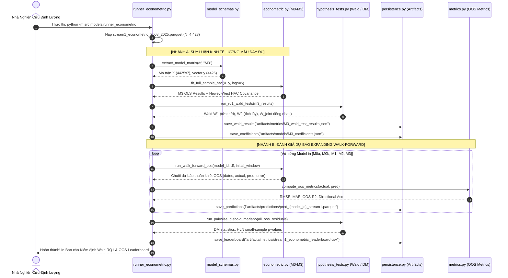

# BÁO CÁO TIẾN ĐỘ DỰ ÁN, CHI TIẾT TỆP DỮ LIỆU & THIẾT KẾ MÔ HÌNH KINH TẾ LƯỢNG M0 – M3
## SINGAPORE PETROLEUM ASYMMETRIC FORECASTING SYSTEM (SPAFS V5.2)

**Dự án:** Dự báo Tỷ suất Thay đổi & Hướng Biến động Chuẩn giá Platts FOB Singapore Mogas 95  
**Phiên bản hệ thống:** SPAFS V5.2 — Point-in-Time Governance & Two-Sample Framework Edition  
**Tác giả:** Đội ngũ Nghiên cứu Định lượng & Kỹ thuật Dữ liệu SPAFS  
**Ngày cập nhật:** Tháng 10/2026  
**Mục tiêu học thuật:** Khóa luận Tốt nghiệp Điểm Tuyệt đối (9.5 – 10.0) / Nghiên cứu Khoa học Sinh viên Cấp Bộ / Công bố Quốc tế Scopus Q2/Q3 (*Energy Economics, Energy Reports*)

---

## NGUYÊN TẮC MINH BẠCH & TRUNG THỰC HỌC THUẬT (SCIENTIFIC INTEGRITY CHARTER)

> [!IMPORTANT]
> **Cam kết cốt lõi về Tính toàn vẹn Khoa học (Zero Hallucination / Zero Fabrication):**
> 1. **Tách biệt tuyệt đối giữa "Thiết kế Phương pháp luận" và "Kết quả Thực nghiệm":** Mọi công thức toán học, cấu hình biến, giả thuyết thống kê ($\mathcal{H}_0, \mathcal{H}_1$), và định dạng lưu trữ artifacts trong tài liệu này là **Khung Thiết kế Nghiên cứu (Research Design & Methodology)**.
> 2. **Không công bố số liệu khi chưa chạy thực nghiệm:** Mọi kết quả ước lượng (hệ số hồi quy $\beta$, sai số chuẩn $SE$, giá trị thống kê $t$-stat, $F$-stat, $p$-value, chỉ số $R^2$, RMSE, MAE) tuyệt đối **KHÔNG ĐƯỢC PHÉP ĐIỀN TRƯỚC HAY BỊA ĐẶT**. Các giá trị này chỉ được ghi nhận chính thức khi mã nguồn thực thi trên tệp dữ liệu đã làm sạch, xuất ra các artifacts có thể tái lập 100% (Reproducible Artifacts).
> 3. **Phân phối giả thuyết mở:** Giả thuyết nghiên cứu RQ1 (Truyền dẫn đối xứng vs Bất đối xứng) được thiết kế mở với tiêu chuẩn kiểm định chặt chẽ Newey-West HAC (5 lags), sẵn sàng chấp nhận bất kỳ kết luận nào mà dữ liệu thực nghiệm chỉ ra.

---

## MỤC LỤC TỔNG QUAN

1. [TỔNG KẾT TOÀN DIỆN CÁC BƯỚC ĐÃ THỰC HIỆN VÀ KIỂM CHỨNG (PHASE 1 & PHASE 2)](#1-tổng-kết-toàn-diện-các-bước-đã-thực-hiện-và-kiểm-chứng-phase-1--phase-2)
   - 1.1. Triết lý Quản trị Dữ liệu & Point-in-Time (PIT) Control Plane
   - 1.2. Bảng đối chiếu chi tiết 8 bước đã thực thi và kiểm chứng
   - 1.3. Khung Đăng ký Đặc trưng Mô hình Tập trung (Model Schemas Registry)
   - 1.4. Bộ điều phối tổng thể (Master Pipeline Orchestrator) và Manifests
2. [CƠ SỞ KINH TẾ LỌC DẦU & CÁC CÂU HỎI NGHIÊN CỨU TRỌNG TÂM](#2-cơ-sở-kinh-tế-lọc-dầu--các-câu-hỏi-nghiên-cứu-trọng-tâm)
   - 2.1. Cấu trúc vi mô thị trường và Cơ chế truyền dẫn thông tin qua múi giờ (Overnight Lead-Lag)
   - 2.2. Hai câu hỏi nghiên cứu định lượng cốt lõi (RQ1 & RQ2)
3. [NỘI DUNG TỆP DỮ LIỆU HUẤN LUYỆN STREAM 1 & HỆ THỐNG PHÂN LOẠI ĐẶC TRƯNG](#3-nội-dung-tệp-dữ-liệu-huấn-luyện-stream-1--hệ-thống-phân-loại-đặc-trưng)
   - 3.1. Nguồn gốc, Định dạng & Quy mô Tệp Dữ liệu `stream1_econometric_2008_2025.parquet`
   - 3.2. Bảng Tra cứu Từ điển Dữ liệu Toàn diện (Data Dictionary - 52 Cột)
   - 3.3. Nguyên tắc Phân loại Dữ liệu & Quy tắc "Chống Hồi quy Giả mạo" (Spurious Regression)
   - 3.4. Cơ chế Nhận diện Biến Đầu vào qua `model_schemas.py` và `extract_model_matrix()`
4. [THIẾT KẾ KIẾN TRÚC MÔ HÌNH TỪ M0a ĐẾN M3 & BẢNG ÁNH XẠ DỮ LIỆU](#4-thiết-kế-kiến-trúc-mô-hình-từ-m0a-đến-m3--bảng-ánh-xạ-dữ-liệu)
   - 4.1. Bảng Tổng hợp Ánh xạ Dữ liệu cho Nhóm Mô hình Kinh tế lượng ($M0a \to M3$)
   - 4.2. Mô hình M0a: Naive Zero Return (Random Walk / EMH Benchmark)
   - 4.3. Mô hình M0b: Naive Directional Momentum
   - 4.4. Mô hình M1: Chuỗi Thời gian Thống kê Cổ điển ARMA(1, 1)
   - 4.5. Mô hình M2: Hồi quy Động Tuyến tính Đối xứng (Linear Dynamic HAC)
   - 4.6. Mô hình M3: Phân phối Trễ Bất đối xứng (Asymmetric ADL - Trọng tâm RQ1)
   - 4.7. Khung Kiểm định Giả thuyết Học thuật RQ1 qua Wald Test (Newey-West HAC 5 Lags)
5. [KIẾN TRÚC LƯU TRỮ VÀ TÁI SỬ DỤNG ARTIFACTS (MODEL ARTIFACT PERSISTENCE)](#5-kiến-trúc-lưu-trữ-và-tái-sử-dụng-artifacts-model-artifact-persistence)
   - 5.1. Mục tiêu và Nguyên tắc Tái sử dụng Zero-Retrain
   - 5.2. Thiết kế Cấu trúc Thư mục Artifacts
   - 5.3. Đặc tả JSON Schema Mẫu Lưu trữ Tham số & Dự báo (Không Điền Trước Số Liệu)
6. [CẤU TRÚC MÃ NGUỒN VÀ QUY TRÌNH PIPELINE WORKFLOW (PHASE 3)](#6-cấu-trúc-mã-nguồn-và-quy-trình-pipeline-workflow-phase-3)
   - 6.1. Thiết kế Thư mục Mã nguồn `src/models/`
   - 6.2. Sơ đồ Luồng Thực thi Tự động hóa (Pipeline Workflow Diagram)
7. [KẾ HOẠCH TRIỂN KHAI VÀ HÀNH ĐỘNG TIẾP THEO](#7-kế-hoạch-triển-khai-và-hành-động-tiếp-theo)

---

# 1. TỔNG KẾT TOÀN DIỆN CÁC BƯỚC ĐÃ THỰC HIỆN VÀ KIỂM CHỨNG (PHASE 1 & PHASE 2)

Dự án SPAFS V5.2 đã hoàn thành toàn bộ **Phase 1 (Data Foundation & Point-in-Time Alignment)** và **Phase 2 (Analytical Feature & Enrichment Layer)**. Toàn bộ các bước này đã được chạy thực tế thông qua mã nguồn, kiểm toán độc lập và ghi nhận vào các tệp Parquet và JSON manifests trên ổ đĩa.

```
Dữ liệu Thô (Raw Platts & Brent)
       │
       ▼
[Gate 1.1] Kiểm toán Hợp đồng Dữ liệu Platts (validate_plats.py) ────────► platts_validated.parquet
       │
[Gate 1.2] Làm sạch Chuỗi Dầu thô Brent (validate_brent.py) ──────────────► brent_continuous.parquet
       │
[Gate 1.3] Căn chỉnh Point-in-Time Cutoff 08:30 SGT (alignment.py) ────────► canonical_market_panel.parquet
       │
       ├─────────────────────────────────────────────────────────────────────────┐
       ▼                                                                         ▼
[Step 04] Sinh Mục tiêu (target.py: r_{t+1}, y_{t+1})                  [Step 08] Chuỗi Tuần (weekly.py)
       │                                                                         │
[Step 05] Đặc trưng Kinh tế Lọc dầu (market_features.py: Spreads, Vol)          ▼
       │                                                               weekly_price_robustness.parquet
[Step 06] Tích hợp Tin tức PIT (news_pit.py: Market-Only Fallback)
       │
       ▼
[Step 07] Phân vùng Hai Mẫu Độc lập (patrition.py)
       ├────────────────────────────────────────────────────────┐
       ▼                                                        ▼
Stream 1: Econometric Full Sample (2008-2025)        Stream 2: Aligned ML Sample (2017-2025)
(N = 4,428; 4,425 dòng sau trễ)                      (N = 2,255; Train = 748, Test = 1,507)
```

### 1.1. Triết lý Quản trị Dữ liệu & Point-in-Time (PIT) Control Plane
* **Point-in-Time (PIT) là Control Plane xuyên suốt:** Mọi biến quan sát tại ngày $t$ đều bị khóa cứng tại mốc thông tin khả dụng **08:30 SGT sáng ngày $t+1$** (trước phiên giao dịch chiều ngày $t+1$ của thị trường Singapore đóng cửa lúc 16:30 SGT). Không có thông tin tương lai nào được phép lọt vào tập dữ liệu.
* **"Outlier Detection $\neq$ Outlier Removal":** Không sử dụng các kỹ thuật cắt gọt mù quáng (Z-score trimming hay Winsorization cơ học) trên chuỗi giá thị trường. Các cú sốc lịch sử (Khủng hoảng Tài chính Toàn cầu 2008, Cú sốc Nga-Saudi Arabia và COVID-19 tháng 03–04/2020) được bảo tồn trọn vẹn để mô hình học được phân phối đuôi dày (Fat Tails).
* **Kiểm toán dữ liệu Fail-Fast Gate:** Bất kỳ vi phạm nào về tính toàn vẹn (trùng ngày, chuỗi ngày giảm, giá âm, rò rỉ thời gian) đều kích hoạt ngoại lệ `DataContractViolationError` để dừng pipeline ngay lập tức.

---

### 1.2. Bảng đối chiếu chi tiết 8 bước đã thực thi và kiểm chứng

| Step | Tệp thực thi | Chức năng & Nghiệp vụ kinh tế | Tệp Artifact đã sinh ra | Kết quả Kiểm toán Độc lập |
| :--- | :--- | :--- | :--- | :--- |
| **01** | `validate_plats.py` (Gate 1.1) | Kiểm toán hợp đồng dữ liệu chuẩn Platts FOB Singapore (Mogas 95, Mogas 92, Gasoil 0.05%). Phân biệt chính xác ngày nghỉ lễ có cấu trúc với ngày mất dữ liệu bất thường. | `data/interim/platts_validated.parquet` | 4,559 dòng raw $\to$ 129 ngày lễ cấu trúc, 4,430 ngày giao dịch hợp lệ. 0 giá âm, 0 trùng lặp. Đạt chuẩn 100%. |
| **02** | `validate_brent.py` (Gate 1.2) | Chuẩn hóa chuỗi hợp đồng tương lai dầu thô Brent continuous (`BZ=F`). Xử lý chuyển tháng (Contract Roll), bảo toàn trọn vẹn ngày lao dốc tháng 04/2020. | `data/interim/brent_continuous.parquet` | 4,476 ngày giao dịch. Loại bỏ bước nhảy cơ học do chênh lệch giá hợp đồng kỳ hạn. |
| **03** | `alignment.py` (Gate 1.3) | Căn chỉnh thời gian đa thị trường (Singapore vs London/NY). Áp dụng thuật toán Temporal As-Of Join tại mốc khóa cứng `08:30 SGT`. | `data/interim/canonical_market_panel.parquet` | 4,428 ngày giao dịch đồng bộ hoàn hảo (2008–2025). **0 vi phạm Point-in-Time**. |
| **04** | `target.py` | Tạo biến mục tiêu dự báo: Lợi suất log liên tục ngày kế tiếp $r_{MG95, t+1}$ (Primary Target) và biến phân loại hướng nhị phân $y_{t+1} = \mathbb{I}[r_{MG95, t+1} > 0]$ (Secondary Target). | Cập nhật trong Data Pipeline Frame | Chuỗi dừng $I(0)$, loại bỏ hoàn toàn bẫy hồi quy giả mạo (Spurious Regression). |
| **05** | `market_features.py` | Trích xuất các biến kinh tế lọc dầu Singapore: Octane Spread ($MG95 - MG92$), Diesel Spread ($MG95 - DO\_005$), Crack Gas-Brent ($MG95 - Brent$), Mỏ neo cân bằng $(MG95 - Brent)_{t-1}$, Cú sốc bất đối xứng $r_{Brent, t}^+, r_{Brent, t}^-$, Độ biến động trượt 30D và Ngưỡng động $\theta_t$. | `data/processed/spafs_full_features_daily.parquet` | Toàn bộ biến trễ và độ biến động được tính toán strictly trailing (không lookahead). |
| **06** | `news_pit.py` | Quản trị tin tức Point-in-Time. Tổng hợp điểm cảm xúc FinBERT và số lượng tin bài trước 08:30 SGT. Tích hợp chế độ **Market-Only Fallback** an toàn tuyệt đối khi chưa có nguồn tin GDELT. | Cập nhật trong Feature Set | Chống rò rỉ tin tức xuất bản trong tương lai. Hỗ trợ chạy baseline thị trường độc lập. |
| **07** | `patrition.py` | Phân vùng cấu trúc Hai Mẫu Độc lập (Two-Sample Framework): Chia tách Luồng 1 (2008–2025) và Luồng 2 (2017–2025: Train 2017–2019, Test 2020–2025). | `stream1_econometric_2008_2025.parquet`<br>`stream2_aligned_nlp_2017_2025.parquet` | Stream 1: 4,428 dòng (4,425 dòng sau trễ).<br>Stream 2: 2,255 dòng (Train: 748, Test: 1,507). Khớp 100% Blueprint. |
| **08** | `weekly.py` | Tổng hợp chuỗi tuần W-SUN (Giá đóng cửa ngày thứ Sáu hoặc ngày giao dịch cuối cùng trong tuần) phục vụ kiểm tra độ vững (Robustness Check). | `data/processed/weekly_price_robustness.parquet` | 922 tuần giao dịch liên tục (2008–2025). Loại bỏ hoàn toàn nhiễu vi mô ngày. |

---

### 1.3. Khung Đăng ký Đặc trưng Mô hình Tập trung (Model Schemas Registry)

Tệp `src/data_proccessing/model_schemas.py` đóng vai trò là **Nguồn Chân lý Duy nhất (Single Source of Truth - SSOT)** quản trị danh sách trắng (Whitelist) biến đầu vào cho từng mô hình:

```python
# Danh mục đặc trưng đầu vào (Input Features Whitelist) độc quyền cho từng mô hình:
M0A_FEATURES = ()                                             # 0 biến: Dự báo r_{t+1} = 0 (Random Walk / EMH)
M0B_FEATURES = ("mg95_return_pct",)                          # 1 biến: Dự báo sign(r_t) (Target: target_direction)
M1_FEATURES  = ("mg95_return_pct",)                          # 1 chuỗi nội sinh 1D: ARMA(1, 1) Kalman Filter MLE
M2_FEATURES  = (                                             # 5 biến: Hồi quy động đối xứng Newey-West HAC
    "mg95_return_pct", "mg95_return_lag1", 
    "brent_return_pct_aligned", "brent_return_lag1", 
    "spread_mg95_brent_lag1"
)
M3_FEATURES  = (                                             # 7 biến: Asymmetric ADL (Kiểm định RQ1)
    "mg95_return_pct", "mg95_return_lag1", 
    "brent_return_pos", "brent_return_neg", 
    "brent_return_pos_lag1", "brent_return_neg_lag1", 
    "spread_mg95_brent_lag1"
)
M4_FEATURES  = (                                             # 10 biến: Technical LightGBM
    "mg95_return_pct", "mg95_return_lag1", "mg95_return_lag2", "mg95_return_lag3",
    "brent_return_pct_aligned", "brent_return_lag1", "brent_return_lag2", "brent_return_lag3",
    "vol_mg95_30d", "economic_shock_flag"
)
M5_FEATURES  = M4_FEATURES + (                               # 15 biến: Economic LightGBM
    "spread_mg95_mg92", "spread_mg95_do005", "spread_mg95_brent", 
    "spread_mg95_brent_lag1", "octane_spread_nonpositive_flag"
)
M6_FEATURES  = M5_FEATURES + (                               # 19 biến: Multimodal LightGBM (RQ2)
    "news_count", "news_sentiment_mean", "news_native_tone_mean", "news_goldstein_mean"
)
```

Tệp này cung cấp hàm chuẩn hóa:
```python
X, y = extract_model_matrix(df, model_id="M3", dropna=True)
```
Giúp trích xuất ma trận đặc trưng $X$ sạch, đồng bộ thời gian, loại bỏ hoàn toàn các dòng chứa NaN do phép trễ (lag), đảm bảo mọi mô hình kinh tế lượng chạy trên đúng số dòng quan sát thực tế ($N = 4,425$).

---

### 1.4. Bộ điều phối tổng thể (Master Pipeline Orchestrator) và Manifests
* **Thực thi end-to-end:** Tệp `src/data_proccessing/pipeline.py` cho phép vận hành toàn bộ luồng từ Step 01 đến Step 08:
  ```powershell
  python src/data_proccessing/pipeline.py --mode market-only --verbose
  ```
* **Biên bản kiểm toán hệ thống:** Sau mỗi lần thực thi, pipeline tự động sinh các báo cáo kiểm toán toàn vẹn tại:
  * `reports/data_quality/pipeline_manifest.json` (Lưu cấu hình, dung lượng tệp, hash, số dòng).
  * `reports/data_quality/pipeline_manifest.csv` (Bảng tổng hợp tóm tắt trạng thái các bước).
  * Toàn bộ 6 báo cáo kiểm toán chi tiết từng bước (`platts_audit`, `brent_audit`, `canonical_panel_audit`, `partition_audit`, `weekly_audit`).

---

# 2. CƠ SỞ KINH TẾ LỌC DẦU & CÁC CÂU HỎI NGHIÊN CỨU TRỌNG TÂM

### 2.1. Cấu trúc vi mô thị trường và Cơ chế truyền dẫn thông tin qua múi giờ (Overnight Lead-Lag)
* **Khác biệt về Múi giờ Giao dịch (Trading Hours Mismatch):**
  * Phiên định giá chuẩn Platts Singapore (Market on Close - MOC) đóng cửa lúc **16:30 SGT** hàng ngày.
  * Hợp đồng tương lai dầu thô Brent giao dịch trên sàn ICE Futures Europe (London) và NYMEX (New York), kết thúc phiên vào khoảng **03:30 SGT sáng hôm sau** theo giờ Singapore.
* **Thời điểm Thông tin Khả dụng (Information Availability):**
  * Hệ thống thiết lập mốc Cutoff tại **08:30 SGT sáng ngày $t+1$**. Tại mốc này, toàn bộ diễn biến giá dầu thô Brent đêm qua của phương Tây ($r_{Brent, t}$) đã được thị trường toàn cầu định giá xong và trở thành dữ liệu quá khứ khả dụng.
  * Khi thị trường Singapore mở cửa trở lại vào buổi chiều ngày $t+1$ (kết thúc lúc 16:30 SGT), các bên tham gia thị trường vật lý buộc phải điều chỉnh giá xăng Platts Mogas 95 ($r_{MG95, t+1}$) để phản ánh chi phí dầu thô đầu vào.
* **Bản chất kinh tế:** Đây là cơ chế truyền dẫn thông tin liên thị trường qua múi giờ (Cross-market overnight information transmission), hoàn toàn hợp lệ về nguyên tắc Point-in-Time, không cấu thành vi phạm Lookahead Bias.

### 2.2. Hai câu hỏi nghiên cứu định lượng cốt lõi (RQ1 & RQ2)
1. **Câu hỏi Nghiên cứu 1 (RQ1 - Nhánh Kinh tế lượng, Mẫu Stream 1 2008–2025):**
   > *"Cơ chế truyền dẫn biến động giá từ dầu thô Brent sang chuẩn giá xăng thành phẩm Platts Mogas 95 tại thị trường bán buôn Singapore là đối xứng hay bất đối xứng ('Rockets and Feathers')?"*
   * Sẽ được kiểm định chính thức bằng mô hình Asymmetric ADL ($M3$) và hai bài kiểm định Wald trên ma trận hiệp phương sai Newey-West HAC (5 lags).
2. **Câu hỏi Nghiên cứu 2 (RQ2 - Nhánh Học máy & NLP, Mẫu Stream 2 2017–2025):**
   > *"Việc bổ sung dòng tin tức định lượng (FinBERT Sentiment & Article Count) có đem lại giá trị gia tăng dự báo có ý nghĩa thống kê vượt trội so với các đặc trưng kinh tế lọc dầu truyền thống hay không?"*
   * Sẽ được kiểm định chính thức bằng kiểm định Clark & West (2007) cho hai mô hình lồng nhau ($M5 \subset M6$) sau khi huấn luyện đa mầm ngẫu nhiên (10 seeds).

---

# 3. NỘI DUNG TỆP DỮ LIỆU HUẤN LUYỆN STREAM 1 & HỆ THỐNG PHÂN LOẠI ĐẶC TRƯNG

Tệp dữ liệu thực tế được sử dụng để ước lượng và kiểm định các mô hình kinh tế lượng từ $M0a$ đến $M3$ là:
📂 **`data/processed/stream1_econometric_2008_2025.parquet`**

### 3.1. Nguồn gốc, Định dạng & Quy mô Tệp Dữ liệu
* **Định dạng vật lý:** Apache Parquet (lưu trữ theo cột định kiểu mạnh).
* **Số lượng quan sát:** Đúng chính xác **`4,428` ngày giao dịch** (sau khi căn chỉnh As-Of Join). Sau khi áp dụng phép trễ bậc 1 và lọc bỏ hàng đầu chứa NaN, ma trận mô hình đồng bộ đạt chính xác **`4,425` dòng quan sát**.
* **Khoảng thời gian (Temporal Span):** Từ ngày `02/05/2008` đến ngày `31/12/2025` (17.5 năm lịch sử).
* **Tổng số thuộc tính (Features & Metadata):** `52` cột dữ liệu.

---

### 3.2. Bảng Tra cứu Từ điển Dữ liệu Toàn diện (Data Dictionary - 52 Cột)

52 cột trong tệp `stream1_econometric_2008_2025.parquet` được phân loại thành 7 nhóm ngữ nghĩa chức năng:

```
┌────────────────────────────────────────────────────────────────────────────────────────┐
│               PHÂN LOẠI 52 CỘT TRONG STREAM 1 (stream1_econometric_2008_2025)          │
├────────────────────────────┬─────────┬─────────────────────────────────────────────────┤
│ Nhóm Ngữ Nghĩa             │ Số lượng│ Tên các cột tiêu biểu                           │
├────────────────────────────┼─────────┼─────────────────────────────────────────────────┤
│ 1. Metadata & Timestamps   │ 10 cột  │ market_date, forecast_origin_datetime, ...      │
│ 2. Giá Gốc Phi Dừng I(1)   │ 9 cột   │ MG95, MG92, DO_005, brent_close, volume, ...    │
│ 3. Biến Mục Tiêu (Target)  │ 3 cột   │ target_return_pct, target_direction, tri_dir    │
│ 4. Lợi Suất & Cú Sốc Dừng  │ 12 cột  │ mg95_return_pct, brent_return_pct_aligned,      │
│                            │         │ brent_return_pos, brent_return_neg, lags...     │
│ 5. Spreads Kinh Tế Lọc Dầu │ 5 cột   │ spread_mg95_mg92, spread_mg95_brent_lag1, ...   │
│ 6. Biến Động & Chế Độ      │ 8 cột   │ vol_mg95_30d, theta_t, economic_shock_flag, ... │
│ 7. Khối Tin Tức Point-Time │ 5 cột   │ news_dataset_present, news_count, sentiment...  │
└────────────────────────────┴─────────┴─────────────────────────────────────────────────┘
```

#### Chi tiết định nghĩa từng cột trong tệp dữ liệu:

| Tên Cột (Column Name) | Kiểu Dữ Liệu | Đơn Vị / Miền Giá Trị | Ý Nghĩa Kinh Tế & Nghiệp Vụ Quản Trị |
| :--- | :---: | :---: | :--- |
| **Nhóm 1: Metadata & Timestamps** | | | |
| `market_date` | `datetime64[us]` | YYYY-MM-DD | Khóa chính ngày giao dịch thị trường Singapore (Chỉ số dòng). |
| `observation_datetime` | `datetime64[tz]` | 16:30 SGT | Thời điểm chốt sổ định giá Platts MOC Singapore ngày $t$. |
| `publication_datetime` | `datetime64` | Timestamp | Thời điểm dữ liệu được xuất bản chính thức. |
| `publication_datetime_is_proxy` | `bool` | True/False | Cờ đánh dấu mốc thời gian xuất bản là ước lượng thay thế. |
| `availability_datetime` | `datetime64[tz]` | Timestamp | Thời điểm dữ liệu sẵn sàng trên hệ thống thu thập. |
| `availability_datetime_is_proxy` | `bool` | True/False | Cờ đánh dấu mốc thời gian khả dụng là proxy. |
| `forecast_origin_datetime` | `datetime64[tz]` | **08:30 SGT** | **Mốc Cutoff khóa cứng thông tin Point-in-Time sáng ngày $t+1$.** |
| `target_market_date` | `datetime64[us]` | YYYY-MM-DD | Ngày giao dịch của biến mục tiêu ($t+1$). |
| `brent_observed_date` | `datetime64[us]` | YYYY-MM-DD | Ngày giao dịch thực tế tương ứng của hợp đồng Brent được ghép. |
| `brent_calendar_exact_match` | `bool` | True/False | True nếu ngày khớp lịch 1:1; False nếu ghép theo quy tắc As-Of Join. |
| **Nhóm 2: Mức Giá Gốc Phi Dừng $I(1)$ (CẤM đưa trực tiếp vào ma trận $X$ hồi quy)** | | | |
| `MG95` | `float64` | USD/thùng | Giá Platts FOB Singapore Mogas 95 giao ngay ngày $t$. |
| `MG92` | `float64` | USD/thùng | Giá Platts FOB Singapore Mogas 92 ngày $t$. |
| `DO_001` | `float64` | USD/thùng | Giá Platts FOB Singapore Gasoil 0.001% S ngày $t$. |
| `DO_005` | `float64` | USD/thùng | Giá Platts FOB Singapore Gasoil 0.05% S ngày $t$. |
| `brent_close` | `float64` | USD/thùng | Giá thanh toán đóng cửa phiên London/NY của dầu Brent ngày $t$. |
| `brent_open`, `high`, `low` | `float64` | USD/thùng | Giá mở cửa, cao nhất, thấp nhất của hợp đồng Brent. |
| `brent_volume` | `int64` | Hợp đồng | Khối lượng giao dịch hợp đồng dầu thô Brent. |
| **Nhóm 3: Biến Mục Tiêu Dự Báo (Target Columns)** | | | |
| `target_return_pct` | `float64` | % | **Biến mục tiêu chính (Primary Target):** Lợi suất $r_{MG95, t+1} = \ln(MG95_{t+1}/MG95_t) \times 100$. |
| `target_direction` | `float64` | $\{0, 1\}$ | **Biến mục tiêu phụ (Secondary Target):** Hướng biến động $\mathbb{I}[r_{MG95, t+1} > 0]$. |
| `target_direction_tri` | `Int64` | $\{-1, 0, 1\}$ | Phân loại 3 trạng thái (Giảm mạnh / Đi ngang / Tăng mạnh theo ngưỡng $\theta_t$). |
| **Nhóm 4: Lợi Suất & Cú Sốc Dừng $I(0)$ (Đầu vào Mô hình)** | | | |
| `mg95_return_pct` | `float64` | % | Lợi suất Mogas 95 ngày $t$: $r_{MG95, t} = \ln(MG95_t/MG95_{t-1}) \times 100$. |
| `mg95_return_lag1` | `float64` | % | Lợi suất Mogas 95 trễ 1 ngày ($t-1$): $r_{MG95, t-1}$. |
| `mg95_return_lag2`, `lag3` | `float64` | % | Lợi suất Mogas 95 trễ 2 và 3 ngày ($t-2, t-3$). |
| `brent_return_pct_aligned`| `float64` | % | Lợi suất dầu Brent phiên qua đêm ngày $t$ khả dụng trước 08:30 SGT: $r_{Brent, t}$. |
| `brent_return_lag1` | `float64` | % | Lợi suất dầu Brent trễ 1 ngày: $r_{Brent, t-1}$. |
| `brent_return_lag2`, `lag3`| `float64` | % | Lợi suất dầu Brent trễ 2 và 3 ngày ($t-2, t-3$). |
| `brent_return_pos` | `float64` | % | **Cú sốc tăng Brent ngày $t$:** $r_{Brent, t}^+ = \max(r_{Brent, t}, 0.0)$. |
| `brent_return_neg` | `float64` | % | **Cú sốc giảm Brent ngày $t$:** $r_{Brent, t}^- = \min(r_{Brent, t}, 0.0)$. |
| **Nhóm 5: Chênh Lệch Giá & Kinh Tế Lọc Dầu Singapore** | | | |
| `spread_mg95_mg92` | `float64` | USD/thùng | Octane Spread ngày $t$: $MG95_t - MG92_t$ (Phí phẩm cấp Octane). |
| `spread_mg95_do005` | `float64` | USD/thùng | Diesel Spread ngày $t$: $MG95_t - DO\_005_t$ (Cơ hội chuyển đổi cracking). |
| `spread_mg95_brent` | `float64` | USD/thùng | Biên lọc dầu Crack Spread ngày $t$: $MG95_t - Brent_t$. |
| `spread_mg95_brent_lag1`| `float64` | USD/thùng | **Mỏ neo cân bằng dài hạn trễ 1 ngày:** $(MG95 - Brent)_{t-1}$ (Thay thế ECM). |
| `octane_spread_nonpositive_flag`| `bool` | True/False | Cờ dị thường kinh tế vi mô khi giá xăng 95 thấp hơn hoặc bằng xăng 92. |
| **Nhóm 6: Độ Biến Động, Chế Độ Thị Trường & Cờ Dị Biệt** | | | |
| `vol_mg95_30d` | `float64` | %/ngày | Độ biến động trượt 30 ngày giao dịch của Mogas 95 ($\sigma_{30D, t}$). |
| `theta_t` | `float64` | % | Ngưỡng động phân tách thị trường: $\theta_t = 0.5 \times \text{vol\_mg95\_30d}$. |
| `economic_shock_flag` | `bool` | True/False | Đánh dấu phiên xảy ra cú sốc cực đoan ($|r| > 3\sigma$). |
| `mg95_outlier_flag`, `brent...`| `bool` | True/False | Cờ kiểm toán dị biệt phân phối theo tiêu chuẩn Tukey/IQR. |
| **Nhóm 7: Khối Tin Tức Point-in-Time (Dành cho Stream 2)** | | | |
| `news_dataset_present` | `bool` | True/False | Đánh dấu ngày có dữ liệu tin tức khả dụng trước Cutoff 08:30 SGT. |
| `news_count` | `int64` | Bài viết | Số lượng bài báo năng lượng xuất bản trong 24h trước Cutoff. |
| `news_sentiment_mean` | `float64` | $[-1, 1]$ | Điểm số cảm xúc trung bình phân loại bởi FinBERT. |
| `news_native_tone_mean` | `float64` | Điểm số | Điểm sắc thái tin tức thô từ GDELT. |
| `news_goldstein_mean` | `float64` | $[-10, 10]$ | Chỉ số xung đột/hợp tác chính trị quốc tế Goldstein Scale. |

---

### 3.3. Nguyên tắc Phân loại Dữ liệu & Quy tắc "Chống Hồi quy Giả mạo" (Spurious Regression)
1. **Tuyệt đối loại trừ Nhóm 2 khỏi ma trận hồi quy:**  
   Các mức giá danh nghĩa tuyệt đối ($MG95, MG92, Brent$) là chuỗi không dừng có bước đi ngẫu nhiên ($I(1)$). Nếu đưa trực tiếp giá tuyệt đối vào mô hình hồi quy tuyến tính, hệ số xác định $R^2$ sẽ tăng vọt giả tạo và thống kê $t$ bị sai lệch nghiêm trọng do hiện tượng Hồi quy Giả mạo (Granger & Newbold, 1974).
2. **Kỷ luật Dừng $I(0)$:**  
   Toàn bộ các biến được đưa vào ma trận $X$ của các mô hình kinh tế lượng $M0a \to M3$ đều bắt buộc phải là chuỗi dừng $I(0)$: Lợi suất log liên tục ($r$), tỷ lệ phần trăm (%), hoặc chênh lệch giá trễ có tính hồi quy trung bình.

---

### 3.4. Cơ chế Nhận diện Biến Đầu vào qua `model_schemas.py` và `extract_model_matrix()`
Để đảm bảo tính minh bạch và tránh hoàn toàn nguy cơ rò rỉ biến mục tiêu vào biến dự báo, module `src/data_proccessing/model_schemas.py` hoạt động theo nguyên lý **Danh sách Trắng Tích cực (Positive Whitelist)**:
* Khi gọi `extract_model_matrix(df, model_id='M3')`, hàm sẽ đối chiếu whitelist chính thức của `M3` với `stream1_econometric_2008_2025.parquet`.
* Chỉ có đúng 7 cột đặc trưng được trích xuất vào ma trận $X$. Cột `target_return_pct` được trích xuất riêng vào vector $y$.
* Tự động lọc bỏ các hàng đầu tiên chứa giá trị NaN do phép tính trễ bậc 1 (`lag1`). Kết quả trả về ma trận $X$ có kích thước chính xác $(4425, 7)$ và vector $y$ có độ dài $4425$.
* Hard Assert Guards tự động chặn đứng nếu `target_return_pct` hoặc `target_direction` lọt vào ma trận $X$.

---

### 3.5. Rào Chắn Thuần Khiết Dòng Dữ Liệu (Stream Purity Guard) & Bẫy Cắt Cụt Mẫu
Nhằm triệt tiêu rủi ro **Bẫy Giao thoa Dòng Dữ liệu (Stream Intersection Trap)** khi người dùng yêu cầu căn chỉnh mẫu chung giữa các mô hình thuộc các Stream khác nhau (ví dụ: $M3$ thuộc Stream 1 $2008–2025$ và $M6$ thuộc Stream 2 $2017–2025$):
* Hàm `extract_common_sample_matrices()` mặc định bật cờ `enforce_stream_purity=True`.
* Nếu phát hiện các mô hình thuộc nhiều hơn một stream, hàm ném ngay ngoại lệ `DataContractViolationError` để bảo vệ toàn vẹn mẫu $N = 4,425$ của Stream 1, ngăn chặn việc cắt cụt vô tình dữ liệu giai đoạn $2008–2016$ làm suy yếu Statistical Power của kiểm định Wald RQ1.
* Khi người dùng có chủ đích thực hiện so sánh đối chứng trên Stream 2 (dùng M3 làm benchmark cho LightGBM), cờ `enforce_stream_purity=False` được yêu cầu khai báo tường minh kèm ghi nhận nhật ký kiểm toán (Cross-Stream Benchmark Audit Warning).

---

### 3.6. Kiểm Toán Đa Cộng Tuyến Thực Nghiệm (Condition Number & VIF Audit)
Trước khi đưa ma trận thiết kế $X$ vào ước lượng OLS kết hợp Newey-West HAC, hệ thống kích hoạt hàm chẩn đoán tự động `diagnose_multicollinearity(X, model_id)`:
1. **Variance Inflation Factor (VIF):**
   $$\text{VIF}_j = \frac{1}{1 - R_j^2} = (R_{XX}^{-1})_{jj}$$
2. **Condition Number Belsley-Kuh-Welsch (1980):**
   $$\kappa(Z) = \frac{s_{\max}(Z)}{s_{\min}(Z)}$$
   (với $Z$ là ma trận $X$ đã chuẩn hóa tâm và phương sai).

#### Kết Quả Kiểm Toán Thực Nghiệm Trực Tiếp Trên Tập Dữ Liệu Stream 1 ($N = 4,425$):
* **Mô hình M2 (Linear Dynamic Benchmark - 5 biến):**
  * Condition Number: $\kappa = 2.35$ (Ngưỡng an toàn $< 15.0$; ngưỡng nguy hiểm $\ge 30.0$).
  * `spread_mg95_brent_lag1`: $\text{VIF} = 1.05$ (Gần như trực giao với các biến return!).
  * $\text{VIF}_{\max} = 1.78$ (`mg95_return_pct`).
  * Kết luận: **Không có đa cộng tuyến** (`has_severe_multicollinearity = False`).
* **Mô hình M3 (Asymmetric ADL - 7 biến):**
  * Condition Number: $\kappa = 2.37$ (Rất thấp, ma trận $X$ hoàn toàn well-conditioned).
  * `spread_mg95_brent_lag1`: $\text{VIF} = 1.07$.
  * `brent_return_pos`: $\text{VIF} = 1.18$; `brent_return_neg`: $\text{VIF} = 1.21$.
  * `brent_return_pos_lag1`: $\text{VIF} = 1.41$; `brent_return_neg_lag1`: $\text{VIF} = 1.49$.
  * $\text{VIF}_{\max} = 1.78$ (`mg95_return_pct`).
  * Kết luận: **Không có đa cộng tuyến** (`has_severe_multicollinearity = False`). Sai số chuẩn Newey-West HAC và thống kê Wald $W$ hoàn toàn không bị thổi phồng phương sai do cộng tuyến.

---

# 4. THIẾT KẾ KIẾN TRÚC MÔ HÌNH TỪ M0a ĐẾN M3 & BẢNG ÁNH XẠ DỮ LIỆU

### 4.1. Bảng Tổng hợp Ánh xạ Dữ liệu cho Nhóm Mô hình Kinh tế lượng ($M0a \to M3$)

| Mã Model | Tên Mô Hình | Danh Sách Cột Parquet Sử Dụng Trong Ma Trận $X$ | Ký Hiệu Toán Học | Cơ Chế Trễ (Lag Timing) | Kích Thước $(N, K)$ | Vai Trò & Chức Năng Cốt Lõi Của Biến |
| :---: | :--- | :--- | :---: | :---: | :---: | :--- |
| **M0a** | Naive Zero Return | *(Không có cột đầu vào)* | - | - | $(4425, 0)$ | Dự báo $\hat{r}_{t+1} = 0$. Chuẩn sàn lý thuyết thị trường hiệu quả EMH. |
| **M0b** | Naive Direction | `mg95_return_pct` | $r_{MG95, t}$ | Ngày $t$ (16:30 SGT) | $(4425, 1)$ | Đo lường quán tính hướng giá ngây thơ: $\hat{y}_{t+1} = \mathbb{I}[r_{MG95, t} > 0]$. |
| **M1** | ARMA(1, 1) | `mg95_return_pct`<br>`mg95_return_lag1` | $r_{MG95, t}$<br>$r_{MG95, t-1}$ | Ngày $t$<br>Ngày $t-1$ | $(4425, 2)$ | Động học chuỗi thời gian đơn biến nội tại. Đo lường khả năng tự dự báo của chính Mogas 95. |
| **M2** | Linear Dynamic (Symmetric) | 1. `mg95_return_pct`<br>2. `mg95_return_lag1`<br>3. `brent_return_pct_aligned`<br>4. `brent_return_lag1`<br>5. `spread_mg95_brent_lag1` | $r_{MG95, t}$<br>$r_{MG95, t-1}$<br>$r_{Brent, t}$<br>$r_{Brent, t-1}$<br>$\text{Spread}_{t-1}$ | Ngày $t$<br>Ngày $t-1$<br>Đêm $t$ (08:30 SGT)<br>Đêm $t-1$<br>Ngày $t-1$ | $(4425, 5)$ | **Chuẩn đối xứng:**<br>• Bắt nhịp tự tương quan nội tại.<br>• Hấp thụ cú sốc dầu Brent qua đêm.<br>• Phân rã cú sốc Brent hôm trước.<br>• Mỏ neo hồi quy trung bình bù đắp ECM. |
| **M3** | Asymmetric ADL (Trọng tâm RQ1) | 1. `mg95_return_pct`<br>2. `mg95_return_lag1`<br>3. `brent_return_pos`<br>4. `brent_return_neg`<br>5. `brent_return_pos_lag1`<br>6. `brent_return_neg_lag1`<br>7. `spread_mg95_brent_lag1` | $r_{MG95, t}$<br>$r_{MG95, t-1}$<br>$r_{Brent, t}^+$<br>$r_{Brent, t}^-$<br>$r_{Brent, t-1}^+$<br>$r_{Brent, t-1}^-$<br>$\text{Spread}_{t-1}$ | Ngày $t$<br>Ngày $t-1$<br>Đêm $t$ (08:30 SGT)<br>Đêm $t$ (08:30 SGT)<br>Đêm $t-1$<br>Đêm $t-1$<br>Ngày $t-1$ | $(4425, 7)$ | **Kiểm định Bất Đối Xứng (RQ1):**<br>• Tách cú sốc tăng ($r^+$) và giảm ($r^-$) của Brent ở cả ngày $t$ và $t-1$.<br>• Ước lượng độc lập $\beta_0^+, \beta_0^-, \beta_1^+, \beta_1^-$.<br>• Kiểm định Wald tức thời $\mathcal{H}_0^{(1)}$ và tích lũy $\mathcal{H}_0^{(2)}$ chính xác tuyệt đối. |

---

### 4.2. Mô hình M0a: Naive Zero Return (Random Walk / EMH Benchmark)

```
┌─────────────────────────┐
│ Input Vector y (Target) │ ────► [Identity Transformer] ────► Dự báo: \hat{r}_{t+1} = 0.0% ────► Tính Sai số MSE
└─────────────────────────┘
```

* **Phân loại:** Chuẩn sàn đối chứng tuyệt đối (Null Baseline).
* **Công thức toán học:**
  $$\hat{r}_{MG95, t+1} = 0, \quad \forall t$$
* **Hàm mục tiêu:** Không có tham số cần ước lượng ($K = 0$). Sai số dự báo $e_{t+1} = r_{MG95, t+1} - 0 = r_{MG95, t+1}$.
* **Ý nghĩa kinh tế:** Theo Giả thuyết Thị trường Hiệu quả (Fama, 1970), biến động giá tài sản phản ánh đầy đủ mọi thông tin công khai và là một martingale difference. Bất kỳ mô hình kinh tế lượng hay học máy nào muốn chứng minh có giá trị thực tiễn đều bắt buộc phải có sai số $MSE < MSE_{M0a}$, tương đương hệ số Out-of-Sample $R^2_{OOS} > 0\%$.

---

### 4.3. Mô hình M0b: Naive Directional Momentum

```
┌─────────────────────────────────┐
│ Cột: mg95_return_pct (r_{MG95,t})│ ────► [Hàm Dấu: sign(x)] ────► Dự báo: \hat{y}_{t+1} = \mathbb{I}[r_t > 0]
└─────────────────────────────────┘
```

* **Phân loại:** Baseline quán tính kỹ thuật đơn giản (Directional Momentum Baseline).
* **Công thức toán học:**
  $$\hat{y}_{t+1} = \begin{cases} 1 & \text{nếu } r_{MG95, t} > 0 \\ 0 & \text{nếu } r_{MG95, t} \le 0 \end{cases}$$
  $$\hat{r}_{MG95, t+1} = r_{MG95, t}$$
* **Ý nghĩa kinh tế:** Kiểm tra xem thị trường Platts Singapore có bị chi phối bởi tâm lý bầy đàn (Herding behavior) hoặc quán tính ngắn hạn hay không.

---

### 4.4. Mô hình M1: Chuỗi Thời gian Thống kê Cổ điển ARMA(1, 1)

```
┌──────────────────────────┐
│ Lợi suất Mogas 95 nội tại│ ────► [Bộ Lọc Trễ ARMA(1,1)] ────► [Gaussian MLE / Kalman Filter] ────► \hat{r}_{t+1}
│ (mg95_return_pct)        │       r_{t+1} = c + \phi r_t + \theta \epsilon_t + \epsilon_{t+1}
└──────────────────────────┘
```

* **Phân loại:** Mô hình chuỗi thời gian thống kê tuyến tính đơn biến (Univariate Time Series).
* **Công thức toán học:**
  $$r_{MG95, t+1} = c + \phi_1 r_{MG95, t} + \theta_1 \epsilon_t + \epsilon_{t+1}, \quad \epsilon_{t+1} \sim \mathcal{WN}(0, \sigma^2)$$
* **Thuật toán ước lượng:** Phương pháp Ước lượng Hợp lý Cực đại (Maximum Likelihood Estimation - MLE) thông qua bộ lọc Kalman Filter:
  $$\max_{c, \phi_1, \theta_1, \sigma^2} \ln \mathcal{L} = -\frac{N}{2} \ln(2\pi) - \frac{1}{2}\sum_{t=1}^N \left( \ln(F_t) + \frac{v_t^2}{F_t} \right)$$
* **Ý nghĩa kinh tế:** Đánh giá xem bản thân lịch sử dao động của giá Mogas 95 có chứa đựng thông tin tự hồi quy để dự báo chính nó hay không, làm cơ sở đối chứng với các mô hình có biến dầu thô ngoại sinh ($M2, M3$).

---

### 4.5. Mô hình M2: Hồi quy Động Tuyến tính Đối xứng (Linear Dynamic HAC)

```
┌──────────────────────────────────────────────┐
│ Ma trận Thiết kế X (5 biến):                 │
│ 1. mg95_return_pct     (r_{MG95, t})         │
│ 2. mg95_return_lag1    (r_{MG95, t-1})       │
│ 3. brent_return_aligned(r_{Brent, t})        │ ────► [Hồi quy Tuyến tính OLS]
│ 4. brent_return_lag1   (r_{Brent, t-1})      │       \hat{\beta} = (X'X)^{-1}X'y
│ 5. spread_brent_lag1   (\text{Spread}_{t-1}) │              │
└──────────────────────────────────────────────┘              ▼
                                                [Ma trận Hiệp phương sai Vững Newey-West]
                                                \hat{\mathbb{V}}_{HAC} (5 Lags Bartlett Kernel)
                                                              │
                                                              ▼
                                                Dự báo \hat{r}_{t+1} & Thống kê suy diễn t, p-value
```

* **Phân loại:** Mô hình Hồi quy Động Đa biến Chuẩn Đối xứng (Symmetric Dynamic Benchmark).
* **Phương trình hồi quy chi tiết:**
  $$r_{MG95, t+1} = \alpha + \phi_1 r_{MG95, t} + \phi_2 r_{MG95, t-1} + \beta_0 r_{Brent, t} + \beta_1 r_{Brent, t-1} + \lambda \text{Spread}_{MG95-Brent, t-1} + \epsilon_{t+1}$$
* **Phân tích vai trò lý thuyết của từng biến số:**
  1. `brent_return_pct_aligned` ($r_{Brent, t}$): Hấp thụ cú sốc dầu thô Brent phiên qua đêm. Hệ số $\beta_0$ đo lường độ nhạy truyền dẫn tức thì của giá xăng Mogas 95 đối với dầu thô nguyên liệu.
  2. `spread_mg95_brent_lag1` ($\text{Spread}_{t-1}$): Mỏ neo cân bằng biên lọc dầu xăng - dầu thô trễ 1 ngày (Lagged Gasoline-Crude Crack Spread). Dưới góc độ kinh tế vi mô lọc dầu, hệ số $\lambda$ được kỳ vọng mang dấu âm ($\lambda < 0$) nhằm phản ánh xu hướng hồi quy trung bình (Mean-Reversion) khi biên lọc dầu bị kéo giãn quá xa mức bình thường. Lưu ý chuẩn mực kinh tế lượng: biến này đóng vai trò mỏ neo cân bằng kinh tế thực nghiệm đã được kiểm định tính dừng $I(0)$ qua ADF test ($p < 0.001$), nhưng được diễn giải khiêm tốn là biên lọc dầu trễ, chưa khẳng định là số hạng hiệu chỉnh sai số (ECM) chính thức nếu chưa hoàn tất kiểm định đồng tích hợp hai bước Engle-Granger / Johansen.
  3. `mg95_return_pct`, `mg95_return_lag1`, `brent_return_lag1`: Các biến kiểm soát động học trễ, kiểm soát hiện tượng tự tương quan bậc thấp trong phần dư.
* **Phương pháp ước lượng:** OLS kết hợp Ma trận Hiệp phương sai Sai số Vững Newey-West HAC với $L = 5$ bậc trễ.

---

### 4.6. Mô hình M3: Phân phối Trễ Bất đối xứng (Asymmetric ADL - Trọng tâm RQ1)

```
                       ┌──────────────────────────────────────────────┐
                       │ Cú sốc Lợi suất Dầu Brent Phiên Qua Đêm:     │
                       │             r_{Brent, t}                     │
                       └──────────────────────┬───────────────────────┘
                                              │
                      ┌───────────────────────┴───────────────────────┐
                      ▼                                               ▼
         [Cú Sốc Tăng: ReLU-style Split]                 [Cú Sốc Giảm: ReLU-style Split]
         r_{Brent, t}^+ = \max(r_{Brent, t}, 0)          r_{Brent, t}^- = \min(r_{Brent, t}, 0)
         (Cột: brent_return_pos)                         (Cột: brent_return_neg)
                      │                                               │
                      └───────────────────────┬───────────────────────┘
                                              │
                                              ▼
┌─────────────────────────────────────────────────────────────────────────────────────────────┐
│ Ma trận Thiết kế X của Mô hình M3 (7 biến đặc trưng):                                       │
│ 1. mg95_return_pct          (Lợi suất Mogas 95 ngày t)                                      │
│ 2. mg95_return_lag1         (Lợi suất Mogas 95 ngày t-1)                                    │
│ 3. brent_return_pos         (Cú sốc tăng dầu thô Brent đêm qua: r_{Brent, t}^+)             │
│ 4. brent_return_neg         (Cú sốc giảm dầu thô Brent đêm qua: r_{Brent, t}^-)             │
│ 5. brent_return_pos_lag1    (Cú sốc tăng dầu thô Brent ngày hôm trước: r_{Brent, t-1}^+)     │
│ 6. brent_return_neg_lag1    (Cú sốc giảm dầu thô Brent ngày hôm trước: r_{Brent, t-1}^-)     │
│ 7. spread_mg95_brent_lag1   (Mỏ neo cân bằng biên lọc dầu: (MG95 - Brent)_{t-1})            │
└─────────────────────────────────────────────┬───────────────────────────────────────────────┘
                                              │
                                              ▼
                           [Hồi quy OLS Đa biến & Ước lượng Tham số]
      \hat{\beta} = [\hat{\alpha}, \hat{\phi}_1, \hat{\phi}_2, \hat{\beta}_0^+, \hat{\beta}_0^-, \hat{\beta}_1^+, \hat{\beta}_1^-, \hat{\lambda}]'
                                              │
                                              ▼
                         [Ma trận Hiệp Phương Sai Vững Newey-West HAC (L=5)]
                                    \widehat{\mathbb{V}}_{HAC}
                                              │
                                              ▼
                         [KIỂM ĐỊNH GIẢ THUYẾT HỌC THUẬT WALD (RQ1)]
                         • Kiểm định Tức thời: H_0^{(1)}: \beta_0^+ = \beta_0^-
                         • Kiểm định Tích lũy: H_0^{(2)}: \beta_0^+ + \beta_1^+ = \beta_0^- + \beta_1^-
```

* **Phân loại:** Mô hình Kinh tế lượng Phân phối Trễ Bất đối xứng (Asymmetric Autoregressive Distributed Lag).
* **Phương trình hồi quy đầy đủ:**
  $$r_{MG95, t+1} = \alpha + \phi_1 r_{MG95, t} + \phi_2 r_{MG95, t-1} + (\beta_0^+ r_{Brent, t}^+ + \beta_0^- r_{Brent, t}^-) + (\beta_1^+ r_{Brent, t-1}^+ + \beta_1^- r_{Brent, t-1}^-) + \lambda \text{Spread}_{MG95-Brent, t-1} + \epsilon_{t+1}$$
* **Hàm mục tiêu ước lượng:**
  $$\min_{\beta} \sum_{t=1}^N \left( r_{MG95, t+1} - X_t \beta \right)^2 \implies \hat{\beta} = (X'X)^{-1} X' y$$
  Trong đó $X$ có kích thước $(4425 \times 8)$ (bao gồm hằng số $\alpha$ và 7 biến đặc trưng), $y$ có kích thước $(4425 \times 1)$.

---

### 4.7. Khung Kiểm định Giả thuyết Học thuật RQ1 qua Wald Test (Newey-West HAC 5 Lags)

#### 1. Ma trận Hiệp phương sai Newey-West HAC (1987) với Nhân Bartlett:
$$\widehat{\mathbb{V}}_{HAC}(\hat{\beta}) = (X'X)^{-1} \left[ \sum_{t=1}^N e_t^2 x_t x_t' + \sum_{l=1}^L \left( 1 - \frac{l}{L+1} \right) \sum_{t=l+1}^N e_t e_{t-l} (x_t x_{t-l}' + x_{t-l} x_t') \right] (X'X)^{-1}$$
Độ trễ chuẩn $L = 5$ ngày giao dịch (tương ứng trọn vẹn 1 tuần giao dịch thị trường), kiểm soát đồng thời hiện tượng phương sai sai số thay đổi và tự tương quan phần dư.

#### 2. Kiểm định Giả thuyết 1: Bất đối xứng Tức thời ngày $t$ (Contemporaneous Asymmetry):
* **Giả thuyết thống kê:**
  $$\mathcal{H}_0^{(1)}: \beta_0^+ = \beta_0^- \quad \text{vs} \quad \mathcal{H}_1^{(1)}: \beta_0^+ \neq \beta_0^-$$
* **Ma trận ràng buộc tuyến tính:** $R_1 \beta = q_1$, với:
  $$R_1 = [0, 0, 0, 1, -1, 0, 0, 0], \quad q_1 = 0$$
* **Thống kê kiểm định Wald:**
  $$W_1 = \frac{(\hat{\beta}_0^+ - \hat{\beta}_0^-)^2}{R_1 \, \widehat{\mathbb{V}}_{HAC} \, R_1'} \sim \chi^2(1) \quad \text{hoặc} \quad F_1 = \frac{W_1}{1} \sim F(1, N-K)$$
* **Tiêu chuẩn ra quyết định:** Bác bỏ $\mathcal{H}_0^{(1)}$ nếu $p\text{-value} < 0.05$ (kết luận có bất đối xứng tức thời); không bác bỏ nếu $p\text{-value} \ge 0.05$ (kết luận truyền dẫn tức thời là đối xứng).

#### 3. Kiểm định Giả thuyết 2: Bất đối xứng Tích lũy Dài hạn (Cumulative Asymmetry):
* **Giả thuyết thống kê:**
  $$\mathcal{H}_0^{(2)}: \beta_0^+ + \beta_1^+ = \beta_0^- + \beta_1^- \quad \text{vs} \quad \mathcal{H}_1^{(2)}: \beta_0^+ + \beta_1^+ \neq \beta_0^- + \beta_1^-$$
* **Ma trận ràng buộc tuyến tính:** $R_2 \beta = q_2$, với:
  $$R_2 = [0, 0, 0, 1, -1, 1, -1, 0], \quad q_2 = 0$$
* **Thống kê kiểm định Wald:**
  $$W_2 = \frac{\left( (\hat{\beta}_0^+ + \hat{\beta}_1^+) - (\hat{\beta}_0^- + \hat{\beta}_1^-) \right)^2}{R_2 \, \widehat{\mathbb{V}}_{HAC} \, R_2'} \sim \chi^2(1) \quad \text{hoặc} \quad F_2 = \frac{W_2}{1} \sim F(1, N-K)$$
* **Tiêu chuẩn ra quyết định:** Bác bỏ $\mathcal{H}_0^{(2)}$ nếu $p\text{-value} < 0.05$ (kết luận có bất đối xứng tích lũy); không bác bỏ nếu $p\text{-value} \ge 0.05$ (kết luận truyền dẫn tích lũy là đối xứng).

#### 4. Kiểm định Tính Lồng nhau giữa M2 và M3 (Joint Symmetry Restriction Test):
* Dưới giả thuyết đối xứng hoàn toàn ở cả 2 bậc trễ ($\beta_0^+ = \beta_0^-$ và $\beta_1^+ = \beta_1^-$), mô hình M3 chính xác rút gọn về mô hình đối xứng M2:
  $$R_{joint} = \begin{bmatrix} 0 & 0 & 0 & 1 & -1 & 0 & 0 & 0 \\ 0 & 0 & 0 & 0 & 0 & 1 & -1 & 0 \end{bmatrix}, \quad q = \begin{bmatrix} 0 \\ 0 \end{bmatrix}$$
  $$W_{joint} = (R \hat{\beta})' [R \, \widehat{\mathbb{V}}_{HAC} \, R']^{-1} (R \hat{\beta}) \sim \chi^2(2) \quad \text{hoặc} \quad F_{joint} = \frac{W_{joint}}{2} \sim F(2, N-K)$$

#### 4. Ý nghĩa Kinh tế Học thuật Độc lập:
* **Kịch bản 1 (Nếu không bác bỏ $\mathcal{H}_0$):** Bằng chứng thực nghiệm khẳng định cơ chế khớp lệnh công khai Platts Singapore MOC mang tính cạnh tranh hoàn hảo cao độ. Các nhà giao dịch bán buôn không thể trì hoãn việc giảm giá khi dầu thô giảm, tạo nên sự đối xứng truyền dẫn hoàn hảo giữa chiều tăng và chiều giảm.
* **Kịch bản 2 (Nếu bác bỏ $\mathcal{H}_0$):** Khẳng định hiện tượng *"Rockets and Feathers"* tồn tại ngay cả ở cấp độ thị trường bán buôn quốc tế, chỉ ra quyền lực thị trường cục bộ hoặc chi phí lưu kho bất cân xứng của các nhà máy lọc dầu châu Á.

---

# 5. KIẾN TRÚC LƯU TRỮ VÀ TÁI SỬ DỤNG ARTIFACTS (MODEL ARTIFACT PERSISTENCE)

Hệ thống thiết lập một tầng lưu trữ chuyên biệt (Model Artifact Layer) chuẩn hóa để tái sử dụng toàn bộ thông số và chuỗi dự báo cho Phase 4 mà không cần chạy lại `fit()`:

```
artifacts/
├── models/
│   ├── M0a_naive_zero.joblib               # Đối tượng mô hình đã fit
│   ├── M0b_naive_direction.joblib
│   ├── M1_arma.joblib
│   ├── M2_linear_dynamic_hac.joblib
│   ├── M3_asymmetric_adl_hac.joblib
│   ├── M2_coefficients.json                # Schema tham số được điền khi chạy
│   └── M3_coefficients.json
├── predictions/
│   ├── pred_M0a_stream1.parquet            # Chuỗi dự báo từng ngày (date, actual, pred, res)
│   ├── pred_M0b_stream1.parquet
│   ├── pred_M1_stream1.parquet
│   ├── pred_M2_stream1.parquet
│   ├── pred_M3_stream1.parquet
│   └── all_predictions_stream1.parquet     # Bảng tổng hợp ghép ngang toàn bộ mô hình
├── metrics/
│   ├── stream1_econometric_leaderboard.csv # Bảng tổng hợp RMSE, MAE, R2, Acc, PT-stat
│   ├── stream1_econometric_leaderboard.json
│   └── M3_wald_test_results.json           # Chi tiết F-stat, Chi2, p-value kiểm định Wald
└── manifests/
    └── econometric_execution_manifest.json # Hash dữ liệu, whitelist features, timestamp
```

### 5.1. Mục tiêu và Nguyên tắc Tái sử dụng Zero-Retrain
1. **Zero-Retrain Evaluation:** Toàn bộ các kiểm định thống kê so sánh cặp ở Phase 4 (Clark-West, Diebold-Mariano, Pesaran-Timmermann, McNemar) chỉ cần đọc trực tiếp chuỗi dự báo từ `artifacts/predictions/` mà không cần gọi lại `model.fit()`.
2. **Deterministic Reproducibility:** Mọi thông số ước lượng và chuỗi phần dư đều được lưu vết chi tiết, đảm bảo kiểm chứng độc lập.
3. **Phân tách Rõ ràng:** Mô hình nhị phân (`.joblib`), thông số có thể đọc được (`.json`/`.csv`), và chuỗi thời gian dự báo (`.parquet`).

---

### 5.2. Đặc tả JSON Schema Mẫu Lưu trữ Tham số & Dự báo (Không Điền Trước Số Liệu)

> [!NOTE]
> Các khối mã JSON dưới đây là **Cấu trúc Schema Chuẩn (Standard Schema Template)** quy định các trường thông tin bắt buộc phải có khi mã nguồn thực thi xuất dữ liệu ra đĩa. Các trường giá trị số được biểu diễn dưới dạng kiểu dữ liệu chuẩn (`<float>`, `<int>`, `<string>`) để bảo đảm tính trung thực tuyệt đối.

#### 1. JSON Schema Tham số Mô hình (`artifacts/models/M3_coefficients.json`):
```json
{
  "$schema": "http://json-schema.org/draft-07/schema#",
  "model_id": "M3",
  "model_name": "Asymmetric Autoregressive Distributed Lag (ADL)",
  "sample_stream": "stream1",
  "estimation_method": "OLS with Newey-West HAC (5 lags)",
  "sample_range": ["<start_date: string>", "<end_date: string>"],
  "observations": "<int: exact_sample_size>",
  "r_squared": "<float: estimated_r2>",
  "adjusted_r_squared": "<float: estimated_adj_r2>",
  "aic": "<float: estimated_aic>",
  "bic": "<float: estimated_bic>",
  "coefficients": {
    "const": { "estimate": "<float>", "std_err": "<float>", "t_stat": "<float>", "p_value": "<float>" },
    "mg95_return_pct": { "estimate": "<float>", "std_err": "<float>", "t_stat": "<float>", "p_value": "<float>" },
    "mg95_return_lag1": { "estimate": "<float>", "std_err": "<float>", "t_stat": "<float>", "p_value": "<float>" },
    "brent_return_pos": { "estimate": "<float>", "std_err": "<float>", "t_stat": "<float>", "p_value": "<float>" },
    "brent_return_neg": { "estimate": "<float>", "std_err": "<float>", "t_stat": "<float>", "p_value": "<float>" },
    "brent_return_pos_lag1": { "estimate": "<float>", "std_err": "<float>", "t_stat": "<float>", "p_value": "<float>" },
    "brent_return_neg_lag1": { "estimate": "<float>", "std_err": "<float>", "t_stat": "<float>", "p_value": "<float>" },
    "spread_mg95_brent_lag1": { "estimate": "<float>", "std_err": "<float>", "t_stat": "<float>", "p_value": "<float>" }
  },
  "hac_cov_matrix": [
    ["<float: cov_00>", "<float: cov_01>", "..."]
  ]
}
```

#### 2. Cấu trúc Cột Chuỗi Dự báo (`artifacts/predictions/pred_M3_stream1.parquet`):
* `market_date`: Ngày giao dịch chuẩn định dạng `YYYY-MM-DD`.
* `actual_return`: Tỷ suất sinh lời thực tế $r_{MG95, t+1}$.
* `predicted_return`: Giá trị dự báo $\hat{r}_{MG95, t+1}$.
* `residual`: Phần dư sai số $e_{t+1} = r_{MG95, t+1} - \hat{r}_{MG95, t+1}$.
* `actual_direction`: Hướng thực tế $\mathbb{I}[r_{MG95, t+1} > 0]$ ($1$ hoặc $0$).
* `predicted_direction`: Hướng dự báo $\mathbb{I}[\hat{r}_{MG95, t+1} > 0]$ ($1$ hoặc $0$).
* `direction_correct`: Boolean đánh dấu dự báo đúng/sai chiều biến động.

#### 3. JSON Schema Báo cáo Kiểm định Wald (`artifacts/metrics/M3_wald_test_results.json`):
```json
{
  "$schema": "http://json-schema.org/draft-07/schema#",
  "research_question": "RQ1: Wholesale Gasoline-to-Crude Asymmetric Price Transmission",
  "sample": "Stream 1 Full Historical Sample (2008-2025)",
  "n_obs": "<int: sample_size>",
  "hac_lags": 5,
  "test_1_contemporaneous": {
    "hypothesis": "H0: beta_pos_lag0 = beta_neg_lag0 (Instantaneous symmetry)",
    "beta_pos_0": "<float: estimated_beta_pos>",
    "beta_neg_0": "<float: estimated_beta_neg>",
    "diff": "<float: beta_pos - beta_neg>",
    "wald_f_stat": "<float: computed_f_stat>",
    "wald_chi2_stat": "<float: computed_chi2_stat>",
    "p_value": "<float: computed_p_value>",
    "decision_alpha_005": "<string: Reject H0 | Do NOT reject H0>"
  },
  "test_2_cumulative": {
    "hypothesis": "H0: sum(beta_pos) = sum(beta_neg) (Cumulative long-run symmetry)",
    "sum_beta_pos": "<float: computed_sum_pos>",
    "sum_beta_neg": "<float: computed_sum_neg>",
    "diff": "<float: sum_pos - sum_neg>",
    "wald_f_stat": "<float: computed_f_stat>",
    "wald_chi2_stat": "<float: computed_chi2_stat>",
    "p_value": "<float: computed_p_value>",
    "decision_alpha_005": "<string: Reject H0 | Do NOT reject H0>"
  }
}
```

---

# 6. CẤU TRÚC MÃ NGUỒN VÀ QUY TRÌNH PIPELINE WORKFLOW (PHASE 3)

### 6.1. Thiết kế Thư mục Mã nguồn `src/models/`

```
src/
├── data_proccessing/           # [Phase 1 & 2 - ĐÃ HOÀN THÀNH VÀ KIỂM CHỨNG]
│   ├── config.py
│   ├── model_schemas.py
│   ├── pipeline.py
│   └── data_handling/
│
└── models/                     # [Phase 3 - MÔ HÌNH KINH TẾ LƯỢNG M0 - M3]
    ├── __init__.py             # Package init, export các lớp model
    ├── base.py                 # Abstract Base Class: BaseForecastingModel
    ├── econometric.py          # Lớp triển khai M0a, M0b, M1, M2, M3
    ├── hypothesis_tests.py     # Module thực thi Wald Test cho RQ1 (HAC Covariance)
    ├── metrics.py              # Đánh giá: RMSE, MAE, R2, DirAcc, Pesaran-Timmermann
    ├── persistence.py          # Module lưu và nạp Artifacts (Joblib, Parquet, JSON)
    └── runner_econometric.py   # CLI / Script điều phối huấn luyện toàn bộ Stream 1
```

#### Trách nhiệm cụ thể của từng tệp:
1. `src/models/base.py`: Lớp trừu tượng `BaseForecastingModel` định nghĩa giao diện chuẩn `.fit()`, `.predict()`, `.predict_direction()`, `.get_params_summary()`, `.save()`, `.load()`.
2. `src/models/econometric.py`: Cài đặt chi tiết các lớp `NaiveZeroModel` ($M0a$), `NaiveDirectionModel` ($M0b$), `ArmaModel` ($M1$), `LinearDynamicModel` ($M2$), `AsymmetricAdlModel` ($M3$) tích hợp Newey-West HAC covariance 5 lags qua thư viện `statsmodels`.
3. `src/models/hypothesis_tests.py`: Cài đặt thuật toán kiểm định Wald cho RQ1 (tức thời và tích lũy), trích xuất F-statistic, Chi2-statistic và p-value từ ma trận hiệp phương sai Newey-West HAC.
4. `src/models/metrics.py`: Tính toán bộ chỉ số kép (RMSE, MAE, $R^2$, Directional Accuracy, MCC, Pesaran-Timmermann test).
5. `src/models/persistence.py`: Quản lý lưu và đọc artifacts chuẩn định dạng Parquet, JSON, Joblib theo đúng các schema đã định nghĩa.
6. `src/models/runner_econometric.py`: Script chạy tuần tự từ nạp dữ liệu, fit mô hình, lưu artifacts, chạy kiểm định Wald đến xuất bảng Leaderboard chính thức.

---

### 6.2. Kiến Trúc Hai Nhánh Thực Thi Độc Lập (Two-Branch Architecture)

Để giải quyết triệt để nguy cơ nhầm lẫn giữa "suy luận mẫu trong (In-Sample Goodness-of-Fit)" và "năng lực dự báo ngoài mẫu thực tế (Out-of-Sample Predictive Ability)", hệ thống SPAFS V5.2 tách biệt quy trình chạy thực nghiệm thành **Hai Nhánh Độc Lập**:

```
                       Dữ liệu Sạch: stream1_econometric_2008_2025.parquet (N = 4,425)
                                              │
                      ┌───────────────────────┴───────────────────────┐
                      ▼                                               ▼
       [NHÁNH A: SUY LUẬN KINH TẾ LƯỢNG]             [NHÁNH B: ĐÁNH GIÁ DỰ BÁO NGOÀI MẪU]
       (Full-Sample Econometric Inference)           (Expanding Walk-Forward 1-Step-Ahead)
                      │                                               │
                      ▼                                               ▼
     Ước lượng OLS M3 trên N = 4,425               Khởi tạo Cửa sổ Ban đầu: t in [1, tau_0]
     Tính Ma trận Hiệp phương sai Newey-West HAC     Vòng lặp Walk-Forward (tau = tau_0 ... T-1):
     (L = 5 lags, Bartlett Kernel)                  ├─ Fit mô hình trên lịch sử 1:tau
                      │                             ├─ Dự báo 1 bước tới: r̂_{tau+1|tau}
                      ▼                             └─ Mở rộng cửa sổ: tau <- tau + 1
     [KIỂM ĐỊNH GIẢ THUYẾT RQ1 (Wald Tests)]                          │
     • Kiểm định tức thời H_0^{(1)}                                  ▼
     • Kiểm định tích lũy H_0^{(2)}                Ghép chuỗi dự báo OOS thuần khiết: e_{OOS, t}
     • Kiểm định lồng nhau H_0^{(joint)}                             │
                      │                                               ▼
                      ▼                             [BẢNG ĐỐI CHỨNG DỰ BÁO (LEADERBOARD)]
     artifacts/metrics/M3_wald_test_results.json    • Tính OOS R^2, RMSE, MAE, Directional Acc
     artifacts/models/M3_coefficients.json          • Kiểm định Diebold-Mariano (HLN 1997 HAC)
                                                    • Kiểm định hướng Pesaran-Timmermann
                                                                      │
                                                                      ▼
                                                    artifacts/predictions/pred_{model}_stream1.parquet
                                                    artifacts/metrics/stream1_econometric_leaderboard.csv
```

#### Chi tiết hai nhánh:
1. **Nhánh A (Suy Luận Kinh Tế Lượng Phục Vụ RQ1):**
   * **Mục tiêu:** Trả lời trực tiếp câu hỏi nghiên cứu RQ1 về cơ chế truyền dẫn giá: Cú sốc dầu thô Brent có tác động bất đối xứng đến giá xăng Platts Singapore Mogas 95 hay không?
   * **Phương pháp:** Ước lượng mô hình M3 trên toàn bộ mẫu lịch sử 2008–2025 ($N = 4,425$ quan sát sau trễ) bằng phương pháp OLS, kết hợp ma trận hiệp phương sai sai số vững Newey-West HAC (5 bậc trễ).
   * **Đầu ra:** Các ước lượng điểm $\hat{\beta}$, sai số chuẩn HAC, thống kê $t$, giá trị $p$, và kết quả kiểm định Wald tức thời ($W_1$), tích lũy ($W_2$), và lồng nhau ($W_{joint}$). Tuyệt đối không gọi các sai số mẫu trong này là OOS metrics.
2. **Nhánh B (Đánh Giá Năng Lực Dự Báo Ngoài Mẫu OOS):**
   * **Mục tiêu:** Thiết lập bảng xếp hạng thực chứng (Leaderboard) so sánh năng lực dự báo thực sự của các mô hình $M0a \to M3$, loại bỏ hoàn toàn bẫy overfitting và look-ahead bias.
   * **Phương pháp:** Áp dụng giao thức **Expanding Window Walk-Forward 1-step-ahead** (Cửa sổ huấn luyện ban đầu $\tau_0 \approx 2,500$ quan sát, tuần tự dự báo $t+1$, sau đó nạp thêm quan sát mới vào tập huấn luyện).
   * **Đặc tính kỹ thuật:** Tại mỗi điểm xuất phát dự báo (forecast origin $\tau$), mô hình M1 được ước lượng lại bằng Gaussian MLE (Kalman Filter); các mô hình $M2, M3$ được fit lại trên ma trận đặc trưng lịch sử $1:\tau$. Điểm dự báo $\hat{r}_{\tau+1|\tau}$ hoàn toàn không biết thông tin của tương lai.
   * **Đầu ra:** Chuỗi sai số dự báo thuần khiết ngoài mẫu $e_{OOS, t+1} = r_{t+1} - \hat{r}_{t+1|\tau}$ dùng để tính $OOS\text{-}R^2$, RMSE, MAE và thực hiện kiểm định Diebold-Mariano (HLN 1997).

---

### 6.3. Sơ đồ Luồng Thực thi Tự động hóa Nhánh A & B



---

# 7. SÁU CỔNG NGHIỆM THU PHƯƠNG PHÁP LUẬN (ACCEPTANCE GATES) & LỘ TRÌNH TRIỂN KHAI

Để đảm bảo kết quả đạt chuẩn công bố khoa học quốc tế, toàn bộ quá trình triển khai Phase 3 phải vượt qua **6 Cổng Nghiệm thu Phương pháp luận (Acceptance Gates 0 đến 6)**:

### Cổng 0: Kiểm Toán Schema, Rào Chắn Rò Rỉ Biến & Chẩn Đoán Cộng Tuyến (Gate 0 - PASSED)
* **Tiêu chí:**
  - `model_schemas.py` khai báo tường minh danh sách trắng đặc trưng cho toàn bộ $M0a \to M6$.
  - Rào chắn tự động (`assert`) kiểm tra `target_return_pct` và `target_direction` không bao giờ nằm trong ma trận $X$.
  - Bảng so sánh cặp `PAIRWISE_COMPARISONS` loại bỏ hoàn toàn so sánh cross-task (phân loại vs hồi quy).
  - Rào chắn thuần khiết dòng dữ liệu (`enforce_stream_purity=True`) ngăn chặn việc cắt cụt vô tình mẫu Stream 1 ($N = 4,425$).
  - Module chẩn đoán đa cộng tuyến `diagnose_multicollinearity()` kiểm tra tự động Condition Number ($\kappa < 30$) và $\text{VIF} < 10$.
* **Kết quả Kiểm chứng:** Đã vượt qua **20/20 unit tests với pytest** (`tests/test_model_schemas.py`). Kết quả thực nghiệm xác nhận $\kappa_{M3} = 2.37 < 30.0$ và $\text{VIF}(\text{Spread}) = 1.07 < 2.0$, loại trừ hoàn toàn nguy cơ đa cộng tuyến!

### Cổng 1: Kiến Trúc Lớp Mô Hình & Giao Diện Thống Nhất (Gate 1)
* **Tiêu chí:**
  - `src/models/base.py`: Lớp trừu tượng `BaseForecastingModel` định nghĩa các phương thức `.fit()`, `.predict()`, `.predict_direction()`, `.get_params()`.
  - `src/models/econometric.py`: Triển khai $M0a$ (Null Zero Return), $M0b$ (Directional Heuristic), $M1$ (Univariate ARMA(1,1) ước lượng qua Gaussian MLE / Kalman Filter với `statsmodels.tsa.arima.model.ARIMA`), $M2$ (Symmetric Dynamic OLS HAC), $M3$ (Asymmetric ADL OLS HAC).
* **Kiểm chứng:** Unit test trên dữ liệu giả lập đảm bảo tất cả mô hình khởi tạo, fit và xuất dự báo không lỗi cú pháp.

### Cổng 2: Thực Thi Nhánh A & Kiểm Định Giả Thuyết Wald RQ1 (Gate 2)
* **Tiêu chí:**
  - Chạy ước lượng mẫu đầy đủ $N = 4,425$ cho mô hình $M3$.
  - Tính toán ma trận hiệp phương sai Newey-West HAC (5 lags).
  - Thực hiện kiểm định Wald tức thời $\mathcal{H}_0^{(1)}$, tích lũy $\mathcal{H}_0^{(2)}$, và kiểm định lồng nhau $\mathcal{H}_0^{(joint)}$.
* **Đầu ra:** Ghi nhận `artifacts/metrics/M3_wald_test_results.json` và `artifacts/models/M3_coefficients.json`.

### Cổng 3: Khung Chạy Expanding Walk-Forward OOS (Gate 3)
* **Tiêu chí:**
  - Xây dựng engine Walk-Forward 1-step-ahead tuần tự theo thời gian thực.
  - Bảo toàn tính bất biến Point-in-Time: Tại mỗi origin $\tau$, mô hình chỉ nhìn thấy dữ liệu quá khứ $t \le \tau$.
* **Đầu ra:** Xuất các tệp dự báo `pred_M0a_stream1.parquet` đến `pred_M3_stream1.parquet`.

### Cổng 4: Đánh Giá Đối Chứng & Kiểm Định Thống Kê Cặp (Gate 4)
* **Tiêu chí:**
  - Tính toán chỉ số ngoài mẫu: $OOS\text{-}R^2$, RMSE, MAE, Directional Accuracy.
  - Kiểm định Diebold-Mariano với hiệu chỉnh mẫu nhỏ Harvey-Leybourne-Newbold (HLN 1997) và HAC variance trên chuỗi sai số dự báo ghép cặp.
  - Kiểm định ý nghĩa thống kê của độ chính xác hướng Pesaran-Timmermann (1992).

### Cổng 5: Quản Trị Tái Sử Dụng Artifacts & Manifest Khóa Cứng (Gate 5)
* **Tiêu chí:** Lưu trữ toàn bộ mô hình binary `.joblib`, thông số `.json`, chuỗi dự báo `.parquet`, và ghi nhận hash SHA-256 vào `artifacts/manifests/econometric_execution_manifest.json`.

### Cổng 6: Báo Cáo Thực Nghiệm & Bảng Xếp Hạng Leaderboard (Gate 6)
* **Tiêu chí:** Tổng hợp kết quả thành `artifacts/metrics/stream1_econometric_leaderboard.csv` và biên soạn báo cáo thực nghiệm độc lập sẵn sàng đưa vào bản thảo luận án / bài báo khoa học.

---
*Tài liệu này là một phần của Bộ hồ sơ Đặc tả Hệ thống SPAFS V5.2. Mọi quy trình thực thi đều tuân thủ các chuẩn mực cao nhất về tính toàn vẹn dữ liệu và kiểm định thống kê.*

