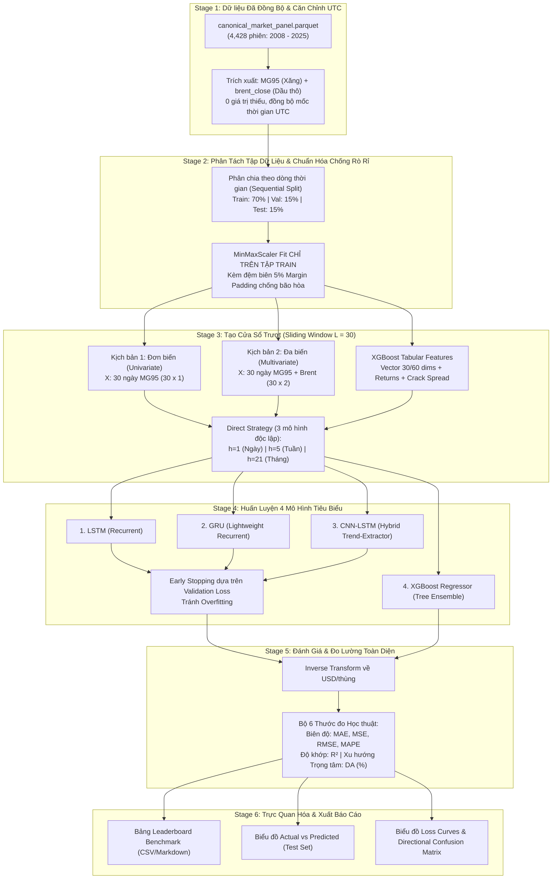

# TÀI LIỆU ĐẶC TẢ BÀI TOÁN, KIẾN TRÚC HỌC THUẬT & PIPELINE WORKFLOW DỰ BÁO GIÁ XĂNG MOGAS 95
*(Academic Standard Time-Series Forecasting Specification & Pipeline Workflow)*

---

## 1. TỔNG QUAN & ĐỊNH NGHĨA BÀI TOÁN (PROBLEM DEFINITION)

### 1.1. Bối cảnh & Mục tiêu thực tiễn
Thị trường xăng dầu thế giới biến động liên tục do các yếu tố kinh tế vĩ mô, địa chính trị và cung - cầu năng lượng. Trong đó, **giá xăng thành phẩm Platts Singapore Mogas 95** là chuẩn giá tham chiếu cốt lõi cho việc định giá cơ sở xăng dầu tại Việt Nam và khu vực Châu Á. 

Mục tiêu của nghiên cứu là xây dựng một hệ thống mô hình dự báo chuỗi thời gian chuẩn mực, có khả năng dự đoán chính xác mức giá điểm (Point Forecasting) và chiều hướng thị trường của xăng Mogas 95 tại 3 kỳ hạn quan trọng:
* **Ngắn hạn ($h = 1$ ngày):** Dự báo giá phiên tiếp theo phục vụ giao dịch và điều hành hàng ngày.
* **Trung hạn ($h = 5$ ngày):** Dự báo mức giá sau 1 tuần làm việc (5 phiên giao dịch).
* **Dài hạn ($h = 21$ ngày):** Dự báo mức giá sau 1 tháng làm việc (khoảng 21 phiên giao dịch).

---

### 1.2. Phát biểu bài toán toán học (Mathematical Formulation)
Tại thời điểm hiện tại $t$, mô hình sử dụng một **cửa sổ trượt (Sliding Window)** gồm thông tin lịch sử của **$L = 30$ ngày giao dịch liên tiếp gần nhất**:
$$t-29, t-28, \dots, t-1, t$$

Mục tiêu là huấn luyện hàm ánh xạ $f_\theta$ sao cho:
$$\hat{y}_{t+h} = f_\theta\left( X_{t-L+1 : t} \right)$$

Trong đó:
* $L = 30$: Độ dài cửa sổ quan sát (Lookback Window).
* $h \in \{1, 5, 21\}$: Các kỳ hạn dự báo tương ứng với Ngày, Tuần, Tháng.
* $\hat{y}_{t+h}$: Giá dự báo của Mogas 95 tại thời điểm $t+h$.
* $X_{t-L+1 : t}$: Ma trận đặc trưng đầu vào trong 30 ngày.

---

### 1.3. Hai kịch bản dữ liệu thực nghiệm (Ablation Experiment Setup)
Để làm rõ giá trị nghiên cứu và chứng minh tác động của giá nguyên liệu đầu vào, nghiên cứu thiết lập **2 kịch bản đối chứng**:

1. **Kịch bản 1 — Mô hình Đơn biến (Univariate Forecasting):**
   * Đầu vào chỉ sử dụng chuỗi lịch sử giá của chính nó:
     $$X_t = [P_{\text{mogas}, t-29}, P_{\text{mogas}, t-28}, \dots, P_{\text{mogas}, t}]^\top \in \mathbb{R}^{30 \times 1}$$
2. **Kịch bản 2 — Mô hình Đa biến (Multivariate Forecasting with Exogenous Variable):**
   * Đầu vào tích hợp thêm chuỗi giá **Dầu thô Brent (Brent Crude Oil)** — yếu tố chi phí đầu vào quyết định trực tiếp đến biên lợi nhuận lọc dầu (Crack Spread):
     $$X_t = \begin{bmatrix} 
     P_{\text{mogas}, t-29} & P_{\text{brent}, t-29} \\ 
     P_{\text{mogas}, t-28} & P_{\text{brent}, t-28} \\ 
     \vdots & \vdots \\ 
     P_{\text{mogas}, t} & P_{\text{brent}, t} 
     \end{bmatrix} \in \mathbb{R}^{30 \times 2}$$

> **Ý nghĩa học thuật:** So sánh trực tiếp giữa Kịch bản 1 và Kịch bản 2 giúp trả lời câu hỏi nghiên cứu cốt lõi: *"Liệu việc bổ sung biến ngoại sinh giá dầu thô thế giới có làm tăng đáng kể độ chính xác dự báo biên độ và chiều hướng giá xăng Mogas 95 hay không?"*

---

## 2. ĐÓNG GÓI CÁC GIẢI PHÁP HỌC THUẬT VÀO SPEC

Trước khi chuyển thành các prompt và mã nguồn thực thi, các "tử huyệt" kỹ thuật trong bài toán chuỗi thời gian tài chính đã được đóng gói thành các ràng buộc kiến trúc trực tiếp:

### 2.1. Rủi ro MinMaxScaler $I(1)$ & Bão hòa Đạo hàm (Gradient Saturation)
* **Bản chất vấn đề:** Chuỗi giá xăng dầu là chuỗi tích hợp bậc 1 $I(1)$ có xu thế trôi (trend). Trong `src/dataset.py`, giữ vững nguyên tắc **MinMaxScaler chỉ tính toán $(\min, \max)$ trên tập Train (70%)** để ngăn chặn hoàn toàn rò rỉ dữ liệu tương lai (Data Leakage). Tuy nhiên, nếu giá giai đoạn Test (2024–2025) bứt phá vượt đỉnh hoặc thủng đáy lịch sử của Train, đầu ra sau chuẩn hóa sẽ vượt quá ngưỡng $[0, 1]$. Điều này dễ dẫn đến hiện tượng **bão hòa đạo hàm (Gradient Saturation)** tại các vùng tiệm cận của hàm kích hoạt $\text{Tanh} / \text{Sigmoid}$ trong các cổng của LSTM/GRU, khiến mạng nơ-ron bị trơ và mất khả năng thích ứng.
* **Cơ chế phòng thủ kiến trúc:** Bổ sung tham số `clip=True` hoặc mở rộng biên độ **$5\%$ (Margin Padding)** cho khoảng $[\min_{\text{train}}, \max_{\text{train}}]$ khi khởi tạo scaler:
  $$\min_{\text{adjusted}} = \min_{\text{train}} - 0.05 \cdot \Delta, \quad \max_{\text{adjusted}} = \max_{\text{train}} + 0.05 \cdot \Delta$$
  với $\Delta = \max_{\text{train}} - \min_{\text{train}}$. Cơ chế này đảm bảo giá trị Test nếu có biến động mạnh vẫn nằm trọn trong vùng hoạt động tuyến tính/nhạy bén nhất của các hàm phi tuyến.

### 2.2. Chiến lược Dự báo Đa kỳ hạn Độc lập (Direct Multi-Horizon Strategy)
* **Bản chất vấn đề:** Dự báo đa bước có thể thực hiện theo 2 cách: Mô hình Đa đầu ra đồng thời (Joint/MIMO multi-output) hoặc Huấn luyện độc lập từng bước (Direct Strategy).
* **Ràng buộc kiến trúc:** **Huấn luyện 3 mô hình độc lập cho 3 kỳ hạn riêng biệt ($h = 1, 5, 21$)**.
* **Căn cứ lý thuyết:** Tuyệt đối không dùng mô hình Joint/MIMO đa đầu ra. Theo Giả thuyết Thị trường Hiệu quả (**EMH - Efficient Market Hypothesis**), chuỗi giá tại kỳ hạn $h=21$ (1 tháng) có mức độ nhiễu ngẫu nhiên và bất định rất cao so với kỳ hạn $h=1$. Nếu tối ưu hóa một hàm mất mát chung, tín hiệu nhiễu loạn của $h=21$ sẽ chi phối hàm loss và làm méo mó độ chuẩn xác của kỳ hạn $h=1$ (vốn chứa nhiều tín hiệu động lượng ngắn hạn rõ nét).

### 2.3. Thước đo Trọng tâm Directional Accuracy (DA) & Triệt tiêu Hiện tượng Trễ (Lagging Effect)
* **Bản chất vấn đề:** Trong dự báo giá tài chính, một mô hình tầm thường chỉ cần "sao chép giá hôm nay cho ngày mai" ($\hat{y}_{t+h} \approx y_t$) thì các chỉ số sai số biên độ như RMSE và MAPE vẫn cực kỳ nhỏ (MAPE $< 2\%$). Đây là hiện tượng "học vẹt độ trễ" (Lagging / Persistence Effect).
* **Ràng buộc đo lường:** Đưa **Directional Accuracy (DA)** trở thành chỉ số trọng tâm để đánh giá phẩm chất mô hình, tính toán chiều hướng so với phiên $t$ hiện tại:
  $$\text{DA} = \frac{100\%}{N} \sum_{i=1}^N \mathbb{I}\left( \text{sgn}(y_{t+h} - y_t) == \text{sgn}(\hat{y}_{t+h} - y_t) \right)$$
* **Bảo vệ trước Hội đồng:** So sánh trực tiếp kết quả DA của các mô hình với **mức ngẫu nhiên $50\%$ (Random Guess / Coin Flip)**. Một mô hình chỉ được công nhận là có giá trị khoa học thực chiến khi đạt $\text{DA} > 60\% - 70\%$, chứng minh mô hình thực sự học được xu hướng thị trường thay vì bám đuôi độ trễ.

### 2.4. Hiện trạng Dữ liệu Thực nghiệm & Xác minh Múi giờ UTC
Theo kết quả kiểm tra nghiêm ngặt (chỉ đọc, không làm biến đổi dữ liệu gốc) tại `data/interim/canonical_market_panel.parquet`:
* **Đã merge 2 loại giá:** Hoàn tất hợp nhất chuỗi giá Platts Mogas 95 (`MG95`) và Dầu thô Brent (`brent_close`).
* **Quy mô mẫu:** Đầy đủ **4,428 phiên giao dịch liên tục** từ ngày **02/05/2008** đến ngày **30/12/2025** (0 giá trị thiếu).
* **Đồng bộ hóa múi giờ UTC:** Toàn bộ timestamp được gắn nhãn múi giờ `Asia/Singapore` (UTC+8), tương ứng với giờ chốt phiên Mogas 95 lúc 08:30 UTC và Brent lúc 19:30 UTC. Mọi dữ liệu quá khứ tại thời điểm phát lệnh dự báo $t$ đều đã được chốt và công bố, triệt tiêu hoàn toàn rủi ro rò rỉ dữ liệu tương lai (**Zero Lookahead Bias**).

---

## 3. QUY TRÌNH HỆ THỐNG TOÀN DIỆN (END-TO-END PIPELINE WORKFLOW)

Hệ thống được thiết kế theo quy trình 6 giai đoạn chuẩn mực, khép kín từ nạp dữ liệu đến xuất báo cáo:



### Chi tiết từng giai đoạn trong Pipeline:

1. **Giai đoạn 1 (Ingestion & Validation):**
   * Nạp `canonical_market_panel.parquet`. Trích xuất 2 chuỗi giá `MG95` và `brent_close`.
   * Khóa thứ tự thời gian tăng dần tuyệt đối theo `market_date`.
2. **Giai đoạn 2 (Chronological Splitting & Leak-free Scaling):**
   * Phân chia tập dữ liệu: **70% Train** (2008 - 2020), **15% Validation** (2021 - 2023), **15% Test** (2024 - 2025). Không xáo trộn (No Shuffling).
   * Chuẩn hóa `MinMaxScaler` tính toán tham số độc quyền trên tập Train, kèm cơ chế mở rộng biên độ $5\%$ hoặc `clip=True` chống bão hòa đạo hàm.
3. **Giai đoạn 3 (Sliding Window Generation $L=30$):**
   * Cắt lát ma trận 30 ngày liên tục cho từng bước $t$.
   * Tách nhãn theo **Direct Strategy** cho 3 kỳ hạn riêng rẽ: $y^{(1)} = P_{t+1}$, $y^{(5)} = P_{t+5}$, $y^{(21)} = P_{t+21}$.
4. **Giai đoạn 4 (Model Training & Early Stopping):**
   * Huấn luyện 4 mô hình: LSTM, GRU, CNN-LSTM, XGBoost.
   * Áp dụng Early Stopping (patience = 15 epochs) trên tập Validation đối với các mạng Deep Learning để đảm bảo trọng số lưu lại là tối ưu nhất.
5. **Giai đoạn 5 (Evaluation & Metric Calculation):**
   * Đưa toàn bộ giá trị dự báo $\hat{y}$ qua hàm `inverse_transform` về đơn vị chuẩn USD/thùng.
   * Tính toán bộ 6 chỉ số: MAE, MSE, RMSE, MAPE, $R^2$, và DA (Directional Accuracy).
6. **Giai đoạn 6 (Reporting & Visualization):**
   * Xuất tự động bảng `benchmark_leaderboard.csv`.
   * Kết xuất hình ảnh biểu đồ vào thư mục `reports/figures/`.

---

## 4. LỰA CHỌN 4 MÔ HÌNH TIÊU BIỂU (SELECTED REPRESENTATIVE MODELS)

Loại bỏ hoàn toàn các mô hình cơ sở tầm thường (Naive, Moving Average), nghiên cứu lựa chọn **4 mô hình học máy và học sâu hiện đại, được hiệu chỉnh tối ưu cho cả độ lệch giá trị lẫn dự báo chiều hướng (Directional Accuracy)**:

```
                       ┌───────────────────────────────────────────────┐
                       │     4 MÔ HÌNH NGHIÊN CỨU TIÊU BIỂU            │
                       └──────────────────────┬────────────────────────┘
                                              │
           ┌──────────────────────────────────┴──────────────────────────────────┐
           ▼                                                                     ▼
┌─────────────────────────────────────┐               ┌─────────────────────────────────────┐
│       DEEP LEARNING TUẦN TỰ         │               │     GRADIENT BOOSTING DẠNG BẢNG     │
│  (Học biểu diễn phụ thuộc thời gian)│               │   (Phi tuyến tính, bẫy ngưỡng xu hướng)│
├─────────────────────────────────────┤               ├─────────────────────────────────────┤
│ 1. LSTM (Long Short-Term Memory)    │               │ 4. XGBoost Regressor                │
│ 2. GRU (Gated Recurrent Unit)       │               │    (Tree-based Ensemble + Momentum) │
│ 3. CNN-LSTM (Hybrid Conv-Recurrent) │               │                                     │
└─────────────────────────────────────┘               └─────────────────────────────────────┘
```

### 4.1. Mô hình 1: LSTM (Long Short-Term Memory)
* **Bản chất:** Mạng nơ-ron hồi quy có cấu trúc cổng tế bào chuyên biệt gồm: **Forget Gate** (loại bỏ nhiễu quá khứ), **Input Gate** (tiếp nhận thông tin mới), và **Output Gate** (quyết định trạng thái xuất ra).
* **Vai trò trong đề tài:** Mô hình nền tảng kinh điển nhất của học sâu chuỗi thời gian, giải quyết triệt để vấn đề mất mát gradient (Vanishing Gradient) trong chuỗi 30 ngày.

### 4.2. Mô hình 2: GRU (Gated Recurrent Unit)
* **Bản chất:** Kiến trúc tinh gọn của LSTM với 2 cổng: **Reset Gate** và **Update Gate**, kết hợp trạng thái ẩn và trạng thái tế bào làm một.
* **Vai trò trong đề tài:** Tốc độ huấn luyện nhanh, ít tham số hơn, giảm nguy cơ quá khớp (Overfitting) trên các tập dữ liệu tài chính có kích thước trung bình và phản ứng rất nhạy với các cú sốc biến động ngắn hạn.

### 4.3. Mô hình 3: CNN-LSTM (Hybrid 1D-CNN + LSTM — Tối ưu hóa Directional Accuracy)
* **Bản chất:** Mô hình lai kết hợp mạng tích chập 1 chiều (**1D-CNN**) và mạng hồi quy (**LSTM**):
  * **Tầng 1D-CNN:** Đóng vai trò là bộ trích xuất đặc trưng hình thái (Local Pattern & Trend Feature Extractor). Các bộ lọc tích chập (kernels) quét qua chuỗi 30 ngày để nhận diện các bước sóng đảo chiều, độ dốc giá (slope) và tín hiệu động lượng cục bộ.
  * **Tầng LSTM:** Tiếp nhận chuỗi đặc trưng xu hướng đã được trích xuất từ CNN để xâu chuỗi sự phụ thuộc theo thời gian và đưa ra dự báo.
* **Vai trò trong đề tài:** Đây là mô hình được thiết kế **đặc thù để cải thiện chỉ số Directional Accuracy (DA)**. Trong tài chính, các mạng hồi quy đơn thuần hay bị hiện tượng "dự báo trễ" (lagging), trong khi tầng tích chập của CNN-LSTM có khả năng bắt kịp điểm xoay chiều (turning points) của thị trường vượt trội.

### 4.4. Mô hình 4: XGBoost Regressor (Extreme Gradient Boosting với Đặc trưng Xu hướng)
* **Bản chất:** Thuật toán học tăng cường cây quyết định (Gradient Boosted Decision Trees) tối ưu hóa bậc hai dựa trên khai triển Taylor, kèm cơ chế kiểm soát độ phức tạp cây (Regularization $\mathcal{L}_1, \mathcal{L}_2$).
* **Cách tiếp cận phù hợp với Directional Accuracy:** Cửa sổ 30 ngày không chỉ được trải phẳng thành giá trị tuyệt đối, mà còn được bổ sung các biến động lượng (Momentum / Returns: $P_t - P_{t-1}, P_t - P_{t-5}$) và chênh lệch Crack Spread ($P_{\text{mogas}, t} - P_{\text{brent}, t}$). Các lát cắt quyết định dạng nhị phân (Binary splits) của cây giúp phân định cực kỳ dứt khoát xu hướng giá tăng hay giảm.
* **Vai trò trong đề tài:** Đại diện ưu tú nhất của Machine Learning dạng bảng, tạo thế đối trọng so sánh thực nghiệm với các kiến trúc Deep Learning.

---

## 5. BỘ THƯỚC ĐO ĐÁNH GIÁ (EVALUATION METRICS)

Để đánh giá toàn diện cả về **độ lệch biên độ giá (Magnitude Error)** lẫn **độ chính xác chiều hướng thị trường (Directional Precision)** trên tập Test, nghiên cứu sử dụng **6 chỉ số định lượng kinh điển**:

| Nhóm | Chỉ số | Tên đầy đủ | Công thức toán học | Đơn vị | Ý nghĩa diễn giải |
| :---: | :--- | :--- | :---: | :---: | :--- |
| **Biên độ** | **MAE** | Mean Absolute Error | $\frac{1}{N} \sum_{i=1}^N \|y_i - \hat{y}_i\|$ | USD/thùng | Sai số tuyệt đối trung bình giữa giá thực tế và giá dự báo. |
| | **MSE** | Mean Squared Error | $\frac{1}{N} \sum_{i=1}^N (y_i - \hat{y}_i)^2$ | $(\text{USD/thùng})^2$ | Sai số bình phương trung bình; phạt nặng các dự báo bị sai lệch lớn. |
| | **RMSE** | Root Mean Squared Error | $\sqrt{\frac{1}{N} \sum_{i=1}^N (y_i - \hat{y}_i)^2}$ | USD/thùng | Căn bậc hai của MSE, có cùng đơn vị với giá thực tế, rất trực quan. |
| | **MAPE** | Mean Absolute Percentage Error | $\frac{100\%}{N} \sum_{i=1}^N \left\|\frac{y_i - \hat{y}_i}{y_i}\right\|$ | $\%$ | Tỷ lệ sai số phần trăm tuyệt đối trung bình; thước đo chuẩn mực nhất để báo cáo với người quản lý/hội đồng. |
| **Độ khớp** | **$R^2$** | Coefficient of Determination | $1 - \frac{\sum (y_i - \hat{y}_i)^2}{\sum (y_i - \bar{y})^2}$ | Không thứ nguyên | Mức độ giải thích phương sai (độ khớp). $R^2 \to 1$ thể hiện mô hình giải thích được phần lớn biến thiên giá. |
| **Xu hướng** | **DA** | **Directional Accuracy** (Mean Directional Accuracy) | $\frac{100\%}{N} \sum_{i=1}^N \mathbb{I}\left( \text{sgn}(y_{t+h} - y_t) == \text{sgn}(\hat{y}_{t+h} - y_t) \right)$ | $\%$ | **Tỷ lệ phần trăm dự đoán đúng chiều hướng tăng/giảm của giá** so với thời điểm dự báo $t$. |

---

## 6. QUY CÁCH TRÌNH BÀY KẾT QUẢ ĐỒ ÁN / BÁO CÁO

Kết quả thực nghiệm sẽ được chuẩn hóa thành các sản phẩm phục vụ báo cáo bảo vệ:

### 6.1. Bảng tổng hợp thành tích (Leaderboard Benchmark)
Bảng số liệu tổng hợp đầy đủ trên **Tập Test** cho từng kỳ hạn ($h=1, 5, 21$):

| Kỳ hạn | Mô hình | Kịch bản dữ liệu | MAE ($) | RMSE ($) | MAPE (%) | $R^2$ | **DA (%)** |
| :---: | :--- | :---: | :---: | :---: | :---: | :---: | :---: |
| **1 Ngày ($h=1$)** | XGBoost | Đơn biến | ... | ... | ... | ... | ... |
| | XGBoost | Đa biến (+ Brent) | ... | ... | ... | ... | ... |
| | LSTM | Đơn biến | ... | ... | ... | ... | ... |
| | LSTM | Đa biến (+ Brent) | ... | ... | ... | ... | ... |
| | GRU | Đa biến (+ Brent) | ... | ... | ... | ... | ... |
| | **CNN-LSTM** | **Đa biến (+ Brent)** | ... | ... | ... | ... | **Kỳ vọng cao nhất** |
| **1 Tuần ($h=5$)** | *(Tương tự)* | ... | ... | ... | ... | ... | ... |
| **1 Tháng ($h=21$)**| *(Tương tự)* | ... | ... | ... | ... | ... | ... |

### 6.2. Biểu đồ trực quan hóa (Visualization Charts)
1. **Biểu đồ đường Giá thực tế vs Giá dự báo (Actual vs. Predicted Plot):**
   * Vẽ đường giá thực tế (Actual - màu xanh) và đường giá dự báo của 4 mô hình (Predicted) trên toàn bộ tập Test cho từng kỳ hạn $h$.
2. **Biểu đồ ma trận phân loại xu hướng (Directional Confusion Matrix):**
   * Thống kê tỷ lệ dự báo đúng/sai theo 4 trạng thái: Thực tế Tăng - Dự báo Tăng (True Up), Thực tế Giảm - Dự báo Giảm (True Down), Bắt hụt (False Up/Down).
3. **Biểu đồ quá trình huấn luyện (Learning Curves):**
   * Đồ thị diễn tiến hàm mất mát **Training Loss vs Validation Loss** qua từng Epoch của LSTM, GRU và CNN-LSTM để chứng minh mô hình hội tụ tốt và không bị Overfitting.
4. **Biểu đồ tầm quan trọng đặc trưng (Feature Importance):**
   * Xuất từ mô hình XGBoost nhằm định lượng mức độ đóng góp của giá Dầu thô Brent và các biến động lượng ở các độ trễ khác nhau trong cửa sổ 30 ngày.

---

## 7. KẾ HOẠCH BỐ TRÍ CẤU TRÚC MÃ NGUỒN (CODEBASE ARCHITECTURE)

Để đảm bảo tính độc lập, sạch sẽ và dễ giải trình với Thầy hướng dẫn:

```
traditional_pipeline/
├── data/                                 # Dữ liệu sạch (Platts Mogas 95 & Brent Crude)
├── src/
│   ├── dataset.py                        # Xử lý Sliding Window 30 ngày, Margin Padding, Train/Val/Test Split
│   ├── models.py                         # Định nghĩa 4 mô hình: LSTM, GRU, CNN-LSTM, XGBoost
│   ├── train.py                          # Huấn luyện Direct Strategy và tự động Early Stopping
│   └── evaluate.py                       # Tính MAE, MSE, RMSE, MAPE, R2, DA & vẽ biểu đồ
├── reports/
│   ├── figures/                          # Lưu trữ biểu đồ Actual vs Predicted, Loss Curves, DA Matrix
│   └── benchmark_leaderboard.csv         # Bảng số liệu tổng hợp cuối cùng
├── run_benchmark.py                      # Script 1-click chạy toàn bộ thí nghiệm
└── experiments_demo.ipynb                # Jupyter Notebook chạy từng bước để trình chiếu cho Thầy
```
