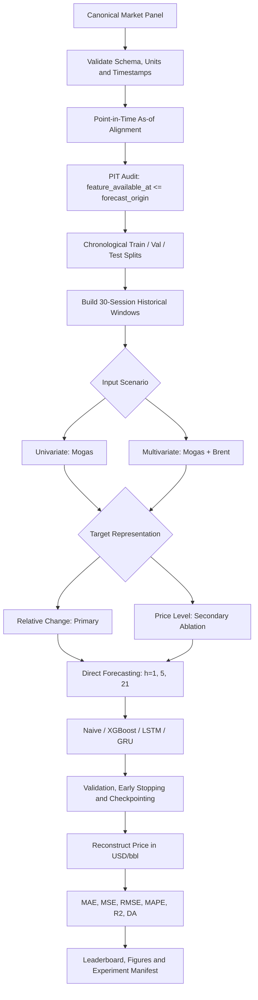

# ĐẶC TẢ BÀI TOÁN, PHƯƠNG PHÁP NGHIÊN CỨU VÀ PIPELINE DỰ BÁO GIÁ MOGAS 95

*(Mogas 95 Time-Series Forecasting: Problem Definition, Methodology & Reproducible Pipeline)*

**Phiên bản:** 2.0 — Revised MVP Specification  
**Phạm vi:** Dự án nghiên cứu ứng dụng quy mô nhỏ  
**Đối tượng dự báo:** Platts Singapore Mogas 95  
**Biến đầu vào bổ sung:** Brent Crude Oil

---

## 1. TỔNG QUAN VÀ ĐỊNH NGHĨA BÀI TOÁN

### 1.1. Bối cảnh và mục tiêu

Giá xăng thành phẩm Mogas 95 tại Singapore chịu ảnh hưởng của cung - cầu sản phẩm lọc dầu, giá dầu thô, tồn kho, công suất lọc dầu, yếu tố mùa vụ và các sự kiện kinh tế - địa chính trị. Giá Brent có thể cung cấp thông tin bổ sung về thị trường dầu thô, nhưng không đại diện đầy đủ cho các yếu tố quyết định giá xăng thành phẩm.

Dự án xây dựng một pipeline dự báo chuỗi thời gian nhằm dự báo **mức giá Platts Singapore Mogas 95** tại ba kỳ hạn:

- **Ngắn hạn:** `h = 1` phiên giao dịch.
- **Trung hạn:** `h = 5` phiên giao dịch.
- **Dài hạn:** `h = 21` phiên giao dịch.

Dự án đồng thời đánh giá khả năng dự báo chiều hướng tăng/giảm của giá. Directional Accuracy (DA) là chỉ số đánh giá bổ sung, không mặc nhiên là hàm mục tiêu huấn luyện.

### 1.2. Câu hỏi nghiên cứu

Nghiên cứu tập trung vào ba câu hỏi:

**RQ1 — Target Representation:** Dự báo biến động tương đối (relative change) có cải thiện kết quả so với dự báo trực tiếp mức giá (price level) hay không?

**RQ2 — Exogenous Information:** Việc bổ sung Brent vào đầu vào có cải thiện chất lượng dự báo Mogas 95 so với mô hình chỉ sử dụng lịch sử Mogas 95 hay không?

**RQ3 — Model Comparison:** XGBoost, LSTM và GRU có cải thiện kết quả so với mô hình Naive Persistence hay không, xét theo từng kỳ hạn dự báo?

Các câu hỏi trên là giả thuyết cần kiểm chứng bằng thực nghiệm. Tài liệu không giả định trước rằng Relative Change, Brent hoặc một kiến trúc cụ thể chắc chắn tạo ra kết quả tốt hơn.

### 1.3. Định nghĩa mẫu dự báo

Tại một **forecast origin** `o`, mô hình chỉ được sử dụng thông tin đã khả dụng tại thời điểm đó. Đầu vào là cửa sổ gồm `L = 30` quan sát gần nhất đã khả dụng:

\[
X_o = [x_{o-L+1},\ldots,x_o], \qquad L=30
\]

Mục tiêu là dự báo giá Mogas 95 tại phiên giao dịch thứ `h` tiếp theo:

\[
\hat P^{M}_{o+h}=f_{\theta,h}(X_o), \qquad h\in\{1,5,21\}
\]

Trong đó:

- `M` ký hiệu Mogas 95.
- `o` là thời điểm phát sinh dự báo, không nhất thiết trùng thời điểm công bố giá Mogas gần nhất.
- `h` được đếm theo **phiên đánh giá Mogas hợp lệ**, không phải ngày lịch.
- `P^M_o` là mức giá Mogas gần nhất đã được công bố và khả dụng tại forecast origin `o`.

Mỗi mẫu phải lưu được tối thiểu: `forecast_origin`, `feature_available_at`, `target_timestamp`, `horizon` và `target_value` để có thể kiểm toán tính hợp lệ thời gian.

### 1.4. Hai kịch bản dữ liệu

**Scenario A — Univariate**

Chỉ sử dụng lịch sử Mogas 95:

\[
X_o^{uni}\in\mathbb{R}^{30\times1}
\]

**Scenario B — Multivariate**

Sử dụng lịch sử Mogas 95 và Brent đã được đồng bộ theo quy tắc Point-in-Time:

\[
X_o^{multi}\in\mathbb{R}^{30\times2}
\]

Brent được xem là **biến dự báo bổ sung (external predictor)**. Không diễn giải Brent là nguyên nhân duy nhất hoặc biến ngoại sinh theo nghĩa nhân quả nếu chưa có thiết kế nhận dạng phù hợp.

---

## 2. ĐÓNG GÓP CỦA DỰ ÁN (PROJECT CONTRIBUTIONS)

Đây là nghiên cứu ứng dụng và đánh giá thực nghiệm. Dự án không tuyên bố đề xuất thuật toán forecasting mới. Các đóng góp dự kiến gồm:

### C1. Point-in-Time Data Alignment

Xây dựng quy trình đồng bộ Mogas 95 và Brent dựa trên thời điểm dữ liệu thực sự được công bố và khả dụng tại forecast origin. Quy trình có metadata thời gian và kiểm tra tự động để phát hiện feature đến từ tương lai.

**Giá trị:** Giảm nguy cơ look-ahead bias và làm rõ điều kiện thông tin mà mô hình có thể sử dụng trong dự báo.

### C2. Target Representation Analysis

So sánh hai cách biểu diễn mục tiêu: biến động tương đối so với mức giá trực tiếp, trong điều kiện dữ liệu, kỳ hạn và mô hình được kiểm soát.

**Giá trị:** Đánh giá thực nghiệm ảnh hưởng của target representation đến sai số dự báo sau khi tái lập về cùng đơn vị USD/thùng.

### C3. Exogenous Information Evaluation

So sánh mô hình Univariate và Multivariate để đo lường mức cải thiện (nếu có) khi bổ sung thông tin Brent.

**Giá trị:** Xác định liệu Brent có bổ sung thông tin dự báo hữu ích cho Mogas 95 trong giai đoạn và cấu hình dữ liệu đang nghiên cứu hay không.

### C4. Reproducible Forecasting Benchmark

Xây dựng pipeline có thể tái chạy, gồm baseline, các mô hình ML/DL, ba kỳ hạn dự báo, metric thống nhất, manifest dữ liệu và báo cáo kết quả.

**Giá trị:** Cho phép kiểm tra, so sánh và tái lập kết quả mà không phụ thuộc vào thao tác thủ công trong notebook.

> **Giới hạn tuyên bố:** Đây là đóng góp về quy trình dữ liệu, thiết kế thực nghiệm và bằng chứng ứng dụng trên bộ dữ liệu cụ thể. Không gọi các đóng góp này là thuật toán mới hoặc state-of-the-art nếu chưa có so sánh và bằng chứng tương ứng.

---

## 3. PHƯƠNG PHÁP LUẬN

### 3.1. Point-in-Time (PIT) và quy tắc đồng bộ dữ liệu

Mogas 95 và Brent có lịch giao dịch, thời điểm chốt giá và thời điểm công bố khác nhau. Vì vậy, không được ghép dữ liệu chỉ dựa trên cùng ngày lịch rồi mặc định rằng cả hai mức giá đều đã khả dụng tại thời điểm dự báo.

Thiết kế sử dụng **forecast origin dự kiến lúc 08:30 Asia/Singapore**. Tại thời điểm này:

- Mogas input là assessment gần nhất đã được công bố trước forecast origin; thông thường là phiên Mogas liền trước.
- Brent input là settlement gần nhất đã hoàn tất và thực sự khả dụng trước forecast origin.
- Target là assessment Mogas kế tiếp sau forecast origin.
- Nếu có độ trễ công bố, ngày nghỉ hoặc khác biệt lịch giao dịch, phải sử dụng timestamp khả dụng thực tế, không suy ra chỉ từ ngày lịch.

Các timestamp gốc phải được lưu bằng UTC; timezone địa phương chỉ được dùng để diễn giải lịch và thời điểm nghiệp vụ. Khi xử lý dữ liệu ICE Brent, cần lưu ý thay đổi giờ mùa hè/mùa đông tại London. Không cố định một giờ UTC duy nhất cho toàn bộ lịch sử nếu nguồn dữ liệu có timestamp thực tế.

**Quy tắc PIT bắt buộc:**

\[
\text{feature\_available\_at}\leq\text{forecast\_origin}
\]

Đối với mỗi mẫu, tất cả feature phải thỏa điều kiện trên. Target phải nằm sau forecast origin và đúng kỳ hạn `h`.

Không tuyên bố “Zero Lookahead Bias” chỉ dựa trên việc dữ liệu không có missing values. Chỉ có thể báo cáo rằng pipeline đã vượt qua PIT audit khi kiểm tra timestamp được thực thi và lưu kết quả thành công.

### 3.2. Hai cách biểu diễn target

Dự án sử dụng Relative Change làm phương pháp chính và Price Level làm đối chứng có giới hạn.

#### Phương pháp 1 — Relative Change (phương pháp chính)

Target là biến động tương đối tích lũy từ mức giá Mogas gần nhất khả dụng tại forecast origin đến mức giá ở kỳ hạn cần dự báo:

\[
R_{o,h}=\frac{P^M_{o+h}-P^M_o}{P^M_o}
\]

Trong đó `P^M_o` là mức Mogas gần nhất đã biết tại forecast origin, còn `P^M_{o+h}` là mức giá Mogas tại phiên mục tiêu.

Để đưa các chuỗi đầu vào về cùng dạng tương đối trong từng cửa sổ, chuẩn hóa riêng từng biến theo giá trị mới nhất khả dụng của chính biến đó:

\[
z^{(j)}_{o,k}=\frac{P^{(j)}_{o-k}}{P^{(j)}_o}-1
\]

với `j` là Mogas hoặc Brent và `k = 0, ..., L-1`. Ký hiệu Brent phải đại diện cho quan sát as-of đã được ghép theo PIT tại từng forecast origin; không thay thế bằng settlement chưa khả dụng.

Tái lập giá dự báo:

\[
\hat P^M_{o+h}=P^M_o(1+\hat R_{o,h})
\]

**Lưu ý phương pháp:** Relative Change được kỳ vọng làm giảm ảnh hưởng của xu hướng mức giá, nhưng không mặc nhiên là chuỗi dừng `I(0)` hoặc có phân phối ổn định. Có thể dùng ADF/KPSS và phân tích đồ thị để kiểm tra đặc tính chuỗi; kết luận phải dựa trên kết quả kiểm định.

#### Phương pháp 2 — Price Level (đối chứng)

Target được dự báo trực tiếp:

\[
y_{o,h}=P^M_{o+h}
\]

Đối với mô hình cần scaling, scaler chỉ được fit trên các mẫu Train. Validation và Test dùng đúng scaler đã fit. Không clipping giá trị Test chỉ vì chúng nằm ngoài miền Train; mô hình neural sử dụng linear output layer để cho phép đầu ra nằm ngoài khoảng chuẩn hóa.

Không bắt buộc sử dụng Margin Padding 5%. Nếu thử nghiệm padding, phải ghi rõ đây là một cấu hình riêng và không được thay đổi dựa trên kết quả Test.

Kết quả của hai phương pháp chỉ được so sánh sau khi tái lập dự báo về cùng đơn vị USD/thùng và sử dụng cùng tập forecast origin hợp lệ.

### 3.3. Chiến lược đa kỳ hạn — Direct Forecasting

Sử dụng Direct Strategy: mỗi kỳ hạn có một mô hình hoặc một cấu hình huấn luyện độc lập.

\[
f_{\theta_1}(X_o)\rightarrow\hat y_{o,1}
\]

\[
f_{\theta_5}(X_o)\rightarrow\hat y_{o,5}
\]

\[
f_{\theta_{21}}(X_o)\rightarrow\hat y_{o,21}
\]

Lựa chọn này nhằm đơn giản hóa huấn luyện, đánh giá riêng từng kỳ hạn và tránh việc các mục tiêu khác nhau dùng chung một loss trong MVP.

Không kết luận rằng Joint/MIMO luôn gây gradient contamination hoặc kém hơn Direct. MIMO chỉ nằm ngoài phạm vi so sánh của phiên bản MVP.

### 3.4. Lookback Window

Giữ cố định `L = 30` phiên trong thí nghiệm chính để giới hạn số cấu hình và giúp so sánh mô hình nhất quán.

Việc tối ưu lookback 7/14/60 phiên không thuộc phạm vi MVP. Có thể bổ sung ở giai đoạn mở rộng nếu kết quả ban đầu cho thấy lookback là yếu tố quan trọng.

### 3.5. Feature Engineering cho XGBoost

Cửa sổ đầu vào được chuyển thành vector dạng bảng. Có thể sử dụng:

- Lag values hoặc relative changes của Mogas và Brent.
- Return/momentum ở một số độ trễ được xác định trước, ví dụ 1 và 5 phiên.
- Các thống kê rolling đơn giản nếu được tính hoàn toàn từ dữ liệu quá khứ.

Chỉ tạo **crack spread** khi giá sản phẩm và giá dầu thô đã được quy đổi về đơn vị tương thích và đồng bộ timestamp. Nếu chưa đáp ứng điều kiện này, không gọi chênh lệch hai mức giá thô là crack spread; hãy loại feature đó khỏi MVP.

---

## 4. DỮ LIỆU VÀ PHÂN CHIA TẬP

### 4.1. Dataset nguồn

Dataset nguồn được khai báo trong cấu hình dự án:

`data/interim/canonical_market_panel.parquet`

Theo snapshot mô tả trong phiên bản đặc tả hiện tại:

- Giai đoạn dữ liệu: `2008-05-02` đến `2025-12-30`.
- Số quan sát được khai báo: `4,428` phiên.
- Missing values được khai báo: `0`.

Các con số này là metadata của snapshot hiện tại và phải được xác minh lại bằng script kiểm tra dữ liệu khi chạy pipeline. Không coi chúng là kết quả audit mới nếu chưa thực thi kiểm tra.

File canonical là nguồn dữ liệu bất biến đối với benchmark: pipeline chỉ đọc file này, không ghi đè dữ liệu nguồn.

### 4.2. Chronological Split

Sử dụng phân chia tuần tự, không shuffle:

| Tập | Giai đoạn | Số dòng theo snapshot hiện tại | Mục đích |
|---|---|---:|---|
| Train | 2008–2020 | 3,099 | Fit tham số mô hình và preprocessing |
| Validation | 2021–2023 | 664 | Early stopping và lựa chọn cấu hình |
| Test | 2024–2025 | 665 | Đánh giá cuối cùng |

Tổng: `4,428` dòng. Tỷ lệ xấp xỉ `70% / 15% / 15%`.

Việc phân loại mẫu Train/Validation/Test phải dựa trên forecast origin theo quy tắc đã chốt. Target của một mẫu phải nằm trong phần thời gian tương ứng và không được vượt qua ranh giới của tập đó.

**Quy tắc tạo cửa sổ:** Cho phép sử dụng lịch sử từ partition trước làm context cho Validation hoặc Test, vì các quan sát đó đã tồn tại tại forecast origin. Không được dùng feature có timestamp sau forecast origin. Không loại bỏ máy móc 30 quan sát đầu mỗi partition nếu chúng có thể được dùng hợp lệ làm lịch sử.

Đối với horizon `h`, chỉ giữ mẫu khi target tương ứng tồn tại trong partition đánh giá. Do đó số mẫu supervised thực tế có thể ít hơn số dòng trong file split, đặc biệt ở cuối giai đoạn Test.

### 4.3. Lưu trữ và Audit

```text
data/
├── interim/
│   └── canonical_market_panel.parquet
└── splits/
    ├── train_2008_2020.parquet
    ├── train_2008_2020.csv
    ├── val_2021_2023.parquet
    ├── val_2021_2023.csv
    ├── test_2024_2025.parquet
    ├── test_2024_2025.csv
    └── splits_manifest.json
```

`splits_manifest.json` cần lưu tối thiểu:

- Nguồn dữ liệu, số dòng và khoảng thời gian.
- Số dòng từng partition.
- Quy tắc split và thời điểm tạo split.
- Tên cột, đơn vị và timezone.
- Checksum của file nguồn và file split.
- Quy tắc forecast origin, as-of join và target timestamp.
- Kết quả kiểm tra missing values, duplicate timestamps và PIT violations.

---

## 5. MÔ HÌNH NGHIÊN CỨU

### 5.1. Naive Persistence — Baseline bắt buộc

Dự báo giá tương lai bằng mức giá Mogas gần nhất đã khả dụng tại forecast origin:

\[
\hat P^M_{o+h}=P^M_o
\]

Baseline được đánh giá trên cả ba kỳ hạn. Nó tạo mốc tối thiểu để xác định mô hình phức tạp có thực sự cải thiện sai số dự báo mức giá hay không.

Đối với DA, cần báo cáo thêm phân phối tỷ lệ tăng/giảm và một directional baseline đơn giản (ví dụ dự báo lớp chiếm đa số trên Train). Không mặc định `50%` là ngưỡng chuẩn phù hợp với mọi phân phối hướng giá.

### 5.2. XGBoost Regressor

Đại diện cho Machine Learning dạng bảng. Cửa sổ lịch sử được trải phẳng và kết hợp với các lag/return features đã định nghĩa.

Vai trò: kiểm tra liệu mô hình cây tăng cường có thể khai thác quan hệ phi tuyến mà không cần kiến trúc recurrent hay không.

### 5.3. LSTM

Mô hình recurrent có các cổng Forget, Input và Output. Được sử dụng làm đại diện Deep Learning tuần tự.

Vai trò: học quan hệ phụ thuộc theo thời gian trong cửa sổ 30 phiên.

### 5.4. GRU

Mô hình recurrent sử dụng Reset Gate và Update Gate, thường có ít tham số hơn LSTM.

Vai trò: đối chứng kiến trúc recurrent gọn hơn và đánh giá trade-off giữa độ chính xác và độ phức tạp.

### 5.5. CNN-LSTM — Mở rộng, không thuộc MVP

CNN-LSTM kết hợp 1D-CNN để trích xuất local patterns và LSTM để học phụ thuộc theo thời gian. Mô hình này chỉ được thêm sau khi benchmark chính đã ổn định.

Không mặc định CNN-LSTM cải thiện Directional Accuracy; hiệu quả phải được xác nhận bằng Test chưa dùng để tuning.

---

## 6. MA TRẬN THỰC NGHIỆM MVP

Để tránh mở rộng không cần thiết, thiết kế thực nghiệm được chia thành benchmark chính và ablation target representation.

### 6.1. Benchmark chính — Relative Change

| Thành phần | Giá trị |
|---|---|
| Target representation | Relative Change |
| Data scenario | Univariate, Multivariate |
| Mô hình học | XGBoost, LSTM, GRU |
| Horizon | 1, 5, 21 |
| Số cấu hình | `2 × 3 × 3 = 18` |

Naive Persistence được chạy riêng cho ba horizon, không nhân đôi theo Univariate/Multivariate vì baseline không sử dụng Brent. Như vậy benchmark chính có thêm 3 baseline configurations.

### 6.2. Ablation phụ — Price Level

Để giữ quy mô nhỏ, chỉ dùng hai mô hình đại diện:

- XGBoost: đại diện ML dạng bảng.
- LSTM: đại diện Deep Learning tuần tự.

| Thành phần | Giá trị |
|---|---|
| Target representation | Price Level |
| Data scenario | Univariate, Multivariate |
| Mô hình | XGBoost, LSTM |
| Horizon | 1, 5, 21 |
| Số cấu hình | `2 × 2 × 3 = 12` |

**Tổng MVP:** `18 + 12 + 3 = 33` cấu hình đánh giá, chưa tính số random seeds. Nếu cần giảm thời gian, có thể hoàn thành 18 cấu hình Relative Change và 3 Naive trước; Price Level ablation là phần tiếp theo.

### 6.3. Quy tắc huấn luyện công bằng

- Dùng cùng forecast origin, horizon và tập đánh giá khi so sánh các mô hình.
- Tuning chỉ sử dụng Train/Validation; Test chỉ mở ở bước đánh giá cuối.
- Scaler và mọi phép biến đổi học từ dữ liệu chỉ fit trên Train.
- Deep Learning sử dụng Early Stopping theo Validation Loss và lưu best checkpoint.
- Ghi nhận random seed, hyperparameters, thời gian huấn luyện và phiên bản thư viện.
- Nếu chạy nhiều seed cho LSTM/GRU, báo cáo mean và standard deviation; không chỉ chọn seed có kết quả đẹp nhất.

Cấu hình tối ưu không được lựa chọn dựa trên Test.

---

## 7. EVALUATION METRICS

Tất cả dự báo giá phải được tái lập về USD/thùng trước khi tính metric. Với Relative Change, sử dụng công thức tái lập ở Mục 3.2.

### 7.1. Point Forecast Metrics

| Metric | Ý nghĩa | Đơn vị |
|---|---|---|
| MAE | Sai số tuyệt đối trung bình | USD/thùng |
| MSE | Sai số bình phương trung bình | (USD/thùng)² |
| RMSE | Căn bậc hai của MSE; nhạy với sai số lớn | USD/thùng |
| MAPE | Sai số phần trăm tuyệt đối trung bình | % |
| R² | Mức độ phù hợp so với trung bình của target | Không thứ nguyên |

MAPE phù hợp hơn khi giá thực tế dương và cách xa 0. R² có thể âm trên Test; không ép hoặc diễn giải R² âm là lỗi tính toán.

### 7.2. Directional Accuracy

Đánh giá hướng biến động so với mức giá tại forecast origin:

\[
DA_h=\frac{100}{N}\sum_{i=1}^{N}
\mathbb{I}\left[
\operatorname{sgn}(P_{i+h}-P_i)
=
\operatorname{sgn}(\hat P_{i+h}-P_i)
\right]
\]

Trong đó `P_i` là giá Mogas gần nhất đã khả dụng tại forecast origin. Quy tắc xử lý trường hợp không đổi giá (`sign = 0`) phải được thống nhất trong code và báo cáo; không thay đổi quy tắc sau khi xem kết quả Test.

DA là metric đánh giá. Nếu mô hình được huấn luyện bằng MAE/MSE trên target liên tục, không mô tả mô hình là “tối ưu trực tiếp DA”.

Không đặt trước mục tiêu DA 60–70% như tiêu chuẩn nghiệm thu phổ quát. Cần so sánh với directional baseline và phân phối Up/Down thực tế trên từng horizon.

### 7.3. Phân tích bổ sung

- Actual vs Predicted cho từng horizon.
- Directional confusion matrix: Actual Up/Down và Predicted Up/Down.
- Training/Validation Loss cho LSTM và GRU.
- XGBoost feature importance; có thể dùng Permutation Importance nếu cần đánh giá ảnh hưởng ngoài gain-based importance.
- MAE/RMSE/DA theo các giai đoạn thị trường nếu số lượng mẫu cho phép.

Các forecast horizon chồng lấn có thể tạo ra sai số phụ thuộc theo thời gian. Vì vậy không nên mặc định mọi forecast error là các quan sát độc lập khi thực hiện kiểm định thống kê.

---

## 8. PIPELINE WORKFLOW END-TO-END



### 8.1. Các stage triển khai

**Stage 1 — Data Audit & PIT Alignment**

- Kiểm tra schema, đơn vị, missing values và duplicate timestamps.
- Xác định timestamp công bố/khả dụng của Mogas và Brent.
- Thực hiện as-of join theo forecast origin.
- Tạo báo cáo PIT violations; pipeline phải dừng nếu có feature đến từ tương lai.

**Stage 2 — Split & Dataset Construction**

- Tạo split tuần tự và manifest.
- Tạo supervised samples theo lookback 30 và horizon 1/5/21.
- Giữ lịch sử trước partition làm context khi hợp lệ.
- Ghi lại forecast origin và target timestamp của từng sample.

**Stage 3 — Baseline & Main Benchmark**

- Chạy Naive Persistence.
- Chạy XGBoost, LSTM và GRU với Relative Change.
- So sánh Univariate và Multivariate.

**Stage 4 — Target Representation Ablation**

- Chạy XGBoost và LSTM với Price Level.
- So sánh với cùng horizon và forecast origin hợp lệ.

**Stage 5 — Evaluation & Reporting**

- Tái lập giá và tính metrics.
- Xuất leaderboard, forecast charts, loss curves và confusion matrix.
- Lưu cấu hình và metadata để tái lập từng thí nghiệm.

---

## 9. CẤU TRÚC CODEBASE

```text
mogas95_forecasting/
├── configs/
│   ├── data.yaml
│   ├── experiment.yaml
│   └── models.yaml
│
├── data/
│   ├── interim/
│   │   └── canonical_market_panel.parquet
│   └── splits/
│       ├── train_2008_2020.parquet
│       ├── val_2021_2023.parquet
│       ├── test_2024_2025.parquet
│       └── splits_manifest.json
│
├── src/
│   ├── data/
│   │   ├── validation.py
│   │   ├── alignment.py
│   │   ├── splitting.py
│   │   └── dataset.py
│   │
│   ├── features/
│   │   └── engineering.py
│   │
│   ├── models/
│   │   ├── baseline.py
│   │   ├── xgboost_model.py
│   │   ├── lstm.py
│   │   └── gru.py
│   │
│   ├── training/
│   │   ├── trainer.py
│   │   └── callbacks.py
│   │
│   └── evaluation/
│       ├── metrics.py
│       ├── reconstruction.py
│       └── visualization.py
│
├── experiments/
│   └── benchmark.py
│
├── outputs/
│   ├── checkpoints/
│   ├── predictions/
│   ├── figures/
│   └── benchmark_leaderboard.csv
│
├── notebooks/
│   └── exploration.ipynb
│
├── run_benchmark.py
└── README.md
```

Notebook chỉ dùng cho EDA, kiểm tra và trình bày. Logic dữ liệu, huấn luyện và đánh giá chính thức phải nằm trong `src/` để có thể chạy tự động.

---

## 10. OUTPUT VÀ TIÊU CHÍ HOÀN THÀNH

### 10.1. Output bắt buộc

```text
outputs/
├── predictions/
│   ├── predictions_h1.csv
│   ├── predictions_h5.csv
│   └── predictions_h21.csv
├── figures/
│   ├── actual_vs_predicted_h1.png
│   ├── actual_vs_predicted_h5.png
│   ├── actual_vs_predicted_h21.png
│   ├── directional_confusion_matrix.png
│   └── loss_curves.png
├── benchmark_leaderboard.csv
└── experiment_manifest.json
```

Mỗi prediction record nên có `forecast_origin`, `target_timestamp`, `horizon`, `model`, `scenario`, `target_representation`, `actual_price`, `predicted_price` và các thông tin cần thiết để truy xuất experiment.

### 10.2. Tiêu chí hoàn thành MVP

MVP được xem là hoàn thành khi:

1. PIT audit xác nhận không có feature timestamp vượt forecast origin trong các mẫu được dùng.
2. Train/Validation/Test được tạo tuần tự và có manifest kiểm toán.
3. Baseline và các mô hình chính chạy được cho ba horizon.
4. Các kịch bản Univariate/Multivariate dùng cùng quy tắc đánh giá.
5. Giá dự báo được tái lập về USD/thùng trước khi tính metrics.
6. Test không được sử dụng để tuning hoặc lựa chọn mô hình.
7. Có leaderboard, prediction files và biểu đồ cần thiết.
8. Có thể chạy lại benchmark từ cấu hình và random seed đã lưu.

Không đặt điều kiện hoàn thành dựa trên việc một mô hình phải đạt DA 60–70% hoặc phải vượt một mô hình cụ thể. Kết quả âm hoặc không cải thiện so với baseline vẫn là kết quả nghiên cứu hợp lệ nếu quy trình thực nghiệm được thực hiện đúng.

---

## 11. GIỚI HẠN VÀ PHẠM VI MỞ RỘNG

### 11.1. Giới hạn của MVP

- Chỉ sử dụng Mogas 95 và Brent; chưa bao quát đầy đủ crack spreads, tồn kho, công suất lọc dầu, FX, freight, mùa vụ và tin tức địa chính trị.
- Kết quả chỉ phản ánh giai đoạn dữ liệu và quy tắc forecast origin đã chọn.
- Brent có thể cung cấp thông tin dự báo nhưng không đủ để suy luận quan hệ nhân quả.
- Relative Change không bảo đảm tính dừng; cần kiểm tra bằng dữ liệu.
- DA không đồng nghĩa với lợi nhuận giao dịch; dự án chưa mô phỏng transaction costs, slippage hoặc chiến lược giao dịch.

### 11.2. Mở rộng sau MVP

Chỉ xem xét sau khi benchmark cơ bản ổn định:

- CNN-LSTM hoặc kiến trúc khác.
- Lookback sensitivity: 14/30/60 phiên.
- Walk-forward evaluation bổ sung.
- Biến ngoại sinh khác nếu có dữ liệu PIT đáng tin cậy.
- Kiểm định thống kê so sánh forecast errors có xét đến sự chồng lấn giữa các horizon.
- Dashboard theo dõi dự báo và sai số.

---

## 12. TÓM TẮT THIẾT KẾ ĐƯỢC CHỐT

| Thành phần | Quyết định MVP |
|---|---|
| Target | Platts Singapore Mogas 95 |
| External predictor | Brent Crude Oil |
| Forecast origin | 08:30 Asia/Singapore, cần xác minh theo availability timestamp |
| Lookback | 30 phiên |
| Horizons | 1, 5, 21 phiên Mogas |
| Input scenarios | Univariate / Multivariate |
| Primary target | Relative Change |
| Secondary target ablation | Price Level |
| Forecast strategy | Direct, một cấu hình riêng cho từng horizon |
| Models | Naive, XGBoost, LSTM, GRU |
| Validation | Chronological Train / Validation / Test; không shuffle |
| Scaling | Fit trên Train; không clipping Test |
| Metrics | MAE, MSE, RMSE, MAPE, R², DA |
| Main contributions | PIT alignment, target representation analysis, Brent evaluation, reproducible benchmark |
| Extended model | CNN-LSTM, ngoài phạm vi MVP |

**Nguyên tắc xuyên suốt:** Ưu tiên tính hợp lệ của dữ liệu, thiết kế thực nghiệm công bằng và khả năng tái lập. Độ phức tạp của mô hình chỉ được tăng khi kết quả benchmark cho thấy có lý do thực nghiệm rõ ràng.
