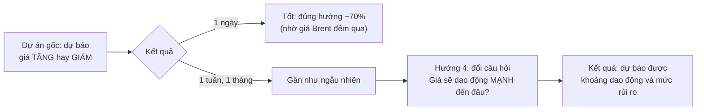
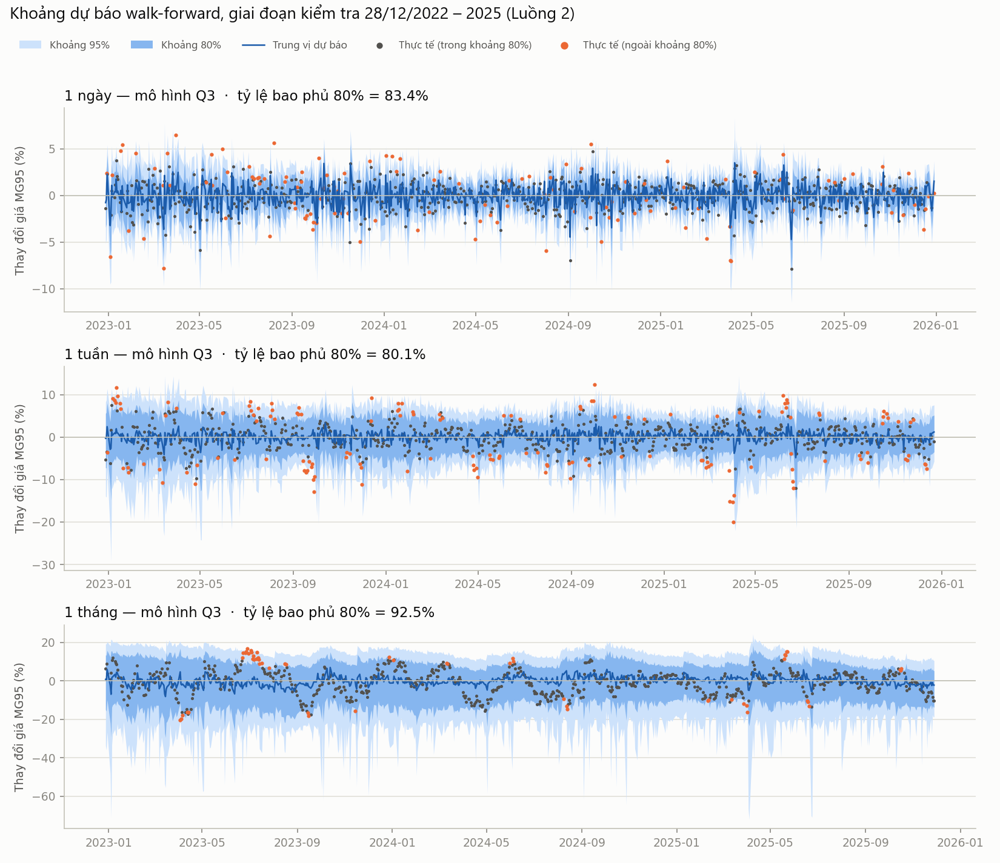
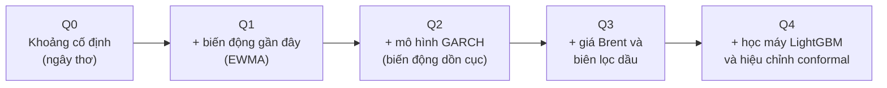
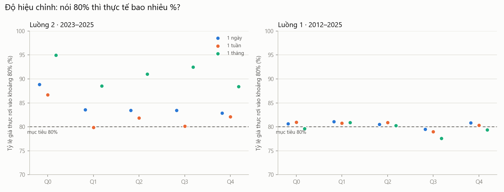
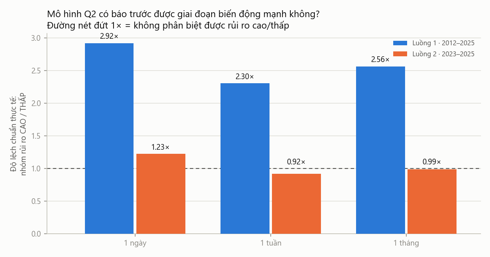

# Dự báo **khoảng dao động và rủi ro** giá xăng Singapore

### Bản trình bày dễ hiểu (Hướng 4, dự án SPAFS V5.2)

*Ngày 08/11/2026 · Dữ liệu: Platts Mogas 95 (MG95) và ICE Brent, 2008–2025 · Mọi con số lấy trực tiếp từ kết quả chạy thật trong `artifacts/risk/`*

> **Một câu tóm tắt:** giá xăng tuần tới hay tháng tới **tăng hay giảm** thì gần như không đoán được. Nhưng giá **dao động mạnh đến đâu** thì đoán được, đủ tin cậy để doanh nghiệp và cơ quan điều hành dùng lập kế hoạch.

---

## 1. Câu chuyện: vì sao có hướng 4?

**Ví dụ dễ hình dung:** dự báo thời tiết không nói chắc *"mai mưa lúc 3 giờ"*, nhưng nói được *"mai 70% khả năng mưa, nhiệt độ 24–31°C"*. Hướng 4 làm điều tương tự với giá xăng.

---

## 2. Mô hình đưa ra cái gì?

Mỗi ngày, với mỗi kỳ hạn (1 ngày, 1 tuần, 1 tháng), mô hình trả lời **3 câu hỏi**:

| Câu hỏi | Ví dụ thật (dự báo phát ra ngày 28/11/2025, kỳ hạn 1 tháng) |
|---|---|
| **Giá có thể thay đổi trong khoảng nào?** | 80% khả năng nằm trong **−10,0% đến +9,2%** |
| **Khả năng giá tăng là bao nhiêu?** | 55%, tức gần như "không biết" |
| **Mức rủi ro hiện tại?** | **THẤP** so với các lần dự báo trước |
| *Thực tế xảy ra* | *Giá giảm 10,4%, sát mép dưới của khoảng* |

> Khoảng 80% nghĩa là **cứ 5 lần thì khoảng 1 lần giá nằm ngoài khoảng**. Thỉnh thoảng trượt là bình thường. Mô hình chỉ sai khi trượt **nhiều hơn hoặc ít hơn** mức đó một cách có hệ thống.

*Dải xanh đậm là khoảng 80%, xanh nhạt là khoảng 95%. Chấm xám là giá thực rơi trong khoảng 80%, chấm cam là rơi ngoài.*

---

## 3. Mô hình được xây dựng như thế nào?

### 3.1 Năm "bậc thang", mỗi bậc thêm đúng một ý tưởng

| Mã | Ý tưởng bằng lời thường |
|---|---|
| **Q0** | "Tương lai dao động giống trung bình quá khứ". Khoảng không đổi theo thời gian. Đây là mốc để so sánh. |
| **Q1** | "Gần đây giá biến động mạnh thì sắp tới cũng sẽ mạnh". Đo biến động các phiên gần nhất. |
| **Q2** | Mô hình kinh tế lượng chuẩn (GARCH) cho hiện tượng "sóng gió kéo dài, yên ả cũng kéo dài". |
| **Q3** | Thêm thông tin thị trường: dầu Brent đêm qua tăng hay giảm, chênh lệch xăng–dầu thô. |
| **Q4** | Dùng học máy (cây quyết định) và một bước "căn chỉnh" để tỷ lệ bao phủ đúng như cam kết. |

**Vì sao xây kiểu bậc thang?** So mỗi bậc với bậc trước là biết **từng ý tưởng có đáng giá không**. Ví dụ, Q3 so với Q2 cho biết thông tin Brent có giúp ích không. Q4 so với Q3 cho biết học máy có thực sự cần không.

### 3.2 Mỗi lựa chọn thiết kế đều xuất phát từ một quan sát

| Quan sát từ dữ liệu hoặc kết quả trước | Quyết định thiết kế |
|---|---|
| Hướng giá tuần/tháng gần như ngẫu nhiên | Đổi sang dự báo khoảng và rủi ro |
| Chạy thử nhanh: biến động quá khứ tương quan 0,30–0,42 với biến động tương lai | Hướng này khả thi, nên làm tiếp |
| Giá xăng có những cú sốc lớn hơn phân phối chuẩn ("đuôi dày") | Dùng phân phối Student-t và phân vị thực nghiệm (FHS), không giả định phân phối chuẩn |
| Brent đêm qua giúp dự báo 1 ngày rất tốt (dự án gốc) | Đưa Brent vào Q3 và Q4 |
| Các dự báo tuần/tháng chồng lấp nhau | Kiểm định trên mẫu không chồng lấp, để không "đếm một cú sốc nhiều lần" |
| Giai đoạn kiểm tra 2023–2025 quá yên ả | Thêm bộ kiểm tra dài 2012–2025, có các khủng hoảng 2014–2015, 2020, 2022 |
| Một reviewer độc lập phát hiện lỗi cập nhật biến động | Sửa lỗi, thêm test, rồi **chạy lại toàn bộ**. Mọi số liệu trong tài liệu này là sau khi sửa. |

### 3.3 Kiểm tra công bằng: "không nhìn trộm tương lai"

- Mô hình chỉ học từ dữ liệu **trước** thời điểm dự báo, rồi tiến dần theo thời gian (walk-forward), giống như dùng thật ngoài đời.
- Chỉ dùng thông tin có trước **08:30 giờ Singapore**.
- Mức rủi ro "cao/thấp" chỉ được so với **các dự báo trước đó**, không so với toàn bộ mẫu.

---

## 4. Kết quả: tốt ở đâu, chưa tốt ở đâu?

### 4.1 Điểm tốt ✅

| # | Điểm tốt | Con số |
|---|---|---|
| 1 | **Nói 80% thì đúng khoảng 80%** (trên 14 năm, ở cả 3 kỳ hạn) | Q1, Q2: bao phủ **80,3–81,1%** |
| 2 | **Báo trước được giai đoạn sóng gió** | Khi mô hình báo "rủi ro cao", giá dao động mạnh **gấp 2,1–3,4 lần** so với lúc báo "rủi ro thấp" |
| 3 | **Dự báo 1 ngày tốt hẳn nhờ Brent** | Q3: sai số phân vị giảm **25%**, khoảng hẹp hơn **17–32%**, xác suất tăng tốt hơn đoán mò **25%** |
| 4 | **Tuần tới: khoảng hiệu chỉnh gần như hoàn hảo** | Q3: bao phủ **80,1%** (2023–2025), tốt nhất trên cả hai bộ dữ liệu |
| 5 | **Rẻ, nhanh, dễ giải thích** | GARCH chạy khoảng 1,5 giây; toàn bộ bộ chính chạy khoảng 2 phút |
| 6 | **Kiểm tra nghiêm ngặt** | 81 test tự động, kiểm định thống kê, lưu dấu vết để tái lập |

### 4.2 Điểm chưa tốt ⚠️

| # | Điểm yếu | Con số | Vì sao |
|---|---|---|---|
| 1 | **Không đoán được hướng ở tuần/tháng** | Xác suất tăng chỉ tốt hơn đoán mò 0–5% | Bản chất thị trường, cần thêm dữ liệu kỳ hạn |
| 2 | **Khoảng 1 tháng quá rộng trên 2023–2025** | Nói 80% nhưng thực tế 88–95% | Mô hình học từ giai đoạn có COVID và năm 2022, nên quá thận trọng khi thị trường yên |
| 3 | **Không phân biệt được rủi ro trên 2023–2025 (tuần/tháng)** | Tỷ số cao/thấp chỉ khoảng 0,9–1,1 lần | Giai đoạn này quá yên, gần như không có gì để phân biệt |
| 4 | **Khi có khủng hoảng, Q3 và Q4 trượt liên tiếp** (kỳ hạn 1 ngày) | Kiểm định Christoffersen bác bỏ (p = 0,007 và 0,001) | Khoảng hẹp theo Brent, nên phản ứng chậm khi có cú sốc lớn |
| 5 | **Học máy (Q4) không thắng** | Kém Q3 ở mọi kỳ hạn; ở kỳ hạn tháng kém 15–22% | Dữ liệu tháng quá ít (35–167 tháng độc lập) cho học máy |
| 6 | **Kết luận ở kỳ hạn tháng còn yếu về thống kê** | p ≈ 0,06–0,11 trên 14 năm | Số tháng độc lập ít |

### 4.3 Tóm lại theo kỳ hạn

| Kỳ hạn | Mô hình nên dùng | Đoán **hướng**? | Đoán **biên độ**? | Báo trước **sóng gió**? |
|---|---|---|---|---|
| **1 ngày** | Q3 (Q2 để cảnh báo khủng hoảng) | ✅ Có | ✅ Tốt nhất | ✅ Có |
| **1 tuần** | Q3 | ❌ Gần như không | ✅ Tốt | ✅ Có (khi thị trường biến động) |
| **1 tháng** | Q2 (GARCH) | ❌ Không | 🟡 Đúng trên 14 năm, quá rộng khi thị trường yên | 🟡 Có trên 14 năm, yếu về thống kê |

---

## 5. So với các nghiên cứu hiện đại thì sao?

> **Lưu ý trung thực:** chưa có nghiên cứu nào dùng đúng chuỗi giá MG95 Singapore cùng giai đoạn này, nên **không so trực tiếp con số được**. Phần dưới so về **cách làm** và **loại kết luận**.

| Nhóm nghiên cứu | Họ thường làm gì | Dự án này hơn ở đâu | Dự án này kém ở đâu |
|---|---|---|---|
| **GARCH cho dầu thô** (Kang và cộng sự 2009; Fan và cộng sự 2008) | Dự báo rủi ro **1 ngày** của **dầu thô** WTI/Brent | Làm cho **xăng thành phẩm** (giá tham chiếu cho Việt Nam), **3 kỳ hạn**, kiểm định chặt hơn | Chưa thử các biến thể GARCH bất đối xứng và GARCH chuyển chế độ |
| **Dùng dữ liệu tần suất cao / biến động hàm ý** (Corsi 2009; Haugom và cộng sự 2014) | Dùng dữ liệu trong ngày hoặc chỉ số OVX | Chỉ cần giá đóng cửa hằng ngày, rẻ và sẵn có | **Thiếu thông tin quý** cho kỳ hạn tháng |
| **Lai học sâu** (GARCH-LSTM, CEEMDAN-GRU, 2018–2024) | Báo cáo học sâu tốt hơn GARCH | Kiểm tra walk-forward nghiêm, có kiểm định thống kê. Kết quả **ngược lại**: học máy không thắng khi dữ liệu ít | Chưa thử mạng nơ-ron cho dự báo phân vị |
| **Mô hình nền tảng** (Chronos, TimesFM, 2024) | Một mô hình lớn dự báo xác suất cho mọi chuỗi | Rẻ, giải thích được, hiệu chỉnh đúng | **Chưa so sánh** với các mô hình này |
| **Conformal thích ứng** (Gibbs và Candès 2021) | Khoảng tự nới hoặc co theo thời gian thực | Đã dùng conformal (Q4) | Bản conformal hiện tại là **tĩnh**, chưa thích ứng, nên khoảng quá rộng khi thị trường yên |
| **Dự báo giá xăng** (Baumeister, Kilian và Lee 2017) | Dự báo **điểm** giá bán lẻ Mỹ theo tháng | Dự báo **khoảng và rủi ro**, giá bán buôn châu Á, từ 1 ngày đến 1 tháng | Chưa kết hợp nhiều mô hình (forecast combination) như họ |

**Điểm đáng chú ý:** nhiều bài báo gần đây khẳng định học sâu luôn thắng. Kết quả của dự án, có kiểm định thống kê, cho thấy **khi dữ liệu ít, mô hình đơn giản (GARCH, hồi quy phân vị) vẫn tốt nhất**. Điều này khớp với kết luận kinh điển của Hansen và Lunde (2005): *"khó có mô hình nào vượt hẳn GARCH(1,1)"*.

---

## 6. Đóng góp của đề tài

### 6.1 Đã đạt được

| # | Đóng góp | Ý nghĩa |
|---|---|---|
| 1 | **Đối tượng mới**: dự báo khoảng và rủi ro cho giá xăng MG95 Singapore ở 3 kỳ hạn | Phần lớn nghiên cứu làm về dầu thô hoặc giá bán lẻ Mỹ, ít nghiên cứu về giá xăng tham chiếu cho Việt Nam |
| 2 | **Bản đồ "thông tin còn giá trị đến đâu"** | Brent giúp thu hẹp khoảng 19% ở 1 ngày, 2,5% ở 1 tuần, và không còn ý nghĩa thống kê ở 1 tháng |
| 3 | **Quy trình đánh giá chặt chẽ, tái lập được** | Không nhìn trộm tương lai, kiểm định trên mẫu không chồng lấp, so sánh có ý nghĩa thống kê |
| 4 | **Phản biện xu hướng "học sâu luôn thắng"** | Có bằng chứng định lượng trong bối cảnh dữ liệu ít |
| 5 | **Cảnh báo về phương pháp** | Nếu chỉ đánh giá trên 2023–2025, ta sẽ kết luận sai rằng "không dự báo được rủi ro" |
| 6 | **Sản phẩm dùng được** | Khoảng 95% của kỳ hạn tháng làm kịch bản xấu khi lập ngân sách; nhãn "rủi ro cao" làm tín hiệu cảnh báo sớm |

### 6.2 Sẽ đóng góp thêm (hướng phát triển)

| Hướng | Giải quyết điểm yếu nào |
|---|---|
| **Conformal thích ứng (ACI)**: khoảng tự co hoặc giãn theo thời gian thực | Khoảng quá rộng khi thị trường yên, và trượt liên tiếp khi có khủng hoảng |
| **Lai Q3 với biến động GARCH** | Q3 phản ứng chậm khi có cú sốc |
| **Thêm dữ liệu kỳ hạn và biến động hàm ý** (hướng 1) | Kỳ hạn tháng còn yếu |
| **Thêm "kịch bản xấu nhất trung bình"** (Expected Shortfall) | Hiện chỉ biết ngưỡng, chưa biết vượt ngưỡng thì mất bao nhiêu |
| **So sánh với mô hình nền tảng** (Chronos, TimesFM) | Đóng khoảng trống so sánh với các mô hình mới nhất |
| **Quy đổi sang giá cơ sở Việt Nam và mô phỏng Quỹ bình ổn** | Chứng minh giá trị kinh tế thực tế |

---

## 7. Nếu giảng viên hỏi…

| Câu hỏi | Trả lời ngắn |
|---|---|
| *"Không đoán được hướng thì có ích gì?"* | Doanh nghiệp cần biết **kịch bản xấu** để lập ngân sách. Cơ quan điều hành cần biết **khi nào sắp có sóng gió** để chuẩn bị Quỹ bình ổn. Cả hai không cần biết hướng. |
| *"Sao học máy lại thua?"* | Kỳ hạn tháng chỉ có 35–167 điểm độc lập. Học máy cần nhiều dữ liệu, nên dễ học nhầm nhiễu. GARCH có cấu trúc kinh tế sẵn, nên ổn định hơn. |
| *"Sao 2023–2025 kết quả kém hơn?"* | Giai đoạn đó thị trường yên ả, không có sóng gió để phân biệt. Vì vậy cần thêm bộ kiểm tra 14 năm có khủng hoảng. |
| *"Làm sao biết không gian lận dữ liệu?"* | Mô hình chỉ học từ quá khứ, có test tự động kiểm tra điều này, và một reviewer độc lập đã rà soát code. |

> **Thông điệp cuối:** *"Với dữ liệu hiện có, giá xăng ngày mai đoán được hướng. Tuần và tháng tới thì không đoán được hướng, nhưng **đoán được mức rủi ro**: khoảng dự báo đúng như cam kết, và trên 14 năm phân biệt được thời kỳ sóng gió, khi giá dao động mạnh gấp 2–3 lần thời kỳ yên ả."*

---

*Bản đặc tả kỹ thuật chi tiết (pipeline, công thức metric, bảng số đầy đủ, tài liệu tham khảo): xem `02_DAC_TA_KY_THUAT_VA_KET_QUA.md` trong cùng thư mục.*
