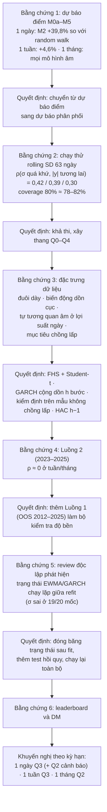
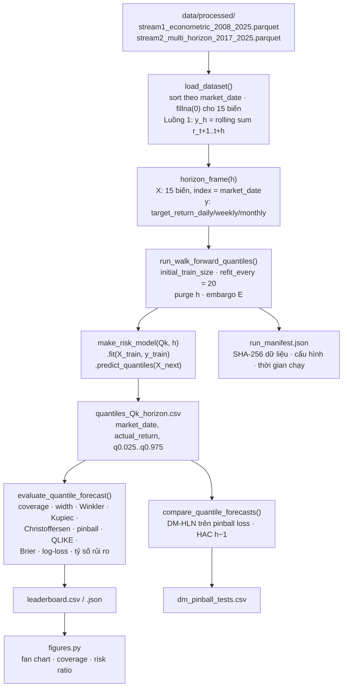
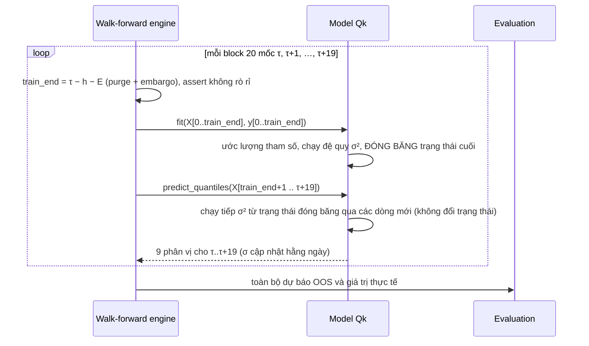

# Đặc tả kỹ thuật: Hướng 4, dự báo khoảng và rủi ro giá MG95 Singapore

### SPAFS V5.2 · Pipeline, mô hình, metric, kết quả, so sánh tài liệu và đóng góp

*Ngày 08/11/2026 · Nguồn số liệu: `artifacts/risk/stream{1,2}/leaderboard.csv`, `dm_pinball_tests.csv`, `run_manifest.json` (chạy 07/11/2026) · Code: `src/models/risk/`, `src/models/evaluation/interval_tests.py`, `src/models/runner_risk_multi_horizon.py`*

---

## Mục lục

1. [Phát biểu bài toán](#1-phát-biểu-bài-toán)
2. [Mô hình được xây dựng dựa trên kết quả như thế nào](#2-mô-hình-được-xây-dựng-dựa-trên-kết-quả-như-thế-nào)
3. [Pipeline workflow](#3-pipeline-workflow)
4. [Dữ liệu và giao thức walk-forward](#4-dữ-liệu-và-giao-thức-walk-forward)
5. [Đặc tả năm mô hình Q0–Q4](#5-đặc-tả-năm-mô-hình-q0q4)
6. [Metric đánh giá: định nghĩa và công thức](#6-metric-đánh-giá-định-nghĩa-và-công-thức)
7. [Kết quả đầy đủ](#7-kết-quả-đầy-đủ)
8. [Điểm mạnh và điểm yếu](#8-điểm-mạnh-và-điểm-yếu)
9. [So sánh với tài liệu hiện đại](#9-so-sánh-với-tài-liệu-hiện-đại)
10. [Đóng góp](#10-đóng-góp)
11. [Hạn chế và hướng phát triển](#11-hạn-chế-và-hướng-phát-triển)
12. [Kiểm soát chất lượng và tái lập](#12-kiểm-soát-chất-lượng-và-tái-lập)
13. [Tài liệu tham khảo](#13-tài-liệu-tham-khảo)

---

## 1. Phát biểu bài toán

### 1.1 Biến mục tiêu

Lợi suất log cộng dồn h phiên của giá Platts Mogas 95 (MG95), đơn vị %:

$$
y_{t,h} = \sum_{k=1}^{h} r_{t+k}, \qquad r_t = 100 \cdot \ln\frac{P_t}{P_{t-1}}, \qquad h \in \{1, 5, 21\}
$$

### 1.2 Đầu ra

Tại mỗi mốc t, mỗi mô hình phát ra vector 9 phân vị có điều kiện, không chéo nhau:

$$
\hat q_{t,h}(\tau), \quad \tau \in \mathcal{T} = \{0.025, 0.05, 0.10, 0.25, 0.50, 0.75, 0.90, 0.95, 0.975\}
$$

Từ đó suy ra ba sản phẩm:

| Sản phẩm | Định nghĩa |
|---|---|
| Khoảng 80% / 95% | `[q0.10, q0.90]`, `[q0.025, q0.975]` |
| Xác suất tăng | `P(y > 0) = 1 − F̂(0)`, với `F̂` nội suy tuyến tính qua 9 phân vị; ở hai đuôi gán 1,25% / 98,75% |
| Nhãn rủi ro | Phân vị của độ rộng khoảng 80% tại t, so với **các dự báo trước t** (expanding rank, tối thiểu 60 dự báo): dưới 25% là THẤP, trên 75% là CAO |

### 1.3 Câu hỏi nghiên cứu

| RQ | Nội dung | Metric chính |
|---|---|---|
| RQ4a | Khoảng có hiệu chỉnh đúng không? | Coverage, Kupiec, Christoffersen |
| RQ4b | Khoảng theo mô hình có tốt hơn khoảng cố định không? | Pinball, DM so với Q0, độ rộng |
| RQ4c | Có phân biệt được giai đoạn rủi ro cao và thấp không? | Tỷ số rủi ro cao/thấp, Spearman, QLIKE |
| RQ4d | Brent và biên lọc dầu có thêm thông tin không? | DM Q3 so với Q2 |

---

## 2. Mô hình được xây dựng dựa trên kết quả như thế nào

Thiết kế hướng 4 **không chọn trước**, mà đi theo chuỗi quyết định dựa trên bằng chứng:



### 2.1 Thiết kế thang (ablation ladder)

Mỗi bậc thêm **đúng một thành phần**, nên mỗi cặp DM trả lời đúng một câu hỏi:

| Cặp DM | Thành phần được kiểm định | Trả lời cho |
|---|---|---|
| Q1 so với Q0 | Biến động có điều kiện (EWMA) | RQ4b |
| Q2 so với Q1 | Hồi quy về trung bình dài hạn của GARCH, đuôi Student-t | Cấu trúc biến động |
| Q3 so với Q2 | Biến ngoại sinh (Brent, spread, cờ sốc), dịch chuyển vị trí và co giãn | RQ4d |
| Q4 so với Q3 | Phi tuyến (LightGBM) và hiệu chỉnh conformal | Giá trị của học máy |
| Qk so với Q0 | Tổng giá trị so với baseline ngây thơ | RQ4b |

### 2.2 Ánh xạ "đặc trưng dữ liệu → lựa chọn kỹ thuật"

| Đặc trưng | Lựa chọn | Hiện thực trong code |
|---|---|---|
| Đuôi dày | GARCH Student-t; FHS dùng phân vị thực nghiệm của `z = y/σ` | `GarchFHS`, `_ScaleFHS` |
| Biến động dồn cục | EWMA λ = 0,94; GARCH(1,1) | `_EwmaVariance`, `GarchFHS._recurse` |
| Phương sai h bước khác h·σ² (tự tương quan âm) | FHS chuẩn hoá theo σ_h của chính mô hình, nên tự hấp thụ phần lệch | `_ScaleFHS.fit` |
| Brent đêm qua dẫn dắt MG95 hôm sau | Q3 có cả `b` và `abs(b)`: vừa dịch vị trí vừa co giãn | `LinearQuantileRegression._design` |
| Phân vị có thể chéo nhau | Sắp xếp lại (Chernozhukov và cộng sự 2010) | `_sorted_frame` |
| Mục tiêu chồng lấp | Purge = h; embargo; split conformal cách h phiên; kiểm định với bước nhảy h | `walk_forward.py`, `ConformalLightGBMQuantiles.fit`, `interval_tests.py` |

---

## 3. Pipeline workflow

### 3.1 Sơ đồ tổng thể



### 3.2 Vòng lặp walk-forward (một mô hình, một kỳ hạn)



### 3.3 Lệnh chạy

Môi trường chuẩn của dự án: `D:\Test\env_prj\Scripts\python.exe` (Python 3.11, đã cài `arch` 8.0.0, `lightgbm` 4.6.0, `statsmodels` 0.15.0). Có thể chạy từng bước hoặc chạy qua bộ điều phối tổng `run_pipeline.py`:

| Bước | Lệnh | Thời gian |
|---|---|---|
| Chạy toàn bộ Luồng 3 (tự động) | `python run_pipeline.py --flow risk` | khoảng 12 phút |
| 1. Kiểm thử toàn bộ (81 test) | `python run_pipeline.py --flow test` (hoặc `python -m pytest -q tests`) | khoảng 45–55 giây |
| 2. Chạy Luồng 2 (bộ chính) | `python src/models/runner_risk_multi_horizon.py --dataset stream2` | khoảng 2 phút |
| 3. Chạy Luồng 1 (kiểm tra độ bền) | `python src/models/runner_risk_multi_horizon.py --dataset stream1` | khoảng 10 phút |
| 4. Vẽ hình | `python src/models/risk/figures.py` | khoảng 10 giây |

> [!NOTE]
> Khi kiểm tra lại ngày 08/11/2026 bằng `D:\Test\env_prj\Scripts\python.exe -m pytest -q tests`, toàn bộ **81/81 test đều đạt**. Nếu chạy bằng Python hệ thống mặc định chưa cài `arch`, cần chạy `pip install arch` trước.

### 3.4 Thời gian chạy theo mô hình (Luồng 2, giây)

| | Q0 | Q1 | Q2 | Q3 | Q4 |
|---|---|---|---|---|---|
| 1 ngày | 0,1 | 0,2 | 1,8 | 8,0 | 33,0 |
| 1 tuần | 0,1 | 0,2 | 1,5 | 8,1 | 37,1 |
| 1 tháng | 0,1 | 0,2 | 1,5 | 9,2 | 36,6 |

---

## 4. Dữ liệu và giao thức walk-forward

| | Luồng 2 (bộ chính) | Luồng 1 (kiểm tra độ bền) |
|---|---|---|
| File | `stream2_multi_horizon_2017_2025.parquet` | `stream1_econometric_2008_2025.parquet` |
| Dữ liệu học ban đầu | 2017 → 27/12/2022 (1.500 dòng) | 05/2008 → 12/2011 |
| OOS | 28/12/2022 → 29/12/2025 | 03/01/2012 → 29/12/2025 |
| Số mốc OOS (ngày / tuần / tháng) | 754 / 750 / 734 | 3.507 / 3.503 / 3.487 |
| Số điểm độc lập (bước nhảy h) | 754 / 150 / 35 | 3.507 / 701 / 167 |
| Khủng hoảng trong OOS | Không đáng kể | 2014–2015, 2020, 2022 |
| SHA-256 dữ liệu (Luồng 2) | `cef0b3dd…c38c` | trong `run_manifest.json` |

**Tham số giao thức:**

| Tham số | Giá trị |
|---|---|
| Cửa sổ | Mở rộng (expanding) |
| Refit | Mỗi 20 phiên; σ² vẫn cập nhật hằng ngày giữa hai lần refit |
| Purge | h (1 / 5 / 21) |
| Embargo E | 0 / 2 / 5 |
| Ràng buộc | `train_end + h + E ≤ τ` (có assert và test) |
| Point-in-time | Mọi biến đều biết trước 08:30 SGT ngày t+1 |
| Tần suất tăng lịch sử (climatology) | Tỷ lệ `y > 0` trong dữ liệu học tại mốc OOS đầu tiên (ngày / tuần / tháng — Luồng 2: 0,525 / 0,544 / 0,576; Luồng 1: 0,542 / 0,545 / 0,581) |

**Biến đầu vào (15 biến dùng chung với M5):** `mg95_return_pct`, `mg95_return_lag1..3`, `brent_return_pct_aligned`, `brent_return_lag1..3`, `vol_mg95_30d`, `economic_shock_flag`, `spread_mg95_mg92`, `spread_mg95_do005`, `spread_mg95_brent`, `spread_mg95_brent_lag1`, `octane_spread_nonpositive_flag`.

---

## 5. Đặc tả năm mô hình Q0–Q4

Interface chung (`src/models/risk/quantile_models.py`):

```python
model = make_risk_model(model_id, horizon)   # "Q0".."Q4", h ≥ 1
model.fit(X, y)                              # X chứa mg95_return_pct, y = y_{t,h}
Q = model.predict_quantiles(X_next)          # DataFrame, cột = LEVELS, đã sắp xếp
```

### 5.1 Khung FHS dùng chung (Q0, Q1, Q2)

Với phương sai h bước ex-ante của mô hình, ký hiệu σ²_{h,t}:

$$
z_t = \frac{y_{t,h}}{\sigma_{h,t}}, \qquad \hat q_{t,h}(\tau) = \sigma_{h,t}\cdot \hat Q_z(\tau)
$$

Trong đó `Q̂_z` là phân vị thực nghiệm của z trên tập học, bỏ `min(63, n/4)` dòng đầu để làm burn-in.

| Mô hình | σ²_{h,t} |
|---|---|
| **Q0**, mô phỏng lịch sử | `1`, tức là phân vị thực nghiệm của y |
| **Q1**, EWMA + FHS | `h · s²_t`, với `s²_t = λ s²_{t−1} + (1−λ) r_t²`, λ = 0,94, khởi tạo bằng phương sai 63 dòng đầu |
| **Q2**, GARCH(1,1)-t + FHS | `Σ_{k=0}^{h−1} [v̄ + φ^k (σ²_{t+1\|t} − v̄)]`, với `σ²_{t+1\|t} = ω + α ε_t² + β σ²_{t\|t−1}`, `φ = min(α+β, 0,9999)`, `v̄ = ω/(1−φ)` |

**Q2:** ước lượng bằng `arch_model(mean="Constant", vol="GARCH", p=1, q=1, dist="t")`. Nếu ước lượng lỗi, dùng tham số dự phòng `(μ, ω, α, β) = (0, 0, 0,06, 0,94)` (gần với EWMA) và ghi `converged = False`.

### 5.2 Q3: hồi quy phân vị tuyến tính

Mỗi mức τ có một hồi quy `QuantReg` (statsmodels, `max_iter = 5000`):

$$
\hat q_{t,h}(\tau) = \beta_0^\tau + \beta_1^\tau s_{h,t} + \beta_2^\tau b_t + \beta_3^\tau |b_t| + \beta_4^\tau r_t + \beta_5^\tau \text{spread}_{t-1} + \beta_6^\tau \text{shock}_t
$$

Trong đó `s_{h,t} = sqrt(h · s²_t)` là biến động EWMA, và `b_t` là lợi suất Brent đã căn theo giờ. `b` dịch **vị trí** khoảng; `s` và `abs(b)` co giãn **độ rộng**.

### 5.3 Q4: LightGBM phân vị + CQR

| Thành phần | Đặc tả |
|---|---|
| Đầu vào | 15 biến + `s_{h,t}` |
| Học | 9 mô hình `LGBMRegressor(objective="quantile", alpha=τ)`; `n_estimators = 200`, `learning_rate = 0,03`, `num_leaves = 15`, `min_child_samples = 50`, `subsample = colsample = 0,8`, `seed = 42` |
| Tách dữ liệu | 20% cuối tập học làm tập hiệu chỉnh (tối thiểu 50 dòng), cách tập học thật h phiên |
| Điểm conformal | Với mỗi cặp (τ_lo, τ_hi): `E_i = max(q_lo − y_i, y_i − q_hi)` |
| Hiệu chỉnh | `Q̂_E` = thống kê thứ tự ở mức `⌈(n+1)(1−α)⌉/n` (`method="higher"`); khi dự báo: `q_lo − Q̂_E`, `q_hi + Q̂_E` |

---

## 6. Metric đánh giá: định nghĩa và công thức

Ký hiệu: y là giá trị thực, `[L, U]` là khoảng mức 1−α, `1{·}` là hàm chỉ thị, N là số mốc OOS.

| Metric | Công thức | Tốt khi | RQ |
|---|---|---|---|
| **Coverage** | `1 − (1/N) Σ 1{y < L hoặc y > U}` | ≈ 0,80 / 0,95 | 4a |
| **Độ rộng** | `(1/N) Σ (U − L)` | Hẹp, với điều kiện coverage đúng | 4b |
| **Winkler** | `(U−L) + (2/α)·[(L−y)·1{y<L} + (y−U)·1{y>U}]` | Nhỏ | 4b |
| **Pinball** (metric xếp hạng chính) | `(1/N)(1/9) Σ_t Σ_τ max(τ·u, (τ−1)·u)`, với `u = y − q̂(τ)`; xấp xỉ CRPS/2 | Nhỏ | 4b, 4d |
| **Kupiec POF** | `LR = −2[ln L(α) − ln L(π̂)] ~ χ²(1)`, π̂ là tỷ lệ trượt | p > 0,05 | 4a |
| **Christoffersen độc lập** | So Markov bậc 1 (`π01 ≠ π11`) với mô hình độc lập; `LR ~ χ²(1)` | p > 0,05 | 4a |
| **QLIKE** | `(1/N) Σ [ln σ̂² + (y − q̂0.5)²/σ̂²]`, với `σ̂ = (q̂0.9 − q̂0.1)/(2·1,2816)` | Nhỏ | 4c |
| **Brier / log-loss** | `(1/N) Σ (p̂_up − 1{y>0})²` | Nhỏ | Hướng |
| **Brier skill** | `100·(1 − Brier/Brier_clim)`, so với tần suất tăng lịch sử | > 0 | Hướng |
| **Spearman** | Tương quan hạng giữa độ rộng 80% và `abs(y)` | > 0 | 4c |
| **Tỷ số rủi ro cao/thấp** | `SD(y \| rank ≥ 0,75) / SD(y \| rank ≤ 0,25)`, rank là expanding rank của độ rộng 80% (chỉ so với các dự báo trước đó) | > 1 | 4c |
| **DM-HLN** | `d_t = pinball_A,t − pinball_B,t`; phương sai HAC với `h − 1` lag; hiệu chỉnh mẫu nhỏ HLN; kiểm định một phía "A tốt hơn B" | p < 0,05 | So sánh |

**Quy ước cho mục tiêu chồng lấp:**
- Coverage, độ rộng, pinball, QLIKE, Brier dùng **mọi** mốc.
- Kupiec và Christoffersen dùng mẫu con `miss[::h]`, vì các lần trượt liên tiếp của mục tiêu chồng lấp thực chất là cùng một cú sốc.
- DM dùng HAC h−1. Hàm `dm_test_losses` dùng chung với DM cho dự báo điểm.

---

## 7. Kết quả đầy đủ

*Chữ **đậm** = pinball thấp nhất trong kỳ hạn. Kup = p Kupiec, Chr = p Christoffersen. Tỷ số = SD thực tế nhóm rủi ro cao / nhóm rủi ro thấp.*

### 7.1 Luồng 2 (OOS 28/12/2022 → 29/12/2025)

| Kỳ hạn | Mô hình | Cov80 | Rộng80 | Kup80 | Chr80 | Cov95 | Kup95 | Pinball | QLIKE | Brier skill | ρ Spearman | Tỷ số |
|---|---|---|---|---|---|---|---|---|---|---|---|---|
| 1N | Q0 | 0,889 | 5,29 | <0,001 | 0,201 | 0,985 | <0,001 | 0,351 | 2,207 | −0,1% | 0,16 | 1,19 |
| 1N | Q1 | 0,836 | 4,37 | 0,012 | 0,911 | 0,954 | 0,648 | 0,337 | 2,177 | 0,0% | 0,18 | 1,25 |
| 1N | Q2 | 0,834 | 4,49 | 0,016 | 0,948 | 0,952 | 0,775 | 0,339 | 2,154 | −0,1% | 0,15 | 1,23 |
| 1N | **Q3** | 0,834 | **3,60** | 0,016 | 0,877 | 0,947 | 0,703 | **0,263** | **1,616** | **+25,3%** | 0,24 | **1,75** |
| 1N | Q4 | 0,829 | 3,75 | 0,043 | 0,282 | 0,973 | 0,001 | 0,277 | 1,725 | +21,0% | 0,17 | 1,56 |
| 1T | Q0 | 0,867 | 11,81 | 0,140 | 0,148 | 0,988 | 0,056 | 0,789 | 3,847 | +0,1% | 0,09 | — |
| 1T | Q1 | 0,799 | 10,11 | 0,839 | 0,822 | 0,948 | 0,853 | 0,773 | 3,930 | +0,1% | 0,12 | 0,93 |
| 1T | Q2 | 0,819 | 10,44 | 0,406 | 0,118 | 0,953 | 0,585 | 0,771 | 3,873 | 0,0% | 0,11 | 0,92 |
| 1T | **Q3** | 0,801 | 10,15 | 0,681 | 0,364 | 0,956 | 0,320 | **0,745** | **3,809** | +4,1% | 0,11 | 1,09 |
| 1T | Q4 | 0,821 | 10,78 | 0,090 | 0,633 | 0,949 | 0,853 | 0,802 | 4,149 | −3,1% | 0,08 | 1,06 |
| 1Th | Q0 | 0,950 | 26,27 | 0,002 | 0,806 | 1,000 | 0,058 | 1,462 | 5,123 | +0,5% | 0,17 | — |
| 1Th | Q1 | 0,886 | 23,01 | 0,063 | 0,200 | 0,997 | 0,058 | 1,398 | 5,076 | +0,5% | −0,06 | 0,95 |
| 1Th | Q2 | 0,910 | 23,46 | 0,002 | 0,806 | 1,000 | 0,058 | 1,400 | 5,034 | +0,5% | 0,01 | 0,99 |
| 1Th | **Q3** | 0,925 | 23,51 | 0,063 | 0,446 | 0,996 | 0,528 | **1,375** | **4,977** | +2,6% | 0,07 | 0,99 |
| 1Th | Q4 | 0,884 | 29,82 | 0,176 | 0,036 | 0,977 | 0,058 | 1,684 | 5,598 | −0,1% | −0,01 | 0,91 |

### 7.2 Luồng 1 (OOS 03/01/2012 → 29/12/2025)

| Kỳ hạn | Mô hình | Cov80 | Rộng80 | Kup80 | Chr80 | Cov95 | Kup95 | Chr95 | Pinball | QLIKE | Brier skill | ρ | Tỷ số |
|---|---|---|---|---|---|---|---|---|---|---|---|---|---|
| 1N | Q0 | 0,807 | 4,78 | 0,321 | <0,001 | 0,950 | 0,960 | <0,001 | 0,432 | 3,027 | +0,4% | −0,03 | 1,47 |
| 1N | Q1 | 0,811 | 5,20 | 0,103 | 0,524 | 0,944 | 0,116 | 0,512 | 0,396 | 2,301 | +0,4% | 0,35 | 2,93 |
| 1N | Q2 | 0,805 | 5,05 | 0,436 | 0,818 | 0,944 | 0,116 | 0,512 | 0,394 | 2,293 | +0,4% | 0,34 | 2,92 |
| 1N | **Q3** | 0,795 | **3,96** | 0,459 | **0,007** | 0,939 | **0,005** | **<0,001** | **0,318** | **1,856** | **+25,2%** | 0,38 | **3,43** |
| 1N | Q4 | 0,808 | 4,05 | 0,212 | **0,001** | 0,956 | 0,108 | **<0,001** | 0,332 | 1,948 | +23,2% | 0,36 | 3,04 |
| 1T | Q0 | 0,810 | 11,21 | 0,556 | <0,001 | 0,956 | 0,474 | <0,001 | 0,963 | 4,478 | +0,2% | −0,05 | 0,89 |
| 1T | Q1 | 0,808 | 12,45 | 0,865 | 0,141 | 0,944 | 0,401 | 0,631 | 0,906 | 4,005 | +0,2% | 0,28 | **2,33** |
| 1T | Q2 | 0,809 | 12,11 | 0,792 | 0,272 | 0,948 | 0,614 | 0,963 | 0,897 | 3,984 | +0,1% | 0,28 | 2,30 |
| 1T | **Q3** | 0,790 | 11,25 | 0,359 | 0,678 | 0,942 | 0,242 | 0,719 | **0,875** | **3,923** | +5,1% | 0,29 | 2,25 |
| 1T | Q4 | 0,804 | 11,39 | 0,940 | 0,545 | 0,949 | 0,738 | 0,170 | 0,899 | 4,033 | +2,6% | 0,24 | 2,06 |
| 1Th | Q0 | 0,796 | 23,56 | 0,758 | 0,458 | 0,961 | 0,622 | 0,001 | 2,245 | 6,504 | +0,4% | −0,06 | 1,08 |
| 1Th | Q1 | 0,809 | 28,04 | 0,492 | 0,639 | 0,951 | 0,900 | 0,368 | 2,126 | 5,918 | +0,3% | 0,24 | 2,87 |
| 1Th | **Q2** | 0,803 | 26,66 | **0,938** | **0,858** | 0,945 | 0,820 | 0,310 | 2,104 | **5,917** | +0,3% | 0,23 | 2,56 |
| 1Th | Q3 | 0,776 | 24,24 | 0,288 | 0,434 | 0,923 | 0,223 | 0,171 | **2,069** | 5,971 | +4,6% | 0,24 | **3,03** |
| 1Th | Q4 | 0,794 | 27,73 | 0,639 | 0,274 | 0,938 | 0,900 | 0,043 | 2,294 | 6,439 | −1,9% | 0,13 | 2,13 |

Ví dụ SD thực tế theo nhóm rủi ro, Q2 kỳ hạn tháng trên Luồng 1: nhóm cao **17,4%**, nhóm thấp **6,8%**.

### 7.3 Kiểm định Diebold–Mariano trên pinball loss

*Giá trị là mức cải thiện pinball của mô hình ứng viên so với mốc (%), p một phía. ✅ = ứng viên tốt hơn có ý nghĩa ở mức 5%.*

| Cặp | L2 · 1N | L2 · 1T | L2 · 1Th | L1 · 1N | L1 · 1T | L1 · 1Th |
|---|---|---|---|---|---|---|
| Q1 so với Q0 | +3,8% (<0,001) ✅ | +2,0% (0,089) | +4,4% (0,026) ✅ | +8,3% (<0,001) ✅ | +5,9% (0,003) ✅ | +5,3% (0,112) |
| Q2 so với Q0 | +3,4% (<0,001) ✅ | +2,3% (0,043) ✅ | +4,3% (<0,001) ✅ | +8,6% (<0,001) ✅ | +6,8% (<0,001) ✅ | +6,3% (0,072) |
| Q3 so với Q0 | +25,1% (<0,001) ✅ | +5,5% (<0,001) ✅ | +5,9% (0,059) | +26,3% (<0,001) ✅ | +9,1% (<0,001) ✅ | +7,8% (0,061) |
| Q4 so với Q0 | +21,0% (<0,001) ✅ | −1,7% (0,81) | −15,2% (0,997) | +23,1% (<0,001) ✅ | +6,6% (<0,001) ✅ | −2,2% (0,70) |
| Q2 so với Q1 | −0,4% (0,90) | +0,3% (0,26) | −0,1% (0,53) | +0,4% (<0,001) ✅ | +0,9% (<0,001) ✅ | +1,0% (0,056) |
| **Q3 so với Q2** (RQ4d) | **+22,4% (<0,001) ✅** | **+3,3% (0,002) ✅** | +1,7% (0,32) | **+19,3% (<0,001) ✅** | **+2,5% (0,004) ✅** | +1,7% (0,18) |
| Q4 so với Q2 | +18,2% (<0,001) ✅ | −4,0% (0,98) | −20,3% (>0,99) | +15,8% (<0,001) ✅ | −0,2% (0,55) | −9,0% (>0,99) |
| Q4 so với Q3 | −5,5% (>0,99) | −7,6% (>0,99) | −22,4% (>0,99) | −4,3% (>0,99) | −2,7% (0,97) | −10,9% (>0,99) |

*L2 = Luồng 2, L1 = Luồng 1. HAC lag = 0 / 4 / 20.*

### 7.4 Trả lời câu hỏi nghiên cứu

| RQ | Kết luận | Bằng chứng then chốt |
|---|---|---|
| 4a | **Có** trên Luồng 1; trên Luồng 2 thì khoảng **thận trọng quá mức** | L1: Q1/Q2 có Cov80 từ 0,803 đến 0,811 ở cả 3 kỳ hạn, Kupiec p ≥ 0,10, Christoffersen p ≥ 0,14. L2 kỳ hạn tháng: Cov80 từ 0,88 đến 0,95 |
| 4b | **Có** | Q2 tốt hơn Q0 có ý nghĩa ở 5/6 trường hợp; Q3 tốt hơn Q0 ở 4/6 trường hợp (2 trường hợp tháng có p ≈ 0,06) |
| 4c | **Có trên L1** (tỷ số 2,1–3,4), **không có trên L2 ở tuần/tháng** (0,9–1,1) | ρ Spearman trên L1 là 0,23–0,38, trên L2 ở kỳ hạn tháng là khoảng 0 |
| 4d | **Có ở 1N, nhỏ ở 1T, không rõ ở 1Th** | Q3 so với Q2: +19–22% / +2,5–3,3% / +1,7% (không có ý nghĩa) |

---

## 8. Điểm mạnh và điểm yếu

### 8.1 Điểm mạnh

| # | Điểm mạnh | Bằng chứng |
|---|---|---|
| S1 | Hiệu chỉnh đúng trên dài hạn ở cả 3 kỳ hạn | L1: Q2 có Cov80 = 0,805 / 0,809 / 0,803; Kupiec p = 0,44 / 0,79 / 0,94 |
| S2 | Không trượt dồn cục với mô hình biến động | L1: Q2 có Christoffersen p (80%) = 0,82 / 0,27 / 0,86; Q0 bị bác bỏ ở ngày và tuần (p < 0,001) |
| S3 | Phân biệt rủi ro mạnh khi thị trường có biến động | L1: tỷ số 2,1–3,4 (Q1–Q4) so với 0,9–1,5 (Q0) |
| S4 | Kỳ hạn 1 ngày: sắc nét và có thông tin về hướng | Q3: pinball −25 đến −26% so với Q0; độ rộng −17% (L1) đến −32% (L2); Brier skill +25% |
| S5 | Kỳ hạn tuần ổn định trên cả hai luồng | Q3 có pinball tốt nhất ở cả L1 và L2; Cov80 0,790–0,801 |
| S6 | Giao thức chặt chẽ | Purge/embargo có assert; kiểm định trên mẫu không chồng lấp; DM-HLN dùng HAC; nhãn rủi ro chỉ dùng dữ liệu quá khứ |
| S7 | Rẻ, giải thích được | Q2 chạy dưới 2 giây cho mỗi kỳ hạn; tham số GARCH có ý nghĩa kinh tế |
| S8 | Tái lập được | Manifest lưu SHA-256; seed cố định; 81 test; review độc lập |

### 8.2 Điểm yếu

| # | Điểm yếu | Bằng chứng | Nguyên nhân | Hướng khắc phục |
|---|---|---|---|---|
| W1 | Không dự báo được hướng ở tuần/tháng | Brier skill 0–5% | Gần với hiệu quả thị trường, thiếu dữ liệu kỳ hạn | Hướng 1 (swap/futures) |
| W2 | Khoảng quá rộng trên L2 (đặc biệt kỳ hạn tháng) | Cov80 0,88–0,95; Kupiec p = 0,002 (Q0, Q2) | FHS dùng phân vị của z trên **toàn bộ** lịch sử học, gồm cả COVID và 2022 | FHS có trọng số giảm dần; ACI |
| W3 | Không phân biệt được rủi ro trên L2 ở tuần/tháng | Tỷ số 0,9–1,1; ρ ≈ 0 | Giai đoạn yên ả, phương sai của biến động thấp | Báo cáo song song L1; thêm biến động hàm ý |
| W4 | Q3/Q4 trượt dồn cục trong khủng hoảng (kỳ hạn ngày) | L1: Chr80 p = 0,007 / 0,001; Q3 có Cov95 = 0,939 (Kupiec p = 0,005) | Khoảng hẹp theo Brent, thành phần co giãn (EWMA) phản ứng chậm | Thêm σ GARCH vào Q3; ACI; kết hợp Q2 làm cảnh báo |
| W5 | Q4 (ML + CQR) không thắng | Kém Q3 ở mọi ô (−2,7% đến −22,4%) | Mẫu độc lập nhỏ; split CQR mất 20% dữ liệu; tính hoán đổi (exchangeability) bị vi phạm | Conformal thích ứng; điều chuẩn mạnh hơn; QRA |
| W6 | Sức mạnh kiểm định ở kỳ hạn tháng thấp | L2: 35 điểm độc lập; L1: 167; DM p ≈ 0,06–0,11 | Độ dài mẫu | Coi kết luận tháng là gợi ý; dùng bootstrap theo block |
| W7 | Q4 khoảng 95% quá rộng ở kỳ hạn ngày trên L2 | Cov95 = 0,973, Kupiec p = 0,001 | Hiệu chỉnh conformal trên giai đoạn biến động hơn | Như W2 |
| W8 | Thiếu chỉ số đo độ nặng của phần đuôi | Chưa có Expected Shortfall | Phạm vi | Thêm ES và scoring VaR–ES đồng thời (Fissler–Ziegel) |
| W9 | P(tăng) bị chặn ở hai đuôi | Nội suy qua 9 phân vị | Thiết kế | Tăng số phân vị hoặc dùng mô hình phân loại riêng |

---

## 9. So sánh với tài liệu hiện đại

> [!IMPORTANT]
> Không có công trình nào dùng đúng chuỗi MG95 Singapore với cùng cửa sổ OOS, nên **không thể so trực tiếp con số** (coverage, pinball) giữa các bài. Phần so sánh dưới đây dựa trên **phương pháp, phạm vi và loại kết luận**. Tài liệu được trích theo hiểu biết chung của lĩnh vực; nên đối chiếu lại chi tiết (năm, tạp chí) trước khi đưa vào luận văn.

### 9.1 Bảng so sánh theo nhóm tài liệu

| Nhóm | Đại diện | Cách làm điển hình | Dự án này **tối ưu hơn** ở | Dự án này **hạn chế** ở |
|---|---|---|---|---|
| **GARCH/VaR cho năng lượng** | Sadorsky (2006); Fan và cộng sự (2008); Hung, Lee và Liu (2008); Kang, Kang và Yoon (2009) | Họ GARCH (GED, skewed-t, FIGARCH…), VaR 1 ngày cho WTI/Brent, backtest Kupiec/Christoffersen | Sản phẩm **tinh chế châu Á**; **3 kỳ hạn** với phương sai GARCH cộng dồn; FHS phi tham số; kiểm định trên mẫu không chồng lấp; so sánh DM giữa các mô hình | Chưa có GJR/EGARCH (bất đối xứng), FIGARCH (nhớ dài), MS-GARCH (chuyển chế độ); chưa có ES |
| **Hồi quy phân vị / CAViaR** | Koenker và Bassett (1978); Engle và Manganelli (2004) | Mô hình phân vị trực tiếp, đệ quy tự hồi quy | Q3 thêm biến ngoại sinh có ý nghĩa kinh tế (Brent đã căn giờ, crack spread); kiểm định giá trị gia tăng bằng DM | Chưa có thành phần tự hồi quy kiểu CAViaR cho phân vị |
| **Biến động thực hiện / hàm ý** | Corsi (2009, HAR-RV); Haugom và cộng sự (2014, OVX); Degiannakis và Filis (2017) | Dùng dữ liệu trong ngày hoặc chỉ số biến động hàm ý từ quyền chọn | Chỉ cần giá đóng cửa ngày (Platts), phù hợp với dữ liệu Việt Nam có thể tiếp cận; tuân thủ point-in-time | **Thiếu nguồn thông tin mạnh nhất** cho rủi ro kỳ hạn tháng, đây là nguyên nhân chính của W3 |
| **Lai học sâu** | Kim và Won (2018, GARCH-LSTM); các mô hình GARCH-LSTM, CEEMDAN-GRU cho dầu (2020–2024) | Báo cáo học sâu tốt hơn GARCH về MSE của biến động; thường chỉ chia train/test một lần; phân rã (CEEMDAN) trên toàn chuỗi dễ gây rò rỉ dữ liệu | Walk-forward có purge, có kiểm định DM và test chống rò rỉ. Kết luận **ngược chiều** có bằng chứng: Q4 thua Q3/Q2 ở tuần/tháng | Chưa thử mạng nơ-ron phân vị (LSTM-QR, TFT) cho bài toán rủi ro |
| **Học sâu xác suất / mô hình nền tảng** | DeepAR (Salinas và cộng sự 2020); TFT (Lim và cộng sự 2021); Chronos (Ansari và cộng sự 2024); TimesFM (Das và cộng sự 2024) | Dự báo phân phối toàn chuỗi; mô hình nền tảng dùng zero-shot | Chi phí tính toán nhỏ hơn nhiều bậc; giải thích được; đã kiểm chứng hiệu chỉnh | **Chưa đưa vào benchmark**, đây là khoảng trống so sánh lớn nhất |
| **Conformal cho chuỗi thời gian** | Romano, Patterson và Candès (2019, CQR); Gibbs và Candès (2021, ACI); Xu và Xie (2021, EnbPI); Zaffran và cộng sự (2022, AgACI) | Khoảng có bảo đảm bao phủ; các biến thể thích ứng cho dữ liệu phụ thuộc | Áp dụng CQR với tách purge h phiên (đúng cho mục tiêu chồng lấp) | Mới dùng **split CQR tĩnh**, nên không thích ứng: khoảng quá rộng khi thị trường yên (W2) và trượt dồn cục khi khủng hoảng (W4) |
| **Dự báo giá xăng** | Baumeister, Kilian và Lee (2017); Baumeister, Kilian và Zhou (2018) | Dự báo **điểm** (MSPE) giá bán lẻ Mỹ theo tháng; product spread; kết hợp nhiều mô hình | Dự báo **phân phối**; giá bán buôn Singapore; từ 1 ngày đến 1 tháng. Kết quả nhất quán với họ: spread/Brent có thông tin, nhưng ở đây giá trị tập trung ở ngắn hạn | Chưa kết hợp dự báo (pooling); chưa quy đổi sang giá bán lẻ |
| **Phương pháp luận dự báo xác suất** | Gneiting và Raftery (2007); Nowotarski và Weron (2018, QRA); Hansen và Lunde (2005) | Proper scoring rules; kết hợp phân vị; "GARCH(1,1) khó bị vượt" | Dùng pinball (proper scoring) làm metric chính; kết quả của Q2 phù hợp với Hansen và Lunde | Chưa có QRA hoặc trung bình phân vị giữa các mô hình |

### 9.2 Định vị tóm tắt

| Nhóm | Yêu cầu dữ liệu và tính toán | Mức chặt chẽ của kiểm định (điển hình) | Đa kỳ hạn | Dự báo phân phối |
|---|---|---|---|---|
| GARCH VaR 1 ngày (2006–2009) | Thấp | Trung bình (Kupiec/Christoffersen, ít DM) | ❌ | 🟡 (chỉ đuôi) |
| HAR-RV / OVX | Cao (dữ liệu trong ngày, quyền chọn) | Trung bình đến cao | 🟡 | 🟡 |
| Lai học sâu (2018–2024) | Cao | Thấp đến trung bình (thường chia train/test một lần) | 🟡 | 🟡 |
| Mô hình nền tảng (2024) | Rất cao (tiền huấn luyện) | Trung bình | ✅ | ✅ |
| Conformal thích ứng | Thấp đến trung bình | Cao (có bảo đảm lý thuyết) | 🟡 | 🟡 (khoảng) |
| **SPAFS Hướng 4** | **Thấp** | **Cao** (walk-forward có purge, DM-HLN, kiểm định trên mẫu không chồng lấp) | ✅ | ✅ |

*Đây là đánh giá định tính theo mô thức điển hình của từng nhóm, không phải đánh giá từng bài cụ thể.*

### 9.3 Tối ưu hơn ở đâu (tổng hợp)

1. **Độ tin cậy của kết luận:** mỗi khẳng định "A tốt hơn B" đều có DM-HLN với HAC phù hợp kỳ hạn. Nhiều bài lai học sâu chỉ báo cáo RMSE/MAE.
2. **Đa kỳ hạn đúng phương pháp:** purge/embargo, split conformal có khoảng cách h phiên, kiểm định trên mẫu không chồng lấp. Phần lớn tài liệu VaR năng lượng chỉ làm kỳ hạn 1 ngày.
3. **Chi phí và khả năng giải thích:** cùng hoặc tốt hơn ML với chi phí nhỏ hơn hàng chục lần; hệ số Q3 đọc được, ví dụ "Brent tăng thì khoảng dịch lên".
4. **Hai cửa sổ OOS:** cho thấy kết luận phụ thuộc vào chế độ thị trường, một khía cạnh ít bài báo cáo.

### 9.4 Hạn chế so với tài liệu (tổng hợp)

1. Thiếu biến động thực hiện và hàm ý, nên kỳ hạn tháng yếu.
2. Chưa có conformal thích ứng, GARCH bất đối xứng hay chuyển chế độ.
3. Chưa benchmark với học sâu xác suất và mô hình nền tảng.
4. Chưa có Expected Shortfall và đánh giá giá trị kinh tế, ví dụ mô phỏng Quỹ bình ổn hay chiến lược phòng ngừa rủi ro.

---

## 10. Đóng góp

### 10.1 Đã đạt được

| # | Loại | Đóng góp | Bằng chứng |
|---|---|---|---|
| C1 | **Thực nghiệm, đối tượng** | Bộ benchmark dự báo khoảng và rủi ro **đa kỳ hạn (1/5/21 phiên)** cho Platts MG95 Singapore, chuỗi tham chiếu trong công thức giá cơ sở xăng dầu Việt Nam. Theo khảo sát sơ bộ, chưa thấy công trình tương tự (cần xác nhận bằng tổng quan tài liệu có hệ thống) | §7, 15 cấu hình × 2 luồng |
| C2 | **Thực nghiệm, phát hiện** | Định lượng phát biểu "**rủi ro dự báo được, hướng thì không**" cho sản phẩm tinh chế, ở 3 kỳ hạn | Brier skill tuần/tháng 0–5%, trong khi tỷ số rủi ro trên L1 là 2,1–3,4 |
| C3 | **Thực nghiệm, phát hiện** | **Đường cong suy giảm thông tin** của Brent và crack spread theo kỳ hạn | Q3 so với Q2: +19–22% → +2,5–3,3% → +1,7% (không có ý nghĩa) |
| C4 | **Thực nghiệm, phản biện** | Bằng chứng có kiểm định rằng **mô hình đơn giản ≥ ML** trong bối cảnh mẫu nhỏ, đa kỳ hạn | DM Q4 so với Q3 không thắng ở bất kỳ ô nào; ở kỳ hạn tháng kém 10,9–22,4% |
| C5 | **Phương pháp** | Giao thức đánh giá thống nhất cho dự báo điểm và dự báo phân vị chồng lấp: dùng chung engine walk-forward, dùng chung ước lượng HAC, kiểm định trên mẫu không chồng lấp, nhãn rủi ro chỉ dùng dữ liệu quá khứ | `walk_forward.py`, `interval_tests.py`, `forecast_tests.py` |
| C6 | **Phương pháp, cảnh báo** | Chứng minh **lựa chọn cửa sổ OOS có thể đảo ngược kết luận** về khả năng dự báo rủi ro | RQ4c: L1 có, L2 không |
| C7 | **Kỹ thuật** | FHS với phương sai h bước của chính mô hình: hấp thụ phần lệch giữa quy tắc √h và phương sai thật khi lợi suất ngày tự tương quan âm, không cần mô hình hoá ARMA riêng | `_ScaleFHS`; L1 Cov80 đúng ở cả 3 kỳ hạn |
| C8 | **Ứng dụng** | Sản phẩm dùng được cho nhập khẩu và điều hành: khoảng 95% tháng của Q2 làm kịch bản xấu; nhãn CAO làm tín hiệu chuẩn bị Quỹ bình ổn | §1.2, fan chart |
| C9 | **Tái lập** | Pipeline mở, có manifest (SHA-256), seed cố định, 81 test, và đã qua review độc lập (một lỗi nghiêm trọng đã được phát hiện và sửa) | §12 |

### 10.2 Sẽ đóng góp (lộ trình)

| # | Đóng góp dự kiến | Khắc phục | Thiết kế thí nghiệm |
|---|---|---|---|
| F1 | **ACI / AgACI** áp lên Q2 và Q3 | W2, W4, W5 | DM so với bản tĩnh; Christoffersen; coverage theo chế độ thị trường |
| F2 | **Q3 + σ GARCH** (lai kinh tế lượng và hồi quy phân vị) | W4 | Ablation Q3 so với Q3+GARCH |
| F3 | **Biến động hàm ý (OVX) và swap Singapore** (hướng 1) | W1, W3 | Q3 + IV; RQ4c trên L2 |
| F4 | **ES và scoring VaR–ES đồng thời** (FZ0 loss) | W8 | Backtest ES (Acerbi–Szekely) |
| F5 | **Kết hợp phân vị (QRA / trung bình)** | Đa dạng hoá mô hình | So với mô hình đơn tốt nhất |
| F6 | **Benchmark Chronos / TimesFM zero-shot** | Khoảng trống so sánh | Cùng giao thức walk-forward và metric |
| F7 | **Quy đổi sang giá cơ sở Việt Nam và mô phỏng Quỹ bình ổn** | Giá trị kinh tế | Lợi suất trung bình kỳ điều hành; mô phỏng trích/chi quỹ |
| F8 | **MS-GARCH / GJR-GARCH** | Bất đối xứng, chuyển chế độ | Ablation so với Q2 |

---

## 11. Hạn chế và hướng phát triển

1. **Sức mạnh kiểm định ở kỳ hạn tháng:** L2 có 35 điểm độc lập, L1 có 167. Kết luận tháng chỉ nên xem là *gợi ý*.
2. **Phụ thuộc chế độ thị trường:** FHS trên toàn bộ lịch sử học gây thận trọng quá mức khi giai đoạn OOS yên ả.
3. **Tính hoán đổi của conformal:** split CQR giả định dữ liệu hoán đổi được, điều không đúng với chuỗi tài chính. Cần conformal thích ứng.
4. **Thông tin còn thiếu:** biến động hàm ý, dữ liệu trong ngày, đường cong kỳ hạn.
5. **Phạm vi sản phẩm:** chỉ MG95; chưa có MG92 và dầu diesel 0,05S như mục tiêu dự báo.
6. **Môi trường:** cần cài `arch` để tái lập (§3.3).

---

## 12. Kiểm soát chất lượng và tái lập

| Hạng mục | Nội dung |
|---|---|
| Test | 81 test; 27 test riêng cho hướng 4: công thức pinball, Kupiec, Christoffersen đối chiếu bản tính tay; phương sai GARCH h bước đối chiếu công thức kỳ vọng; dữ liệu mô phỏng GARCH cho Q1/Q2 có coverage khoảng 80/95% và thắng Q0; Christoffersen phát hiện được trượt dồn cục; dự báo giữa hai lần refit không đổi khi gọi lại (idempotent) |
| Chống rò rỉ | Assert `train_end + h + E ≤ τ`; test ở h = 1, 5, 21; conformal có khoảng cách h phiên |
| Review độc lập | Phát hiện lỗi trạng thái EWMA/GARCH chạy lặp giữa hai lần refit (σ lệch tới khoảng 50% ở 19/20 mốc). Đã sửa bằng cách đóng băng trạng thái sau fit và thêm test hồi quy. Ngoài ra, conformal chuyển sang dùng thống kê thứ tự, và QLIKE tính quanh trung vị dự báo |
| Tái lập | `run_manifest.json`: SHA-256 dữ liệu, các mức phân vị, `refit_every`, kỳ hạn, embargo, thời gian chạy, thời điểm UTC; LightGBM `random_state = 42` |
| Trạng thái kiểm tra lại (08/11/2026) | **81/81 test đạt** trên môi trường chuẩn `D:\Test\env_prj\Scripts\python.exe` |

---

## 13. Tài liệu tham khảo

*Danh mục chuẩn của lĩnh vực, trích theo hiểu biết chung. Nên đối chiếu lại số tập, trang và DOI trước khi đưa vào luận văn.*

**Biến động và VaR**
- Bollerslev, T. (1986). Generalized autoregressive conditional heteroskedasticity. *Journal of Econometrics*.
- J.P. Morgan/Reuters (1996). *RiskMetrics: Technical Document*.
- Barone-Adesi, G., Giannopoulos, K., & Vosper, L. (1999). VaR without correlations for portfolios of derivative securities. *Journal of Futures Markets* (Filtered Historical Simulation).
- Hansen, P. R., & Lunde, A. (2005). A forecast comparison of volatility models: does anything beat a GARCH(1,1)? *Journal of Applied Econometrics*.
- Corsi, F. (2009). A simple approximate long-memory model of realized volatility. *Journal of Financial Econometrics*.
- Patton, A. J. (2011). Volatility forecast comparison using imperfect volatility proxies. *Journal of Econometrics* (QLIKE).

**Năng lượng**
- Sadorsky, P. (2006). Modeling and forecasting petroleum futures volatility. *Energy Economics*.
- Fan, Y., Zhang, Y.-J., Tsai, H.-T., & Wei, Y.-M. (2008). Estimating Value at Risk of crude oil price and its spillover effect using the GED-GARCH approach. *Energy Economics*.
- Hung, J.-C., Lee, M.-C., & Liu, H.-C. (2008). Estimation of value-at-risk for energy commodities via fat-tailed GARCH models. *Energy Economics*.
- Kang, S. H., Kang, S.-M., & Yoon, S.-M. (2009). Forecasting volatility of crude oil markets. *Energy Economics*.
- Haugom, E., Langeland, H., Molnár, P., & Westgaard, S. (2014). Forecasting volatility of the U.S. oil market. *Journal of Banking & Finance*.
- Degiannakis, S., & Filis, G. (2017). Forecasting oil price realized volatility using information channels from other asset classes. *Journal of International Money and Finance*.
- Baumeister, C., Kilian, L., & Lee, T. K. (2017). Inside the crystal ball: New approaches to predicting the gasoline price at the pump. *Journal of Applied Econometrics*.
- Baumeister, C., Kilian, L., & Zhou, X. (2018). Are product spreads useful for forecasting oil prices? An empirical evaluation of the Verleger hypothesis. *Macroeconomic Dynamics*.

**Phân vị, conformal, đánh giá**
- Koenker, R., & Bassett, G. (1978). Regression quantiles. *Econometrica*.
- Engle, R. F., & Manganelli, S. (2004). CAViaR: Conditional autoregressive value at risk by regression quantiles. *Journal of Business & Economic Statistics*.
- Chernozhukov, V., Fernández-Val, I., & Galichon, A. (2010). Quantile and probability curves without crossing. *Econometrica*.
- Romano, Y., Patterson, E., & Candès, E. (2019). Conformalized quantile regression. *NeurIPS*.
- Gibbs, I., & Candès, E. (2021). Adaptive conformal inference under distribution shift. *NeurIPS*.
- Xu, C., & Xie, Y. (2021). Conformal prediction interval for dynamic time-series. *ICML*.
- Zaffran, M., Féron, O., Goude, Y., Josse, J., & Dieuleveut, A. (2022). Adaptive conformal predictions for time series. *ICML*.
- Kupiec, P. (1995). Techniques for verifying the accuracy of risk measurement models. *Journal of Derivatives*.
- Christoffersen, P. (1998). Evaluating interval forecasts. *International Economic Review*.
- Diebold, F. X., & Mariano, R. S. (1995). Comparing predictive accuracy. *Journal of Business & Economic Statistics*.
- Harvey, D., Leybourne, S., & Newbold, P. (1997). Testing the equality of prediction mean squared errors. *International Journal of Forecasting*.
- Gneiting, T., & Raftery, A. E. (2007). Strictly proper scoring rules, prediction, and estimation. *JASA*.
- Nowotarski, J., & Weron, R. (2018). Recent advances in electricity price forecasting: A review of probabilistic forecasting. *Renewable and Sustainable Energy Reviews*.
- Fissler, T., & Ziegel, J. F. (2016). Higher order elicitability and Osband's principle. *Annals of Statistics*.

**Học sâu và mô hình nền tảng**
- Kim, H. Y., & Won, C. H. (2018). Forecasting the volatility of stock price index: A hybrid model integrating LSTM with multiple GARCH-type models. *Expert Systems with Applications*.
- Salinas, D., Flunkert, V., Gasthaus, J., & Januschowski, T. (2020). DeepAR: Probabilistic forecasting with autoregressive recurrent networks. *International Journal of Forecasting*.
- Lim, B., Arık, S. Ö., Loeff, N., & Pfister, T. (2021). Temporal Fusion Transformers for interpretable multi-horizon time series forecasting. *International Journal of Forecasting*.
- Ansari, A. F., et al. (2024). Chronos: Learning the language of time series. *TMLR*.
- Das, A., Kong, W., Sen, R., & Zhou, Y. (2024). A decoder-only foundation model for time-series forecasting. *ICML* (TimesFM).

---

*Bản trình bày dễ hiểu cho giảng viên: `01_TRINH_BAY_DE_HIEU.md` (cùng thư mục). Hình minh hoạ: `../../artifacts/risk/figures/`.*
