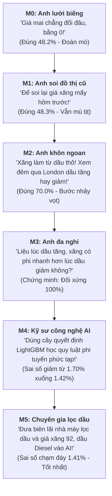

# BẢN GIẢI THÍCH DỄ HIỂU NHẤT: HỆ THỐNG MÔ HÌNH DỰ BÁO GIÁ XĂNG SPAFS V5.2
## Dành cho người đọc muốn nắm bắt toàn bộ bản chất đề tài trong 10 phút

---

### 1. BÀI TOÁN THỰC TẾ LÀ GÌ?

Hãy tưởng tượng bạn là **Giám đốc Xuất Nhập khẩu của một công ty xăng dầu lớn tại Việt Nam** (như Petrolimex hoặc PVOIL):
- Mỗi tháng, doanh nghiệp của bạn phải nhập khẩu hàng trăm nghìn tấn xăng thành phẩm từ thị trường đầu mối lớn nhất Châu Á: **FOB Singapore (Platts Mogas 95)**.
- Giá xăng của phiên hôm đó được chốt chính thức vào lúc **16:30 chiều (giờ Singapore)**.
- **Câu hỏi sống còn mỗi ngày là**:  
  👉 *Ngay từ **08:30 sáng**, làm sao biết được đến **16:30 chiều** giá xăng tại Singapore sẽ tăng hay giảm so với ngày hôm qua để quyết định chốt hợp đồng hay chờ đợi?*

Dự án này sinh ra để chế tạo ra "bộ não AI" trả lời câu hỏi trên bằng số liệu khoa học chính xác.

---

### 2. BẢN CHẤT CỦA 6 "CHUYÊN GIA DỰ ĐOÁN" (TỪ M0 ĐẾN M5)

Để giải bài toán, đề tài xây dựng 6 mô hình toán học và AI giống như thuê **6 chuyên gia với 6 cách tư duy khác nhau**, từ anh ngô nghê nhất đến kỹ sư lọc dầu thông minh nhất:



---

### 3. BẢNG SO SÁNH 6 MÔ HÌNH BẰNG NGÔN NGỮ ĐỜI THƯỜNG

| Mô hình | Cách tư duy của mô hình | Đoán đúng hướng | Sai số (RMSE) | Bài học thực tế rút ra là gì? |
| :--- | :--- | :---: | :---: | :--- |
| **M0a (Anh lười)** | *"Ngày mai giá chẳng đổi gì cả, coi như biến động bằng 0."* | **48.2%** | 2.12% | **Cột mốc đáy**: Đoán mò còn thua tung đồng xu (50%). Mô hình nào không thắng được anh này thì vứt đi. |
| **M1 (Soi giá cũ)** | *"Dùng công thức toán soi lại giá xăng mấy ngày trước để đoán ngày mai."* | **48.3%** | 2.12% | **Bài học 1**: Giá xăng biến động ngẫu nhiên. Nếu chỉ nhìn quá khứ của chính nó thì **hoàn toàn mù tịt**. |
| **M2 (Nhìn dầu thô)** | *"Xăng làm từ dầu thô. Đêm qua bên sàn London giá dầu tăng, chiều nay xăng Singapore phải tăng theo!"* | **70.0%** | **1.70%** | **Cú nhảy vọt**: Tỷ lệ đoán đúng vọt lên 70%! Chìa khóa đoán giá xăng nằm ở **giá dầu thô đêm qua bên kia bán cầu**. |
| **M3 (Kiểm tra đa nghi)**| *"Liệu lúc dầu tăng, xăng có tăng nhanh hơn lúc dầu giảm không?"* | **70.1%** | 1.71% | **Phát hiện học thuật**: **Không có chuyện "tên lửa - lông vũ"**. Ở chợ bán buôn quốc tế, dầu tăng hay giảm thì xăng đều phản ứng nhanh và sòng phẳng như nhau. |
| **M4 (Dùng máy học AI)** | *"Dùng thuật toán AI cây quyết định (LightGBM) để nắm bắt lúc thị trường biến động mạnh hay êm dịu."* | **70.8%** | **1.42%** | **Sức mạnh AI**: AI giúp kéo giảm sai số từ 1.70% xuống 1.42%, tốt hơn hẳn các công thức đường thẳng cổ điển. |
| **M5 (Kinh tế lọc dầu)** | *"Đưa thêm biên lãi lọc dầu (Crack spread) và giá xăng 92, dầu Diesel vào AI."* | **70.4%** | **1.41%** | **Chạm đáy sai số**: Biên lọc dầu đóng vai trò "mỏ neo", kéo các dự đoán quá đà về vùng cân bằng hợp lý. |
| **M6 (Dự kiến: AI đọc báo)**| *"Đưa thêm AI đọc tin tức chiến tranh, cấm vận, tin OPEC vào mô hình M5."* | *(Đang làm)* | *(Đang làm)* | Trả lời câu hỏi: **Đọc báo có giúp AI đoán khôn hơn nữa không?** |

---

### 4. BÓC TRẦN SỰ THẬT: TẠI SAO ĐOÁN ĐÚNG ĐƯỢC 70%? CÓ PHẢI "CHÉM GIÓ"?

Nhiều người trong ngành tài chính khi nghe "đoán đúng 70%" sẽ nghi ngờ ngay, vì cổ phiếu hay vàng đoán đúng 55% đã là siêu cao thủ. Vậy con số 70% ở đây từ đâu mà ra?

👉 **Không có phép thuật nào cả. Bí mật nằm ở: SỰ LỆCH MÚI GIỜ!**

```
[16:30 chiều hôm qua] ───> [03:30 sáng nay] ─────────> [08:30 sáng nay] ───────> [16:30 chiều nay]
 Singapore đóng cửa         London chốt giá dầu         Mô hình chạy dự báo      Singapore chốt giá xăng
  (Hết ngày cũ)              (Đã biết kết quả!)          (Đọc tin dầu đêm qua)     (Cái ta cần đoán)
```

- Singapore đóng cửa sớm (16:30). Nhưng sàn dầu thô London giao dịch suốt đêm tới 03:30 sáng hôm sau mới nghỉ.
- Khi ta thức dậy lúc 08:30 sáng để chạy mô hình, **giá dầu thô London đêm qua đã rõ như ban ngày**.
- Dầu thô là nguyên liệu làm ra xăng (chiếm 85% giá thành). Nếu đêm qua dầu thô tăng vọt +4%, thì chiều nay khi mở chợ Singapore, các thương nhân **chắc chắn phải đẩy giá xăng lên** để không bị lỗ.
- Vì thế, mô hình đạt 70% **không phải vì nó biết trước tương lai**, mà vì nó **tận dụng cú sốc giá dầu thô đêm qua để đón đầu phiên giao dịch chiều nay tại Singapore**.

---

### 5. NẾU ĐOÁN ĐÚNG 70%, TẠI SAO KHÔNG THỂ "LÀM GIÀU NHANH"?

Nếu một mô hình đoán đúng 70%, tại sao lập trình viên không đem đi đánh cược để thành triệu phú? Bởi vì thực tế ngoài đời có **3 rào cản cực lớn**:

1. **Thương nhân ngoài đời không hề ngốc**: 8h30 sáng, các thương nhân tại Singapore cũng nhìn thấy giá dầu đêm qua tăng. Giá chào mua/chào bán của họ lập tức nhảy lên cao ngay đầu ngày. Bạn không thể "mua ở giá cũ của chiều hôm qua" để ăn trọn khoản chênh lệch.
2. **Quy mô tiền bạc quá khủng khiếp**: Mogas 95 FOB Singapore không phải là tiền ảo để mua vài chục đô. Mỗi lần đặt mua một tàu xăng là **50.000 đến 150.000 thùng (khoảng 4 đến 12 triệu USD)**. Chỉ các tập đoàn xăng dầu quốc gia mới có đủ tiền giao dịch.
3. **Chi phí tàu biển và kho bãi**: Sai số dự báo của AI là 1.06%/ngày. Trong khi đó, tiền thuê tàu biển, hao hụt bốc rót, bảo hiểm đã ngốn từ 0.5% - 1.0%. Nếu giao dịch lướt sóng hàng ngày, chi phí sẽ ăn sạch tiền lời.

---

### 6. VẬY Ý NGHĨA THỰC TẾ LỚN NHẤT CỦA ĐỀ TÀI LÀ GÌ?

Đề tài này có 2 giá trị vô cùng đắt giá:

1. **Về mặt quản trị kinh doanh cho doanh nghiệp xăng dầu Việt Nam (Petrolimex, PVOIL, BSR)**:
   - Các công ty này **bắt buộc phải mua bán hàng triệu thùng xăng mỗi tháng**, không mua không được.
   - Mô hình giúp họ **chọn đúng thời điểm chốt giá**: Sáng sớm thấy AI báo chiều nay giá Singapore sẽ tăng mạnh, phòng đàm phán sẽ ký hợp đồng phái sinh hoặc chốt lệnh mua ngay buổi sáng để tiết kiệm hàng tỷ đồng tiền chênh lệch.
2. **Về mặt khoa học và học thuật**:
   - Bác bỏ tin đồn giá xăng "lên như tên lửa, xuống như lông vũ" ở thị trường bán buôn.
   - Chứng minh kiến thức chuyên ngành lọc dầu (Crack spread, Octane) thực sự giúp AI thông minh hơn việc chỉ để AI nhìn giá rồi đoán mò.
